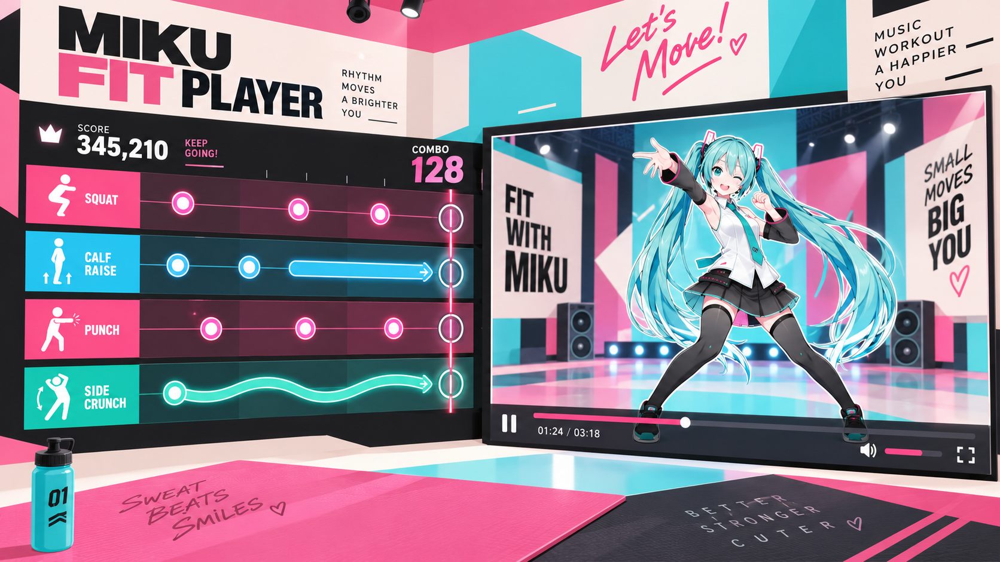

# Waifu Fit Player — Codex 规划交接文档

> **当前任务：只做规划，不开始开发。**
> 项目目录：仓库根目录 `Waifu-Fit-Player/`
> 文档版本：0.2 · 2026-10-15（增加每首歌一种 SPECIAL 标志性动作）  
> 项目显示名暂用 **Waifu Fit Player**；早期构想与参考图使用 **Miku Fit Player**，并非两个项目。

这是一份项目起点，不是已有软件的说明书。它整理了用户已经确定的需求、纠正过的误解，并提出一套最小架构。标为“建议默认值”的内容尚不等于用户最终确认。

**执行优先级：用户最新明确要求 > 本文的已确定需求 > 架构建议 > 参考图中的偶然细节。**

---

## 0. Codex 第一轮该做什么

请先读取本文和 `design/reference/gameplay-pop-reference.png`，然后只读检查项目目录。如果存在 `AGENTS.md`、README、项目配置、锁文件和已有源码，先了解它们；不要假设目录为空，也不要覆盖已有工作。

交接文档的作者没有访问过用户的 Windows 项目目录。目录内容、Node 环境和现有技术栈均需由 Codex 在本地确认。

**第一轮输出：**

1. 简短复述产品边界，明确四轨方向、视频窗口、SWAY HOLD、单曲 SPECIAL 标志性动作、分段网格和快速录谱。
2. 报告目录现状；判断能否沿用已有工程。没有工程时，评估本文的默认技术方案。
3. 提交精简实施计划：模块划分、实施顺序、每阶段可操作的验收标准。
4. 只提出真正影响实现、又无法从本文或目录中解决的问题。非阻塞细节给建议默认值即可。
5. **等待用户明确批准，再开始实施。**

**本轮禁止：**初始化工程、安装依赖、生成业务源码、制作正式 UI 资产、启动整套开发任务、擅自换技术栈或重构已有项目。可以输出规划修订建议，但不要把“做规划”理解为“顺便先写一版”。

---

## 1. 产品定义与不可改变的边界

### 1.1 一句话定义

**一个个人使用的 PC 二次元健身节奏播放器：右侧播放预先做好的舞蹈 MP4，左侧四条横向动作轨道按固定时间线显示提示；同时提供方便新增歌曲的谱面编辑器。**

用户在 MMD 或 Koikatsu／恋活中做好角色、背景、镜头和舞蹈，再导出普通视频。软件不理解视频里的骨骼，也不需要知道用户实际上做了什么动作。

### 1.2 已确定需求

| 项目 | 明确要求 |
|---|---|
| 目标平台 | PC，优先用户自己的 Windows 环境 |
| 素材 | 本地普通 MP4，包含音乐；背景已经做进视频，不要求透明 Alpha |
| 游戏界面 | 左侧四条横向轨道；右侧明确独立的普通视频窗口 |
| 轨道顺序 | 从上到下：Squat、Calf Raise、Punch、Side Crunch |
| 音符移动 | **从左向右**流动，在每条轨道右侧到达命中框 |
| 到框表现 | 自动播放命中特效；普通音符消失，长条进入保持表现 |
| 玩家输入 | 跟练时不需要任何动作输入；键盘录谱只属于编辑模式 |
| 时间关系 | 视频、音符、保持状态与特效在同一条固定时间线上对应 |
| 音符 | 普通 note、HOLD、带 SWAY 标记的特殊 HOLD |
| SPECIAL 标志性动作 | **每首歌最多定义一种**专属 Signature Move；在编舞关键时刻触发，同一种动作可在多个位置重复出现；不新增常驻轨道 |
| 节拍编辑 | 手动填写 BPM；4/4、3/4；中途可更改 BPM 并重新定位 Offset |
| 快速编谱 | 边播放边按键录入；保留 DAW 式点选、拖动、复制与修改 |
| 保存 | 简单 JSON 等本地格式；无需手改 JSON 才能完成日常编谱 |
| 主界面 | 简单主界面和选曲／打开作品入口，不做复杂音乐库 |
| 视觉 | 先采用用户选定的 Pop Art 参考方向；多主题一键切换是可选加分项 |

### 1.3 明确不做

没有 timing 判定、得分、Combo、Perfect/Good/Miss 评价、排行榜、健康统计、动作识别、摄像头、VR、体感设备、实时 3D、PMX/VMD 导入、AI 编舞、自动 BPM 检测、点拍测 BPM、联网账号或云端素材库。SPECIAL 不做可装备的多招系统、不增加游戏界面第五条常驻轨道。

本版也不做渐慢／渐快曲线、复杂速度映射、专业视频剪辑、视频抠像、视频转码、音频分离、音频波形分析或独立 BGM 编辑。上下文中曾出现一次“改 bgm”，暂按同段一直讨论的 **BPM** 理解，不能据此增加第二路音乐播放器；如用户确实需要更换音乐，另行确认。

**这是有音游视觉的播放器，不是缺少了体感模块的传统健身游戏。不要为不存在的功能预留一整套游戏引擎。**

---

## 2. 三个使用界面与核心流程

### 2.1 主界面／选曲

最小入口：**打开视频与谱面、创建新谱面、进入跟练、进入编辑**。可显示当前会话中已打开的作品卡片或简单列表。

“最近打开”可以后补，但不能假装浏览器凭一个文件路径就能自动读取磁盘文件。不要因此开发数据库、全盘扫描或复杂素材索引。

### 2.2 跟练界面

打开已配对的视频与谱面 → 播放 → 看角色并按提示运动 → 暂停／继续／调整位置 → 返回。

暂停就是整条时间线停住；跳转就是所有显示切到目标时间。没有失败状态，不因用户没有运动而改变播放内容。

### 2.3 编辑界面

导入 MP4 → 填 BPM 和拍号 → 定位第一拍 → 按需要添加后续节拍段 → 按键录入或鼠标放置 notes → 修改普通／HOLD／SWAY HOLD → 如本曲需要 SPECIAL，则定义**一种**动作并在关键位置放事件 → 预览 → 保存。

**播放器和编辑器操作同一份谱面，不需要导出一种“播放版”再导回“编辑版”。**

---

## 3. 轨道和音符语义

### 3.1 四轨固定，不擅自改名改用途

| 轨道 ID | 界面名称 | 方向语义 |
|---|---|---|
| `squat` | 蹲起 / SQUAT | `down` 下蹲，`up` 起身 |
| `calf_raise` | 提踵 / CALF RAISE | `up` 提踵，`down` 放下脚跟 |
| `punch` | 出拳 / PUNCH | `left` 左拳，`right` 右拳 |
| `side_crunch` | 侧收腹 / SIDE CRUNCH | `left` 左侧，`right` 右侧 |

建议默认左右以使用者自己的身体为准。音符中箭头的方向表示动作，**不是该音符的移动方向**：左拳箭头 `←` 也随轨道从左向右移动。

### 3.2 三种可辨认的表现

| 形式 | 表达 | 到框后的表现 |
|---|---|---|
| 普通 note | 在这个时刻给出对应动作／阶段提示 | 自动命中闪光，然后消失 |
| HOLD | 从开始到结束持续保持对应姿势 | 头部到框后保持亮起，尾部到框后结束 |
| SWAY HOLD | 保持该姿势的同时自由摇摆 | **原长条**换色、发光，并在条内显示 `SWAY` |

HOLD 的典型例子：长蹲、保持伸拳。SWAY HOLD 的核心示例：**蹲住并自由摇摆**。

**SWAY 是 HOLD 的附加属性，不是新轨道，不是新增的侧向动作，也不是另一条轨道上的提示。**

正确：

```text
蹲起轨：一根带下蹲方向的长条，特殊颜色／发光，条内写 SWAY。
含义：蹲住，并在这根长条的持续时间内自由摇摆。
```

错误：

```text
蹲起轨：下蹲 HOLD
另一轨：额外放一根“摇摆条”来组合
```

不要把摇摆固定塞进出拳轨或侧收腹轨，不要增加第五轨或独立摇摆提示区。参考图中若出现这样的表达，也以本文纠正为准。

### 3.3 保持结束与动作提示

建议默认：HOLD 头部到框时开始该保持，尾部到框时结束保持；尾部要有明确的释放表现。需要特别强调起身时，编谱者可以再放一个 `up` note。

不要在用户不知情时自动生成新音符，也不要建立一个隐藏的人体姿态模拟系统。普通音符是固定时刻的动作提示，不做“是否到位”的检查。

具体身体动作可以由编谱者按音乐和舞蹈安排；软件不用判断运动强度或处方。作品以适合二楼居家、避免跳跃和跺脚为编排方向。

### 3.4 SPECIAL／Signature Move：每首歌一种招牌动作

**已确定：一首歌最多定义一种标志性动作，只在对应编舞的关键时刻出现。**例如这首歌的招牌动作是“比心（HEART POSE）”，那么主歌或副歌的重要拍点可以多次触发**同一个**比心动作；不允许在同一首歌里再定义第二种“招牌动作”。没有招牌动作的歌可以不设置。

- **动作定义属于整首歌：**设置一次名称及简单图标（可选，优先使用内置图标或简短文字）；不做自定义动画制作器或动作素材管理系统。
- **事件属于时间轴：**在指定拍点放置 SPECIAL 事件，可移动／复制／删除；可为瞬间动作，也可设置持续结束时间（例如持续数拍的 Pose）。多个事件共享本曲唯一的动作定义。
- **游戏时的表现：**提前约 2～3 拍出现醒目的 `SPECIAL!` 预告；事件开始到框时自动播放特别闪光，若是持续动作则维持到结束。预告与命中只按视频时间／已编好的谱面发生，不需要玩家按键，也没有成功失败判定。
- **不增加第五轨：**常态仍是四条运动轨道。SPECIAL 出现时可以在**左侧谱面区域**以临时突出提示表现；不要占据右侧普通视频窗口，也不要遮住关键的四轨提示。
- **不混淆 SWAY：**SWAY 始终是原轨道 HOLD 的样式／属性；SPECIAL 是这首歌专属的一种标志性动作事件，并非把摇摆另放到一条轨道。

编辑器中可使用一条很薄的**SPECIAL 事件标记行**，仅用于定位和拖动这些事件；这不是游戏界面的第五条动作轨道。**优先保持配置和编谱操作简单。**

---

## 4. 游戏 UI：采用参考风格，修正不属于需求的元素



### 4.1 要继承的视觉

奶油白、粉红、青蓝与黑色的鲜明对比；大几何色块；有力度的粗体标题；清楚的动作图标；深色横向轨道；右侧有明确边界的视频窗口。

氛围应是活泼的日系音游／Pop Art，而不是普通健康管理仪表盘，也不是堆满霓虹线条的赛博朋克控制台。文字和装饰服务于角色与谱面，不抢占主要空间。

参考图有一些空间舞台感，可以转译为平面几何背景和轻量阴影。**不需要真的创建 3D 房间、地板、灯光、水杯或健身器材。**
尽量完美实现例图效果。你能看出来这是用一张专辑的形状作为最大的承载主要画面的warpper。


参考图有一些空间舞台感，可以转译为平面几何背景和轻量阴影。**不需要真的创建 3D 房间、地板、灯光、水杯或健身器材。**

### 4.2 必须纠正的参考图细节

- 删除 `SCORE`、`COMBO`、皇冠、评分及伪造的运动成绩；不要用假数字填空。
- 纯圆点不足以区分上下左右。可以保留圆形外框，但必须有清晰的动作方向箭头。
- SWAY 应展示为蹲起轨等原轨道上的特殊 HOLD，而非专属的侧收腹波浪轨。
- SPECIAL 是关键时刻在左侧出现的**临时**招牌动作提示；不能画成永久第五轨，也不能盖住右侧视频。
- 右侧是真实 `<video>` 画面区域，不是网页重画的角色立绘；角色不得越出窗口与页面 UI 混成一层。
- 视频和谱面区域必须是正视、清晰可读的可操作界面，不把参考图中的透视倾斜照搬到按钮、轨道或视频上。

### 4.3 布局建议

跟练区左侧四轨，右侧视频。尺寸以参考图的整体观感为主，约 45:55 可作为初稿起点，并非已确认硬比例；不要为精确比例反复阻塞开发。

四轨的命中框排列在轨道最右边、靠近视频的一侧。SPECIAL 的预告和触发演出也保留在左侧区域，不牺牲四轨可读性。主要控件放底部或不遮挡画面的边缘：播放／暂停、共同进度、当前与总时长、速度、音量、全屏、返回。

右侧默认完整显示视频，保持原始比例，不强行拉伸或裁掉头脚。`object-fit: contain` 可用于这种适配；视频本身已裁掉的部分不能靠播放器恢复。[^fit]

全屏对象是**整个跟练界面**，不是只把视频单独全屏。首次可以以 1920×1080 为设计基准，再检查 1280×720 的可读性；本版不做手机端适配。

### 4.4 多套 UI 一键切换：低成本做，不能反客为主

先完成一个默认主题，建议内部 ID 为 `pop-stage`。如果换肤只需要替换颜色、背景图案、字体、边框和命中特效配色，可以再做第二套；否则排到基础版可用之后。

使用一套页面结构与播放逻辑，共享颜色／间距／轨道／音符视觉变量。SVG 音符也读取同一主题配置。主题切换不重新加载视频，不重置进度、不改变谱面、不丢编辑状态。

主题选择放简单菜单；记住用户上次选择即可。**不做皮肤插件系统，也不为每个主题复制一套播放器。**

---

## 5. BPM、拍号与分段 Offset 的最小设计

### 5.1 用户自己查 BPM

没有测 BPM、点拍测速或音频分析按钮。只需要手动输入与编辑。

BPM 在本版统一以四分音符为一拍。4/4 每小节 4 拍；3/4 每小节 3 拍。拍号只改变小节分组，不改变轨道数量。

### 5.2 一个节拍段只需要这些数据

| 字段 | 含义 |
|---|---|
| `id` | 段落标识 |
| `anchorMs` | **该段第一拍在视频中的绝对时间**，毫秒 |
| `bpm` | 本段恒定 BPM，可为小数，必须大于 0 |
| `meter` | `4/4` 或 `3/4` |

界面把 `anchorMs` 显示为“本段 Offset／第一拍位置”，可以手动输入，也可以点击“当前位置设为本段第一拍”。这里的 Offset 是本段在视频中的锚点，**不是把之前各段偏移量逐段相加**。

片段按 `anchorMs` 排序。每段网格从自己的第一拍起算，到下一段锚点为止；最后一段到视频结尾。第一段之前可以没有网格。段落锚点不得重叠。

### 5.3 用户实际操作

```text
A 段：视频 00:02.000 是第一拍，120 BPM，4/4。
B 段：视频 00:34.000 重新对齐第一拍，150 BPM，3/4。
C 段：视频 00:57.300 重新对齐第一拍，120 BPM，4/4。
```

音乐中途停顿后，在恢复处添加新段即可。停顿部分可以不写 notes，也可以有跨过这段时间的 HOLD；**音乐里的停顿不调用播放器暂停，不需要 BPM=0 或渐变系统**。旧网格延伸到新锚点即可，首版不增加专门的“自由时间轨”。

每段可先单独编号小节，不要求跨段维持复杂的全曲小节编号。

### 5.4 网格与吸附

至少提供：每拍、半拍、四分之一拍，以及关闭吸附。粗线表示小节，普通线表示拍，细线表示细分。三拍子不等于三连音；本版不因支持 3/4 就追加所有复杂细分。

核心关系：

```text
每拍毫秒数 = 60000 / BPM
第 k 拍时间 = 本段 anchorMs + k × 每拍毫秒数   （k 从 0 开始）
细分格时间 = 本段 anchorMs + j × 每拍毫秒数 / subdivisions
subdivisions = 1、2 或 4
```

点击、拖动和按键录入共用同一个吸附函数。以所在片段的有效格线作为候选，不吸到下一段范围之外；精确落在段落边界时使用新段。HOLD 起点和终点分别按所在段处理。

### 5.5 一个需要明确的默认：改尺子和移动 notes 是两回事

**架构建议：notes 最终存视频绝对时间；分段 BPM／Offset 用来生成编谱尺子。**

因此，改某段 BPM 或第一拍位置时，默认只调整网格，不擅自挪动已录好的动作。需要让动作一起偏移时，选中该段 notes 整体平移，或者主动执行重新吸附。

这避免“修正一处网格，前面已经和舞蹈对齐的谱也跟着变了”。但用户尚未最终确认此编辑行为；**Codex 在规划中应明确提出这一默认值，请用户确认，而不是悄悄假设。**不需要增加一套同时保存拍位和时间、互相争夺主导权的数据。

---

## 6. 谱面编辑器与实时录谱

### 6.1 布局

建议上方显示视频预览和基本播放控件，下方是足够宽的四轨时间轴；旁边或上方放精简的当前段设置与选中音符属性。四轨顺序、图标和音符外观沿用跟练界面。

编辑器时间从左往右增加，播放线经过固定格子；这是普通 DAW 式编辑坐标。跟练界面则是未来 notes 从左往右进入右侧命中框。**两者展示方式不同，但事件时间相同，不要把游戏滚动界面硬当编辑器。**

### 6.2 最小鼠标编辑

放置普通音符；拖动位置并吸附；切换普通／HOLD；拖动长条头尾；给 HOLD 打开／关闭 SWAY；选择、框选、复制粘贴、删除；时间轴缩放与横向滚动；撤销／重做；保存和未保存提示。

**SPECIAL 编辑：**若本曲启用 SPECIAL，在曲目设置里只定义一次其名称／图标；在编辑时间轴的独立事件标记行点击插入，拖动到关键拍点并吸附，也能复制、删除，或拖长为持续事件。仍使用本来的分段 BPM／Offset 网格与同一套撤销／保存逻辑。SPECIAL 事件数量不限制为一次，但它们都指向本曲唯一的动作；无需为它添加新的录谱快捷键或占用 `1～4` 四轨选择键。

SWAY 开关属于选中 HOLD 的属性，修改原音符，不创建其他轨道的事件。整体拖动 HOLD 默认保持它的媒体时长，单独拖动端点才改长度。

片段循环播放可作为紧接着补上的便利功能，但不要为它建设专业 DAW 的完整循环录音管理。本版不需要波形视图。

### 6.3 快速录谱：播放中按方向键直接写 notes

**建议默认键位，供规划确认：**

| 操作 | 按键／控件 |
|---|---|
| 选择录入轨道 | `1` 蹲起、`2` 提踵、`3` 出拳、`4` 侧收腹 |
| 写入动作方向 | 当前轨道支持的 `↑ ↓ ← →` |
| 录入类型 | 明确的普通／HOLD 模式切换 |
| 特殊保持 | HOLD 模式下的 SWAY 开关 |
| 播放／暂停 | 空格；输入框聚焦时不拦截 |
| 保存／撤销 | Ctrl+S、Ctrl+Z；重做使用常规快捷键 |

轨道选择不能省略：一个 `↑` 本身不足以判断是起身还是提踵。用户可在播放中换轨，也可以第一遍只录出拳，第二遍叠加蹲起。高级自定义键位不是首版前置条件。

必须先启用“录谱”状态，避免正常播放或编辑文字时按键误写 notes。录谱不是玩家输入判定。

### 6.4 录入规则

普通模式：按下有效方向键时读取视频当前位置，按当前设置吸附，然后插入一个 note。保持按住不重复刷 note。

HOLD 模式：按下记录起点，松开记录终点；按下时锁定轨道、方向和 SWAY 属性。即使中途切换选中轨道，松开时也不会把长条写到另一轨。

起止位置都来自视频时间，因此慢放录入仍落在正确的视频位置。不要把系统键盘事件时间戳直接当成视频时间，也不要额外乘一次播放速度。

暂停、跳转或窗口失去焦点时，建议停止本次录入并取消尚未完成的长条，给轻量提示；已录入的完整 notes 保留。禁止产生跨越一次跳转的巨大 HOLD。零长度／反向长条不得写入；吸附造成起止重合时至少调整到下一有效格，无法形成有效区间则取消该条。

浏览器键盘事件会标识持续按住引发的重复事件，可以据此避免普通 note 连刷。快捷键只在正确编辑状态下拦截，不吞掉文本框中的输入。[^keys]

同一轨道可以保存多个事件；本版不做复杂的身体动作冲突推理。明显重叠的相反保持可以给予简单编辑提示，但不是录谱核心的前置功能。

---

## 7. 技术路线与最小架构（建议，待 Codex 检查目录）

### 7.1 默认技术方案

**本地 Web 应用：TypeScript + React + Vite；原生 HTML `<video>`；HTML/CSS 与 SVG 绘制四轨、音符和编辑时间轴。**

这是架构建议，不是用户已经锁死的框架要求。若目录中已有合适的实现，优先沿用，不为形式统一重写。

Vite 提供 React/TypeScript 模板、本地开发与静态构建流程；具体兼容版本在用户批准开发后按当时文档和本机环境选定，并锁定依赖。[^vite]

选择这条路线是为了用少量 Web 界面代码完成播放器、时间轴、键盘输入和主题样式。四轨、有限可见 notes 不需要 Phaser、Unity、Godot 或自建引擎；也不需要 Python/C# 后端。用户有 C#、Python 基础，但项目不必为了复用语言而额外增加后端。

首版选择 SVG 是为了共享箭头图形、样式和编辑交互，不是必须坚持的技术教条。只有实际性能测试暴露问题时才考虑替换绘制方式，不能先上 Canvas、WebGL、Worker 的多层组合。

应用在本机运行，视频与谱面不上传。Vite 的本地开发服务不等于业务后端。独立 exe／桌面外壳以后确有需要再考虑，不把打包外壳列为首版阻塞项。

### 7.2 六个职责足够

| 职责 | 内容 |
|---|---|
| 媒体控制 | 一个视频实例，负责打开、播放、暂停、定位、速度、音量 |
| 谱面模型与时间函数 | 类型、校验、分段网格、吸附、给定时间的音符状态，及单曲 SPECIAL 定义／事件 |
| 跟练视图 | 四轨、普通／HOLD／SWAY HOLD、SPECIAL 临时提示与命中特效、视频布局 |
| 编辑视图 | 时间轴、鼠标编辑、录谱、SPECIAL 事件标记行、选择、撤销与重做 |
| 文件与入口 | 打开／保存 JSON、视频配对、简单主页与选曲入口 |
| 视觉主题 | 一组共享样式变量与音符图形，不包含播放逻辑 |

可采用如下目录；**这是后续实现参考，不是要求本轮生成这些文件**：

```text
Waifu-Fit-Player/
├─ CODEX_HANDOFF.md
├─ design/reference/gameplay-pop-reference.png
└─ src/                         # 用户批准后才创建或调整
   ├─ App.tsx                   # 页面切换、同一个工作区与视频实例
   ├─ model.ts                  # 四轨、Note、TempoSegment、Chart
   ├─ timing.ts                 # 网格、吸附、固定时间状态计算
   ├─ media.ts                  # 少量媒体控制／状态辅助
   ├─ chartFiles.ts             # JSON 读写、轻量校验、视频匹配提示
   ├─ recording.ts              # 键盘实时录谱与未完成 HOLD
   ├─ views/
   │  ├─ Home.tsx
   │  ├─ Player.tsx
   │  └─ Editor.tsx
   └─ ui/
      ├─ NoteGlyph.tsx          # 共用方向箭头、保持条、SWAY 标记
      └─ themes.css
```

状态先使用 React 内置状态／reducer 即可。撤销可以采用小规模谱面快照，不需要命令总线、依赖注入、事件溯源、数据库或大型状态管理框架。

### 7.3 只有一个时间来源

`video.currentTime` 是以秒表示的媒体播放位置；设置它会请求定位。[^media-time]

应用按需读取它，换算成毫秒。视频是唯一主时钟，BPM 只是编谱的尺子，不是第二个播放时钟。

**屏幕状态 = 当前视频时间 + 谱面 + 视觉配置。**暂停、回拖、变速都不需要重演之前的音符。

用于显示的逐帧回调只是实现细节，可以使用 `requestAnimationFrame` 请求绘制；它不负责累计歌曲时间。[^raf] 不要为每个 note 建一个独立定时器，不要从按下播放键开始自行累计 elapsed time，不要让 CSS 动画在视频暂停时继续跑完。

变速只改变视频 `playbackRate`；例如第 20 秒的 note 仍在媒体第 20 秒到框，不再对读取到的视频时间乘播放倍率。[^rate]

只在相关视图内更新当前显示，不必每个显示帧重建整个应用状态。主题切换必须保留视频实例；跟练／编辑切换也应保留当前媒体与定位，不用第二个同时发声的视频来做“预览”。

不承诺跨机器毫秒级音游判定精度，因为本项目没有判定。验收关注整首不出现累积偏移、跳转后对应正确、实际显示流畅。

### 7.4 文件与视频

输入使用本地文件选择，视频不转成 Base64、不嵌进 JSON。对象 URL 只用于当前会话，切换素材后释放，不能当作下次可重新打开的长期路径。[^blob]

MP4 是容器，首轮真实素材优先验证 H.264 视频与 AAC 音频这一常见组合；不支持的文件给明确提示，不偷偷追加转码系统。[^codec]

保存优先采用简单 JSON 导出。需要更顺手的 Ctrl+S 时，可在支持的浏览器内使用 File System Access API；需要用户授权，且不能假设所有浏览器都可直接覆盖磁盘文件。原生保存不可用时明确回退到文件导出。[^files]

首版允许下次重新选择视频配对；文件名和时长仅作匹配提示。不要为“自动记住视频路径”提前增加桌面外壳、持久文件句柄管理或后台文件服务。

---

## 8. 谱面格式草案：简单、可校验、可重开

### 8.1 数据决定

持久化以**视频绝对毫秒时间**为主，编辑器显示拍位。避免同时存储可独立编辑的 `beat` 和 `timeMs` 造成不一致。

普通／保持用 `kind` 区分；SWAY 用保持音符上的 `modifier` 表示。只有 `kind: "hold"` 才有 `endTimeMs` 和 `modifier`。

**SPECIAL 单独存储一份曲目级动作定义和若干时间事件：**`specialMove` 最多一个（可为 `null`），`specialEvents` 可以有多个，每个事件有 `timeMs`、可选 `endTimeMs`。普通四轨 `notes` 不因此增加第五种 `lane`，也不为每次 SPECIAL 重复保存动作名称。

下面是有效的说明用示例，**不是已经写好的实际歌曲谱面或已实现功能**：

```json
{
  "schemaVersion": 1,
  "title": "Demo Workout",
  "videoHint": {
    "fileName": "dance.mp4",
    "durationMs": 180000
  },
  "specialMove": {
    "name": "HEART POSE",
    "icon": "heart",
    "previewBeats": 2
  },
  "tempoSegments": [
    { "id": "seg-a", "anchorMs": 2000, "bpm": 120, "meter": "4/4" },
    { "id": "seg-b", "anchorMs": 34000, "bpm": 150, "meter": "3/4" },
    { "id": "seg-c", "anchorMs": 57300, "bpm": 120, "meter": "4/4" }
  ],
  "notes": [
    {
      "id": "n1", "lane": "punch", "direction": "left",
      "kind": "tap", "timeMs": 10000
    },
    {
      "id": "n2", "lane": "punch", "direction": "right",
      "kind": "tap", "timeMs": 10500
    },
    {
      "id": "n3", "lane": "squat", "direction": "down",
      "kind": "hold", "modifier": "none",
      "timeMs": 12000, "endTimeMs": 16000
    },
    {
      "id": "n4", "lane": "squat", "direction": "down",
      "kind": "hold", "modifier": "sway",
      "timeMs": 18000, "endTimeMs": 22000
    },
    {
      "id": "n5", "lane": "squat", "direction": "up",
      "kind": "tap", "timeMs": 22000
    }
  ],
  "specialEvents": [
    { "id": "sp1", "timeMs": 48000, "endTimeMs": 49600 },
    { "id": "sp2", "timeMs": 112000 }
  ]
}
```

### 8.2 最小校验

版本受支持；ID 唯一（包括 SPECIAL 事件 ID）；时间是有限非负数并按约定保存为整数毫秒；BPM 有限且大于零；拍号合法；轨道与方向匹配；HOLD 结束晚于开始；SWAY 只能附在 HOLD；已知视频时长时不得越界。SPECIAL 仅允许一份曲目级定义；不存在定义却有 SPECIAL 事件时报错；持续事件的 `endTimeMs` 必须晚于 `timeMs`；重复触发同一动作合法。

非法文件给出哪条数据有问题，不静默丢失编辑内容。打开新视频或谱面之前处理未保存修改。未知格式版本不能一边丢字段一边保存覆盖。

主题、音量、网格细分选择属于用户／编辑偏好，不需要塞进每个 note。视频文件名是提示，不是网页读取 Windows 路径的授权。

---

## 9. 显示时间关系：供实现者查阅，不另立引擎项目

### 9.1 普通音符

设 `t` 为当前视频毫秒时间，`hitX` 为右侧命中框位置，`v` 为显示速度（像素／媒体毫秒）：

```text
x(timeMs) = hitX - (timeMs - t) × v
```

未来 note 在命中框左侧；到自己的时间时恰好到框。只绘制可见时间范围内的 notes。显示速度先用固定媒体时间预览窗口计算，BPM 改变不会自动让轨道速度突变。

### 9.2 HOLD 头尾方向不要画反

开始时间是长条头部，结束时间是长条尾部。由于未来越远的事件越靠左，游戏中 **HOLD 头在右、尾在左**：

```text
较晚发生的尾部 ━━━ SWAY ━━━ 较早发生的头部  →  右侧命中框
```

头部到框后，框内保持图标亮起，未经过的条身从左侧继续进入；尾部到框后结束。

```text
等待：t < timeMs
保持中：timeMs <= t < endTimeMs
已结束：t >= endTimeMs
```

直接拖到长条中间，也应立即显示保持中；拖回之前就恢复等待。SWAY 与普通 HOLD 用同一时间逻辑，仅改变原长条及其命中框中的视觉表达。

### 9.3 自动命中特效

用当前时间距 note 开始／结束的差值计算短暂闪光，不靠“这个 note 以前有没有被触发过”的永久标记。暂停时效果停住；跳转时只显示目标位置应有的效果，不补播跨过的几百次命中。

首版只需要视觉命中效果，不额外添加与音乐争抢节奏的按键命中音或节拍器。是否加入音效，以后由用户另行决定。

### 9.4 SPECIAL 事件

一首歌的 SPECIAL 使用自己的事件时间点：`timeMs` 开始，可选 `endTimeMs` 结束。根据事件所在节拍段的 BPM，在开始前约两拍显示 `SPECIAL!` 预告（如配置了 `previewBeats` 则采用配置值）；开始时自动演出，持续型保持到结束，然后恢复正常四轨表现。**不添加专用计时器、不判定玩家是否完成；跳转和暂停行为仍服从同一视频时间。**渐变速度和复杂跨段预告优化不是新增前置任务。

---

## 10. 实施顺序与阶段验收

**下面是批准之后的顺序，不是本轮立即执行的任务清单。所有基础编辑能力都属于首版，而非无限后移的“以后再做”。**

| 阶段 | 交付范围 | 用户可直接验证的结果 |
|---|---|---|
| P0：规划 | 目录检查、需求确认、采用的架构与实施计划 | 能说明如何实现，尚未创建业务代码；等待批准 |
| P1：跟练纵向原型 | 普通 MP4＋四轨＋样例 notes＋普通/HOLD/SWAY HOLD＋基础控制＋默认主题骨架；可用样例事件演示一次 SPECIAL | 一小段真实视频能跟练；箭头向右；下蹲 SWAY 只在下蹲长条上；SPECIAL 不增加常驻第五轨；没有分数/Combo |
| P2：网格与鼠标编辑 | 分段 BPM/Offset、4/4/3/4、吸附、放置/拖动/拉长/切换 SWAY、单曲 SPECIAL 定义／事件编辑、JSON 打开保存 | 能编辑含 BPM/拍号变化及重复 SPECIAL 事件的谱，保存再打开保持一致 |
| P3：快速编谱闭环 | 播放中按键写谱、长按录 HOLD、SWAY 属性、复制、撤销重做、未保存保护 | 不改 JSON 就能做完一首，并能方便地开始第二首 |
| P4：可日常使用 | 简单主界面与选曲入口、默认 UI 完成度、全屏及小窗口检查、整体验收 | 从打开作品到完成跟练形成闭环；有真实 MP4 与编辑流程测试记录 |
| 可选补充 | 第二套主题、一键切换、片段循环等小便利 | 不重载视频、不丢谱、不推迟核心闭环；来不及就明确留待后续 |

不要只提交漂亮静态图或只能读取手写 JSON 的 demo，然后宣称 MVP 完成。也不要先做完整主页、品牌动画和多套皮肤，再开始实现基本编谱。

每阶段结束说明已完成内容、实际验证方法和遗留问题。不要未通过当前验收就扩展新范围。

---

## 11. 关键验收清单

### 11.1 行为与视觉

- [ ] 恰好四轨，顺序正确，所有 notes 向右移动；上下左右动作能辨认。
- [ ] 右侧是可替换的真实视频，背景已包含在视频里；不要求透明或模型文件。
- [ ] 无任何评分、Combo 或动作成功判断。
- [ ] 普通、HOLD、SWAY HOLD 明显区分；蹲姿 SWAY 不占用其他轨道。
- [ ] 一首歌只定义一种 SPECIAL 动作，但同一动作可以在多个关键拍点触发；提前预告、触发特效及持续型结束表现正确；没有常驻第五轨、玩家判定或遮挡右侧视频。
- [ ] HOLD 头尾正确，到中间跳转能恢复保持状态，暂停不会让效果自行跑完。
- [ ] 默认 UI 体现用户选定的粉/青/白/黑 Pop Art 方向，视频与轨道不是倾斜海报。

### 11.2 时间与编辑

- [ ] 120 BPM、锚点 2000 ms：整拍拍点为 2000、2500、3000、3500……；半拍间距 250 ms。
- [ ] 3/4 的粗线每三拍出现，4/4 每四拍；不会把三拍子改成三轨。
- [ ] 34000 ms 的新段从该位置按 150 BPM 排格；到边界使用新段，不影响前段。
- [ ] 57300 ms 可重新定位第一拍，前面音乐停顿不暂停视频。
- [ ] 在 12470 ms 录入，120 BPM／2000 ms 锚点／半拍吸附得到 12500 ms。
- [ ] 0.5 倍速录谱仍按视频位置落点，普通与 HOLD 的时间都不重复缩放。
- [ ] 关吸附时保留录入位置；跨段的 HOLD 两端都能编辑，零长度长条不会保存。
- [ ] 普通按键长按不连刷；输入 BPM 时不误写 notes；失焦／定位不遗留卡住的录入。
- [ ] 移动网格默认不移动已录 notes；这一默认行为已向用户说明并确认。
- [ ] 保存重开保留类型、方向、SWAY、长条端点和各节拍段，以及唯一 SPECIAL 动作配置和全部 SPECIAL 事件；误操作可撤销。

### 11.3 实测而不是推断

时间换算、吸附、长条状态和读写校验适合少量单元测试；界面操作和真实视频播放要在目标浏览器中实际测试。

至少用一段带可辨认拍点的真实 MP4，测试正常播放、暂停恢复、前后定位、慢放和整首结尾。单元测试通过不等于真实媒体播放已经验证。

实际视频尚未提供时，明确说明“媒体联调待用户素材验证”，不要把静态参考图片当作视频测试。相同媒体时间的显示应一致，不承诺未测量的性能数字。

主题若实现：切换前后视频位置、播放状态和未保存编辑内容均应保留。全屏应保留四轨与视频两部分。

---

## 12. 规划阶段需要确认的少数问题

不重复询问已确定的四轨、普通 MP4、无动作识别、无评分或 SWAY 同轨规则。

真正值得确认的是：

1. **已有谱与节拍尺的联动：**建议改 BPM／Offset 默认只改网格，已有 notes 需主动平移或重新吸附；是否采用？
2. **快速录谱键位：**建议 `1～4` 选轨＋方向键录入＋普通/HOLD 模式＋SWAY 开关；是否采用？
3. **首版运行方式：**若目录无现有工程，建议本地浏览器版先行，独立 exe 后补；是否存在必须立即桌面打包的要求？

其余默认：显示名 Waifu Fit Player；左右指使用者自身；基础主题先做一个；HOLD 尾部表示结束保持。这些不应成为一长串问卷。

如果用户确认“按建议默认值继续”，就记录选择并推进，不要求他反复决定框架细节、刷新方式、浏览器媒体管线或未来尚未需要的扩展。

---

## 13. 官方实现参考

这些链接只用于核对底层 API，不是要求扩张项目范围。查询日期：2026-10-15。设计判断、需求与阶段划分来自本项目讨论，非这些文档的产品建议。

[^vite]: Vite — Getting Started，模板、开发和构建。`https://vite.dev/guide/`
[^media-time]: MDN — HTMLMediaElement.currentTime，媒体位置与定位。`https://developer.mozilla.org/en-US/docs/Web/API/HTMLMediaElement/currentTime`
[^raf]: MDN — requestAnimationFrame，显示回调。`https://developer.mozilla.org/en-US/docs/Web/API/Window/requestAnimationFrame`
[^rate]: MDN — HTMLMediaElement.playbackRate，媒体变速。`https://developer.mozilla.org/en-US/docs/Web/API/HTMLMediaElement/playbackRate`
[^fit]: MDN — object-fit，完整容纳视频的显示适配。`https://developer.mozilla.org/en-US/docs/Web/CSS/Reference/Properties/object-fit`
[^blob]: MDN — URL.createObjectURL，当前会话的对象 URL。`https://developer.mozilla.org/en-US/docs/Web/API/URL/createObjectURL_static`
[^codec]: MDN — Web video codec guide，容器与视频/音频编码选择。`https://developer.mozilla.org/en-US/docs/Web/Media/Guides/Formats/Video_codecs`
[^files]: Chrome for Developers — The File System Access API，用户授权后的本地文件访问与保存。`https://developer.chrome.com/docs/capabilities/web-apis/file-system-access`
[^keys]: MDN — KeyboardEvent.repeat，识别持续按住产生的重复按键事件。`https://developer.mozilla.org/en-US/docs/Web/API/KeyboardEvent/repeat`

---

## 14. 用户可直接交给 Codex 的开场指令

```text
项目目录：当前 Waifu-Fit-Player 仓库根目录

先读取 CODEX_HANDOFF.md 和 design/reference/gameplay-pop-reference.png，
再只读检查项目中的 AGENTS.md、README、配置和已有代码。

本轮只做规划，不初始化工程、不安装依赖、不编写业务代码。
以文档中的明确需求为准，参考图只取视觉风格：
不能照搬图里的分数、Combo、纯圆点或跨轨摇摆表现。
SPECIAL 每首歌最多一种招牌动作，可多次触发；在左侧临时提示，不增加第五条常驻游戏轨道。

请先报告目录现状，确认最小技术方案、模块划分、谱面格式和开发顺序，
并列出少数真正需要我确认的事项。不要过度工程化。
第一版必须包括按键快速录谱、鼠标编辑和 SPECIAL 事件编辑，不能只做播放器。
等我批准计划后，再分阶段实施。
```

**最终目标：能够反复导入喜欢的舞蹈视频，方便地写出新谱，并实际站起来跟练。不是构建一个通用音游平台。**
