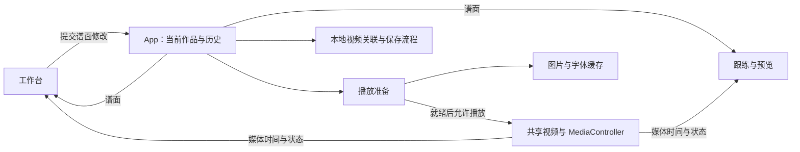

# Waifu Fit Player — HLD

当前架构概览，初稿：2026-10-17。用于定位代码和判断改动边界；只在模块职责、数据契约或关键流程改变时维护，不逐项登记功能与修复。

## 系统范围

React + TypeScript + Vite 本地浏览器应用，无业务后端。主菜单分音游模式与创作模式：前者经专辑、单曲及难度选择进入跟练，后者直接进入谱面工作台。一个作品由谱面 JSON 与关联的本地视频组成；工作台和跟练共用同一个 `<video>`，游玩声音直接来自视频。

## 模块与状态归属

| 位置                                                                                               | 职责与持有的状态                                                                                        |
| -------------------------------------------------------------------------------------------------- | ------------------------------------------------------------------------------------------------------- |
| [App.tsx](../src/App.tsx)                                                                          | 当前作品、撤销历史、保存状态、视频来源、页面切换；协调打开、保存、草稿恢复和视频授权。                  |
| [model.ts](../src/model.ts)、[editing.ts](../src/editing.ts)                                       | 谱面类型、解析／序列化、编辑变换和历史 reducer。业务规则尽量放在这些可独立测试的函数中。                |
| [Editor.tsx](../src/views/Editor.tsx)、[recording.ts](../src/recording.ts)                         | 时间轴交互、属性编辑与录谱；选择、缩放、拖动预览等为编辑器临时状态，不写入谱面。                        |
| [media.ts](../src/media.ts)、[timing.ts](../src/timing.ts)                                         | 控制实际视频，发布时间／播放状态，处理循环；提供媒体时间与谱面时间换算、编谱网格和吸附。                |
| [Player.tsx](../src/views/Player.tsx)、`components/`                                               | 从谱面与当前媒体时间计算画面；音符、长条与特效组件负责呈现。`combo.ts`、`special.ts` 等提供计算规则。   |
| [local-media.ts](../src/local-media.ts)                                                            | 视频预检、关联解析、文件句柄／文件的 IndexedDB 存储和访问权限恢复。对象 URL 的当前生命周期由 App 管理。 |
| [usePlayerPreparation.ts](../src/usePlayerPreparation.ts)、[asset-cache.ts](../src/asset-cache.ts) | 前者提供本曲资源清单并协调视频就绪；后者共享图片解码、字体加载任务和成功结果，失败项可重试。            |
| [library.ts](../src/library.ts)、[useLibrary.ts](../src/useLibrary.ts) | 本地曲库、Normal / Hard 草稿与发布快照、专辑及曲绘；向菜单提供已发布作品。 |
| [Home.tsx](../src/views/Home.tsx)、[LibraryMenu.tsx](../src/views/LibraryMenu.tsx)、[useCardHighlight.ts](../src/useCardHighlight.ts) | 菜单布局与导航、专辑滚动对焦、最近输入目标的唯一流光；曲目选择仍由 App 保留。 |
| [useMenuMusic.ts](../src/useMenuMusic.ts)、[MenuMusic.tsx](../src/components/MenuMusic.tsx)、[useMenuSounds.ts](../src/useMenuSounds.ts) | 主题 BGM、单曲试听及淡入淡出、共享频谱与菜单律动、独立 SE 播放；不接管游戏媒体时钟。 |

播放时间通过媒体订阅直接进入需要它的视图，不写回谱面历史。编辑器卸载后临时工具状态会重置；谱面、历史和实际视频仍由 App 保留。

## 主要数据流

**打开作品**：解析 JSON → 按 `videoHint.assetId` 查找本地视频关联 → 必要时授权或重新定位 → 视频元数据预检与谱面校验 → 一起安装谱面和视频来源 → 等待图片解码、字体及实际视频可播放 → 允许播放。关联或预检失败不替换原作品；安装后的资源准备失败停在可重试界面。预检用的临时 video 不播放，不参与游戏计时。

**编辑与保存**：操作生成新的 Chart → history reducer 提交／撤销／重做 → 工作台及试玩读取当前草稿。拖动仅更新预览，松开提交历史。编辑后防抖 650 ms 自动存草稿，Ctrl+S 立即存；JSON 下载用于备份，包含可选 `songId` / `difficulty`，仍为 schemaVersion 1。localStorage 只存上次草稿指针与偏好；旧版单份草稿首次进入创作模式时迁移，成功后移除旧记录。

**BPM 检测**：`BpmDetectButton.tsx` 按需启动 `bpm.worker.ts`，用打包到本地的 Mediabunny 按块读取、解码当前 MP4 的音轨；不播放音频、不解码视频。只分析当前节拍段内最多 90 秒，以三频段能量起音包络与自相关估计速度，逐块释放音频样本，读取缓存限 8 MiB。成功后通过原 `onChange` 更新当前段 BPM 并进入撤销历史；不修改锚点、音符或共享视频时钟。换视频、换段、改 BPM、关闭面板时终止 Worker，失败不覆盖原值。

**曲库与发布**：`library.ts` 定义 Song、Edition、Album 及原子读改写；`useLibrary.ts` 持有菜单数据。每首 Song 有 Normal / Hard 两个独立草稿槽与两个发布槽，Edition 保存谱面、专辑归属、曲绘和更新时间。发布校验并深复制所选草稿，只替换该难度的发布槽；音游模式加载发布版，禁用草稿自动保存。撤下发布保留草稿；彻底删除清除整首记录及不再被其他谱面引用的视频关联，不操作磁盘原文件。

`Home.tsx` / `LibraryMenu.tsx` 呈现主菜单、纵向专辑与横向单曲选择，`LibraryControls.tsx` 提供编辑器发布字段和管理弹窗。选曲状态由 App 保留。封面压缩为小图，未指定曲绘时取视频帧；专辑未指定封面时从成员曲绘选取，会话内稳定。菜单显示静态封面，不挂载游戏轨道。IndexedDB `waifu-fit-player-library` 存 songs / albums，原视频库保持不变。

专辑列表保留原生滚动吸附，首尾留白随列表高度调整，使第一张和最后一张也可居中。按卡片距可视区中心的距离连续对焦：中心为 100%，相邻约 96%；仅封面轻微降饱和及最多 1.4px 模糊，文字和黑边保持清晰。滚动事件每帧最多处理一次，先读取位置再写样式；只在中心所属卡片变化时更新选中状态。点击的 240ms 展开与原有幕布同时进行，不延迟换页；键盘、鼠标点击和返回位置延续原有逻辑，减少动态效果时关闭缩放与模糊。

**菜单输入与流光**：三页共用 `MenuControls.tsx`，SELECT 使用倒 T 形方向键键帽图标。主菜单／单曲用左右选择，专辑用上下选择，Enter 确认；主菜单右端、专辑顶端、单曲按上可到齿轮，单曲左右键仅选曲，Enter 切换设置。主页卡片按下到耳机并直接展开，Enter 固定，再按收起并取消固定，按上回到原卡片。专辑和单曲的 Back 按钮、Backspace、Esc 走同一返回流程及音效。`CoverTrace.tsx` 提供流光，`useCardHighlight.ts` 在 App 统一管理卡片、齿轮与耳机的唯一 `data-highlighted`；只有最近实际鼠标移动／点击或键盘操作的目标高亮。原生焦点与视觉高亮分开，停住的鼠标不能因滚动或动画抢回高亮；单曲页初次进入即高亮当前曲目，Enter 可直接确认。此状态用 ref 与 DOM 属性管理，不增加逐帧 React 更新。齿轮高亮沿用旋转，并通过现有 `--music-beat` 做轻微呼吸伸缩。悬停流光不改变居中选曲或试听来源。

**菜单音乐**：`useMenuMusic.ts` 分别保留主题 BGM 与单曲试听两个 Audio 元素，同一时间只播放一个。主题曲由 Vite 枚举 `src/assets/menu-bgm/` 并随应用打包，曲目、循环方式与菜单音量保存在 localStorage。当前主题曲用 `Range: bytes=0-` 完整读取压缩文件，以 Blob URL 播放；只保留当前一首，切歌释放旧 URL，未完成的读取可取消。实测原 HTTP 媒体源暂停 25 秒后恢复会再次请求后续字节，但收到 204 空响应并报 `FFmpegDemuxer: data source error`；保留完整文件避免恢复时再走网络续读，也不需要后台静音播放。主菜单到专辑列表不切源；进入单曲页读取当前发布版的视频关联，直接试听 MP4 音轨，过期读取会被丢弃。切换先淡出 500 ms、暂停，再淡入 700 ms；返回时直接继续已暂停的 BGM，不重新加载或跳转 MP3。离开试听释放其临时 URL；主题 BGM 和单曲试听都使用菜单 AudioContext，进入编辑／游玩等无菜单音源的页面或手动暂停 BGM 时才暂停它，恢复播放时唤醒。进入编辑或游玩停止全部菜单音频，倒计时等淡出完成后开始。游戏／视频音量由 MediaController 独立保存，与播放器滑条同步，单曲试听也使用此音量，不接入游戏媒体时钟或音频链路。

`MenuMusic.tsx` 提供耳机菜单与真实频谱：FFT 2048 点，将约 80 Hz～12 kHz 映射成 56 个对数频段，低频靠耳机、高频靠外侧；每段独立平滑起落，限制柱高，不使用整体振幅的传播历史。最多 30 次／秒分析，缓冲区复用；首页绘制频谱，专辑和单曲页只更新色块律动，不绘制 Canvas。主题音乐与单曲试听共用一个 AudioContext／Analyser，仍保持同一时刻只有一个音源播放；离开菜单、页面隐藏或暂停时停止更新，减少动态效果偏好下保持静态。

首页耳机悬停展开非模态三栏菜单，未固定时移出后折叠，点击耳机固定或收起，不创建遮罩；键盘焦点也可进入，Esc 收起。三栏等宽并与主卡片左右对齐，切角边框保留红蓝流光。进度区域仅在展开时订阅现有 BGM Audio 的媒体事件，拖动直接定位该 Audio，不增加轮询时钟，不影响游戏视频或试听时钟。

`MenuSettings.tsx` 在三个菜单页共用非模态角落设置，Audio／System 标签通过悬停、点击或键盘切换。App 继续持有三路音量和音符流速，设置面板与耳机面板复用同一菜单音量；工作台不再提供旧设置齿轮或弹窗。展开状态通过 App 的 DOM 属性驱动现有粉色背景几何的伸缩、白色边线和网点，原音乐变换继续独立运行，不挪动主卡片。点击外部或 Esc 收起，隐藏时面板不可聚焦。

菜单随当前音乐起伏：首页与专辑页跟随主题 BGM，单曲页跟随当前歌曲试听，静音判断使用对应音源的音量。复用同一次频谱读取，以低频和中频能量相对近期平均值连续驱动 CSS 变量，平滑推起、较慢回落，避免只截取瞬时峰值带来的零碎抖动；持续响声不会一直撑满。首页 FIT 最多放大 3.5%／上移 5px，三页的背景斜切色块共用同一套节奏与幅度，沿对角方向最多偏移 44px／32px 并放大 2.4%，不再额外延迟。暂停、静音、页面隐藏、减少动态效果或离开菜单时停止并复位，不逐帧更新 React 状态。

两张主卡片独立悬浮，不读取音乐强度：CSS 以 3.916 秒周期平滑往返，垂直范围 -8～6px，横向 ±2px，倾斜 ±0.25°，两张卡片错开半个周期。仅卡片视觉层浮动，点击区域固定；暂停 BGM 后继续悬浮，减少动态效果时关闭，离开主菜单随组件卸载。

**菜单转场**：App 在点击时只记录目标页，保留旧页面；斜向幕布覆盖整个视口后，由 CSS animationend 事件提交换页，保持全遮挡 80 ms 再揭幕。进入与退出各 260 ms，返回反向。转场期间拦截重复点击和菜单键盘操作，完成后卸载幕布；减少动态效果偏好直接换页。

**音效（SE）音量**：全局设置独立控制，默认 50%，0 为静音；`App` 保存到 `waifu-fit-player-se-volume`，与菜单 BGM、游戏／视频音量互不影响。当前传给 `useMenuSounds.ts`，将来增加游戏 note 音效时沿用此音量值。

**菜单音效**：`useMenuSounds.ts` 统一播放 `src/assets/menu-sfx/` 的五个短 WAV（合计约 60 KB），使用 SE 音量；每次操作至多播放一个，连点中断上一段。耳机菜单、循环方式、BGM 选择与播放暂停、难度等按钮复用点击音；菜单返回、取消、关闭叉号及 Esc 关闭共用 `back.wav`。只在实际操作回调中触发，滚动不会连续发声；音效由脚本离线生成并随 Git 保存。

**本地持久化**：JSON 保存谱面与视频关联 ID，不包含视频二进制。IndexedDB 优先保存视频文件句柄，不支持时保存 File；关联依赖当前浏览器资料及站点 origin，跨机器或清理存储后可能需要重新定位。页面会话中的对象 URL 仅用于播放。

**资源准备**：普通动作素材预先准备，SPECIAL 按本曲配置加载。缓存共享进行中的任务和成功结果，普通编辑及视图切换复用；更换视频或资源清单时重新协调准备。缓存限当前页面会话，不持久化解码结果，不把整段视频解码进内存。进度条表示准备任务完成比例，不是字节下载比例。

## 必须保持的约束

- **唯一媒体时钟**：以 `video.currentTime` 为准。暂停、跳转、变速和循环后的画面从目标时间计算，不靠另一套累计计时器补播动作。绘制通知有频率上限，不改变视频播放速度。
- **时间语义分离**：音符起止使用绝对毫秒。`chartTime = videoTime + videoOffsetMs`；BPM／节拍锚点用于网格与节奏计算，修改它们不隐式移动已写音符。循环最终操作实际视频。
- **作品一致性**：谱面和验证过的视频来源一起替换；更换视频重置编辑历史，避免撤销到与当前视频不匹配的元数据。
- **兼容性有入口**：当前文件为 `schemaVersion: 1`；校验和旧数据兼容处理集中在模型读写边界，不散落到渲染组件。改文件格式时明确迁移策略。
- **视觉与播放解耦**：特效只表达当前时间状态，不控制播放。新增视觉效果要考虑合成与解码负担；结构拆分本身不等于性能改善。

## 卡路里参考值

`calories.ts` 按谱面估算跟练消耗，不使用身高、体重或生理模型。每个音符到达判定点时计入一次动作权重；HOLD／SWAY 再按已经通过判定区的持续秒数计入，不在尾端重复计分。空白段和 SPECIAL 不额外增加。

| 动作               | 起始权重   | 持续权重／秒                  |
| ------------------ | ---------- | ----------------------------- |
| 下蹲／起身         | 3／1.5     | 保持下蹲 2，起身后 0          |
| 出拳／其他手臂方向 | 1.2／0.65  | HOLD 0.25，SWAY 0.65          |
| 侧收腹             | 3          | 1.2                           |
| 提踵／落脚         | 0.4／0.2   | 提踵保持 0.25，落脚后 0       |
| STEP／FOLLOW       | 0.18／0.09 | HOLD 0.55，SWAY（含 FREE）0.2 |

总权重乘固定系数 **0.0414 kcal**。当前 Sunlight 谱面约 507.2051 权重点，对应用户手环测得的全曲约 **21 kcal**：手臂约 9.6、蹲起 5.8、侧收腹 4.1、踏步 1.1、提踵 0.5（分项四舍五入）。后续所有谱面沿用权重和系数，不逐曲归一到 21；后续获得更多实测后再调整。这是动作量参考值，并非个人实测消耗。

音符变化时预先生成累计值与持续速率索引，播放时复用现有媒体时钟，以二分查找计算当前位置的累计值，不逐帧扫描音符、不另设计时循环。暂停冻结，跳转／重播按目标谱面时间重算，视频 offset 与音符使用相同换算。仅最终显示四舍五入到一位小数；每个动作贡献保留精度，**0.1 是显示精度，不是固定增量**。数值变化时仅做短暂的透明度／位移动画。

## 后续扩展与整理

- App 仍协调作品加载、视频授权与页面切换；后续会话流程继续增长时再提取，保留现有媒体实例和校验流程。
- Editor 已集中较多职责，可按时间轴交互、属性面板逐步拆分；每次保持行为，沿用相关测试，不伴随全量重写。
- 新页面可提供自己的 `AssetManifest` 复用加载器。当前内置资源集合有限，尚无缓存容量／淘汰机制；资源规模实际增长后再考虑。
- 桌面打包尚未定案；当前曲库依赖浏览器 origin，不引入服务端或新框架。

## 文档维护边界

- **README**：启动、使用和开发命令；**本文件**：当前架构。各自只记录所属内容，不复制接口字段表或逐功能实现细节。
- 普通修复、视觉调整和内部实现变动不要求更新 HLD；用户操作变了才更新对应 README 段落，架构边界变了才更新这里。
- `decisions.md`、`verification.md` 和旧交接文件仅作为历史资料，不再滚动追加或要求同步维护。测试结果放在当次提交／交付说明；可执行行为以代码和相关测试为准。
