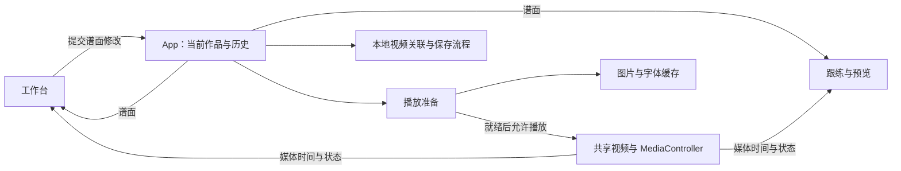

# Waifu Fit Player — HLD

当前架构概览，初稿：2026-10-17。用于定位代码和判断改动边界；只在模块职责、数据契约或关键流程改变时维护，不逐项登记功能与修复。

## 系统范围

React + TypeScript + Vite 本地浏览器应用，无业务后端。主菜单分音游模式与创作模式：前者经专辑、单曲及谱面类型选择进入跟练，后者直接进入谱面工作台。FITNESS 健身谱以节奏锻炼为主，DANCE 舞蹈谱以视频舞步联动为主。一个作品由谱面 JSON 与关联的本地视频组成；工作台和跟练共用同一个 `<video>`，游玩声音直接来自视频。

## 模块与状态归属

| 位置                                                                                                                                                                        | 职责与持有的状态                                                                                                                                                                                         |
| --------------------------------------------------------------------------------------------------------------------------------------------------------------------------- | -------------------------------------------------------------------------------------------------------------------------------------------------------------------------------------------------------- |
| [App.tsx](../src/App.tsx)                                                                                                                                                   | 当前作品、撤销历史、保存状态、视频来源、页面切换；协调打开、保存、草稿恢复和视频授权。                                                                                                                   |
| [model.ts](../src/model.ts)、[editing.ts](../src/editing.ts)                                                                                                                | 谱面类型、解析／序列化、编辑变换和历史 reducer。业务规则尽量放在这些可独立测试的函数中。                                                                                                                 |
| [Editor.tsx](../src/views/Editor.tsx)、[recording.ts](../src/recording.ts)                                                                                                  | 时间轴交互、属性编辑与录谱；选择、缩放、拖动预览等为编辑器临时状态，不写入谱面。                                                                                                                         |
| [media.ts](../src/media.ts)、[timing.ts](../src/timing.ts)                                                                                                                  | 控制实际视频，发布时间／播放状态，处理循环；提供媒体时间与谱面时间换算、编谱网格和吸附。                                                                                                                 |
| [Player.tsx](../src/views/Player.tsx)、`components/`                                                                                                                        | 从谱面与当前媒体时间计算画面；音符、长条与特效组件负责呈现。`combo.ts`、`special.ts` 等提供计算规则。                                                                                                    |
| [local-media.ts](../src/local-media.ts)                                                                                                                                     | 视频预检、关联解析、文件句柄／文件的 IndexedDB 存储和访问权限恢复。对象 URL 的当前生命周期由 App 管理。                                                                                                  |
| [usePlayerPreparation.ts](../src/usePlayerPreparation.ts)、[asset-cache.ts](../src/asset-cache.ts)                                                                          | 前者提供本曲资源清单并协调视频就绪；后者共享图片解码、字体加载任务和成功结果，失败项可重试。                                                                                                             |
| [library.ts](../src/library.ts)、[useLibrary.ts](../src/useLibrary.ts)、[chart-types.ts](../src/chart-types.ts)                                                             | 本地曲库、FITNESS / DANCE 草稿与发布快照、类型及评级元数据、专辑及曲绘；向菜单提供已发布作品。                                                                                                           |
| [Home.tsx](../src/views/Home.tsx)、[LibraryMenu.tsx](../src/views/LibraryMenu.tsx)、[useCardHighlight.ts](../src/useCardHighlight.ts)                                       | 菜单布局与导航、专辑滚动对焦、最近输入目标的唯一流光；曲目选择仍由 App 保留。                                                                                                                            |
| [useMenuMusic.ts](../src/useMenuMusic.ts)、[MenuMusic.tsx](../src/components/MenuMusic.tsx)、[useMenuSounds.ts](../src/useMenuSounds.ts)                                    | 主题 BGM、单曲试听及淡入淡出、共享频谱与菜单律动、独立 SE 播放；不接管游戏媒体时钟。                                                                                                                     |
| [AlbumCover.tsx](../src/components/AlbumCover.tsx)、[AlbumCoverEffects.tsx](../src/components/AlbumCoverEffects.tsx)、[album-cover-detail.ts](../src/album-cover-detail.ts) | 专辑图片内的运镜、分层盘面／飘带和局部灯光。精确匹配原图或上传原文件后启用对应效果；静止与选中共用同一构图，图层解码完成后才显示，未选中／隐藏页面时停动。全部曲目波形复用 MenuMusic 的 FFT 和更新循环。 |

播放时间通过媒体订阅直接进入需要它的视图，不写回谱面历史。编辑器卸载后临时工具状态会重置；谱面、历史和实际视频仍由 App 保留。

## 主要数据流

**可移植曲包**：`scripts/maps-library.ts` 在 Vite dev／preview 安装只读本地目录桥接。`GET /__wfp/maps` 递归扫描 `maps/` 中的 `song.json`，通过 `song-pack.ts` 校验清单与真实谱面，组合 FITNESS／DANCE 已发布快照；旧同目录 `.wfp.json` 按 `videoHint.fileName` 精确匹配视频。`/__wfp/map-file/` 仅服务 maps 内受支持的文件，realpath 检查阻止越界与外部符号链接；MP4 支持 HTTP Range，扫描不读入整段视频，也不将曲包灌入 IndexedDB。资源 ID 以歌曲 ID＋包内路径生成，移动整个项目或重命名完整曲包文件夹保持关联。`map-library.ts` 在页面启动加载一次索引，`local-media.ts` 将 pack 视频接入既有预检、试听和共享媒体时钟。文件或坏谱面只影响对应包。

**曲包与本地编辑**：`useLibrary.ts` 合并目录快照与 IndexedDB，同 ID 的本地记录完整优先；第一次编辑目录歌曲时以目录快照作为原子更新的初值，保留另一类型和已发布版本，之后正常自动存草稿。扫描不写入原文件／本地草稿。目录歌曲的本机删除保存 `Song.hidden` 墓碑，刷新不重新出现；撤下使用既有草稿／发布逻辑。纯目录歌曲随文件刷新更新，本地改过的歌曲保持本地优先。

**导出分享曲包**：`export-song-pack.ts` 从一首歌的已发布快照收集两种谱面、关联视频、曲绘、专辑元数据及自定义封面，以相对路径写入 `song.json`；不导出未发布草稿，不带设备绝对路径或浏览器视频 ID。`zip.ts` 输出标准 UTF-8 STORE ZIP，原 MP4／图片直接作为 Blob 分片，CRC32 分块计算并让出主线程，不转码、不压缩大视频；单包上限 4 GB。入口在本地作品的“导出曲包”。`npm run test:e2e:packs` 使用独立目录与端口验证空白浏览器游玩和导出后在另一目录恢复。

**界面尺寸适配**：`menu-viewport.ts` 以 1920×1080 为较小窗口的逻辑舞台，菜单与 Gameplay 等比缩放 `#root` 并居中留边；宽高均达到设计尺寸时保持原有响应式布局。CSS 的 `--menu-vw`／`--menu-vh` 将画面内尺寸绑定到同一逻辑舞台，未启用时回退原生视口单位；物理窗口的紧凑布局断点在拟合时停用，避免二次缩小。`useMenuViewport` 仅在模式变化及窗口 resize 时同步，捕获阶段先更新，再让转场、插槽读几何。菜单 Portal、确认卡片和插入副本挂在同一根节点；`menuRect` 把屏幕矩形转换回逻辑坐标，潮水和机身轮廓读取 `menuViewport`。进入游戏的黑场仍覆盖真实窗口，原媒体元素与时间轴保持不变。工作室不启用整体缩放，`workbench-viewport.css` 在较矮窗口压缩顶部预览、在较窄窗口允许操作栏换行，并限制弹窗高度；保留时间轴的原生像素／毫秒换算和正常滚动。

**轨道顺序**：`model.ts` 的 `LANES` 统一定义 ARMS → STEP → SIDE CRUNCH → SQUAT → CALF RAISE，游戏、工作台与数字选轨共用；确认页动作名称、图标及占比按动作 ID 对应，不依赖另一份平行数组。谱面仍保存动作 ID，不迁移或改写音符时间。

**启动加载**：首次青色开场的分段条等待字体与本地曲库读取，并保留最短可读展示时间；填满后再退潮显露主页。曲库读取失败沿用原通知并允许进入主页，不等待 BGM 自动播放权限，也不提前加载整套游戏特效。

**双臂展开预设**：方向盘中央以一个连续的紫色 ↔ 表示左手向左、右手向右；保存为起点、类型、终点一致的两颗普通 ARMS reach，分别为 L-left 与 R-right，不新增谱面字段。`armDisplayNotes` 只在显示层合并，计数和卡路里仍读取原始两颗音符。编辑器将配对选中、拖动、拉长、改类型、复制与删除；`changeArmGesture` 转回普通方向时折回一颗 BOTH 音符，保留时长。仅完全匹配的动作配对，不合并不同起止或形态的音符。

**用脚／腿与方向**：STEP 与 SIDE CRUNCH 共用可选 `Note.foot: left | right`，颜色由 foot 决定，箭头由 direction 决定。旧谱面缺少 foot 时按原方向回退，编辑方向或类型前固定原有腿色；绘制、录谱、反向、复制、序列化和发布均保留独立 foot。只在离开这两种轨道时清除该字段，不改变旧谱面的时间、方向或 schemaVersion。

**打开作品**：解析 JSON → 按 `videoHint.assetId` 查找本地视频关联 → 必要时授权或重新定位 → 视频元数据预检与谱面校验 → 一起安装谱面和视频来源 → 等待图片解码、字体及实际视频可播放 → 允许播放。关联或预检失败不替换原作品；安装后的资源准备失败停在可重试界面。预检用的临时 video 不播放，不参与游戏计时。

**首次绘制准备**：曲库进入游戏的黑场会等待资源就绪，再由 `usePlayerRenderPreparation.ts` 驱动真实 Player 绘制 `player-warmup.ts` 中有上限的命中、保持、释放及 SPECIAL 代表状态，恢复开场帧后才显现房间。黑场保持阶段使用 0.995 透明度，避免浏览器将底下的绘制完全剔除；此时暂时隐藏右屏 Cover，让已暂停的视频首帧也实际合成。此处只临时取样轨道画面，不播放／跳转视频，不改变谱面数据、媒体时钟或倒计时时长；取消或卸载清理 RAF。普通菜单转场、暂停恢复和减少动态效果的直接进入路径不经过此黑场。

**编辑与保存**：操作生成新的 Chart → history reducer 提交／撤销／重做 → 工作台及试玩读取当前草稿。拖动仅更新预览，松开提交历史。编辑后防抖 650 ms 自动存草稿，Ctrl+S 立即存；JSON 下载用于备份，包含可选 `songId`、`chartType`（fitness / dance）、`intensity`（low / medium / high）、`danceDifficulty`（非负数），仍为 schemaVersion 1。两种评级互相独立，切换类型保留另一评级的值。localStorage 只存上次草稿指针 `{id, chartType}` 与偏好；旧版单份草稿首次进入创作模式时迁移，成功后移除旧记录。

**BPM 检测**：`BpmDetectButton.tsx` 按需启动 `bpm.worker.ts`，用打包到本地的 Mediabunny 按块读取、解码当前 MP4 的音轨；不播放音频、不解码视频。只分析当前节拍段内最多 90 秒，以三频段能量起音包络与自相关估计速度，逐块释放音频样本，读取缓存限 8 MiB。成功后通过原 `onChange` 更新当前段 BPM 并进入撤销历史；不修改锚点、音符或共享视频时钟。换视频、换段、改 BPM、关闭面板时终止 Worker，失败不覆盖原值。

**游玩区间**：Chart 可选 `playRange: { startMs, endMs }` 使用原视频的绝对毫秒，保持 schemaVersion 1；缺省为完整视频，由 `parseChart` 校验整数、顺序和媒体边界。草稿与发布快照均保留全部事件及区间；`play-range.ts` 将区间加上 `videoOffsetMs` 后筛选 `[start, end)` 内的事件，供音游显示、连击、卡路里及选曲统计使用，不改写事件时间。HOLD／SWAY／SPECIAL 长条必须完整位于区间内，跨边界时发布阻止并可定位；完全在外的事件忽略。工作台“曲目”设置区间并在时间轴映射终点红线，仍可编辑完整媒体；发布弹窗显示实际范围。`MediaController.setPlaybackRange` 仅在音游启用，以同一 video.currentTime 限制跳转、起播和终点暂停，工作台循环独立。音游进度显示区间内的相对时长；单曲试听在原有 Audio 上循环当前已加载音源的区间，换曲淡出期间仍保留旧音源边界。

**曲库与发布**：`library.ts` 定义 Song、Edition、Album 及原子读改写；`useLibrary.ts` 持有菜单数据。每首 Song 有 FITNESS / DANCE 两个独立草稿槽与两个发布槽，Edition 保存谱面、专辑归属、曲绘和更新时间。发布校验并深复制所选草稿，只替换该类型的发布槽；音游模式加载发布版，禁用草稿自动保存。撤下发布保留草稿；彻底删除清除整首记录及不再被其他谱面引用的视频关联，不操作磁盘原文件。

**谱面类型迁移**：`chart-types.ts` 集中兼容旧 `difficulty: normal / hard` 与 `difficultyRating`。JSON 解析转为 `chartType: fitness / dance`、`danceDifficulty`，无类型旧谱默认 dance；导出只写新字段。健身强度不从旧数值猜测，未标注显示 `—`。曲库 IndexedDB v2 升级事务逐条迁移 draft / released，槽名决定类型，保留全部谱面内容、曲绘、视频 ID、区间和时间戳；若新旧槽并存，已有新槽优先。恢复草稿时同时迁移旧 `{id, difficulty}` 指针，避免丢失上次编辑位置。

`Home.tsx` / `LibraryMenu.tsx` 呈现主菜单、纵向专辑与横向单曲选择，`LibraryControls.tsx` 提供编辑器发布字段和管理弹窗。选曲状态由 App 保留。封面压缩为小图，未指定曲绘时取视频帧；专辑未指定封面时从成员曲绘选取，会话内稳定。菜单显示静态封面，不挂载游戏轨道。IndexedDB `waifu-fit-player-library` 存 songs / albums，原视频库保持不变。

**开始确认**：`StartBriefing.tsx` 使用所选发布快照，切换类型同时更新 App 的真实选曲／试听状态。`start-briefing.ts` 集中充能参数及动作构成统计：仅计算游玩区间内 Notes 数量，HOLD／SWAY 各计一个音符，高亮前两类及占比至少 15% 的第三类；图标复用游戏轨道 `LaneGlyph`。作者只读取已有可选 `artist`／`author` 元数据，缺失标为未标注，不扩展 Chart 格式。按住 Enter 或主鼠标键约 1150ms 充能，单一 RAF 只写 CSS 进度变量；松开 180ms 回退，失焦／取消／卸载清理，首次打开的 Enter 连发不能触发充能。视觉填充使用 ease-out，实际充满时间不变；Shift + Enter 跳过长按，复用同一完成反馈与开场流程，防止重复启动；专用充能 SE 随取消立即停止，充满播放 420ms 整条充能区通电反馈及专用完成 SE。光晕位于进度裁切外层，箭头从灰暗逐渐点亮，曲绘叠加静态纸纹，整张卡片缩放为 90%。进入游戏专用 `GameEntrance.tsx`／`game-entrance.css`，只动画黑色遮罩透明度：420ms 渐暗，完全遮住旧页后安装媒体，至少保持黑场 140ms，再用 620ms 显出昏暗房间。房间显现前保持倒计时 waiting，显现完成后才启动既有灯光、轨道通电和 Cover 倒计时；普通菜单导航使用内容淡入淡出与角落色块的轻推呼应。安装失败或需授权时淡回原页面，减少动态效果时直接切换。准备期间显示 Cover 等待，资源错误仍使用原重试界面。充能和暗场不操作媒体时间，视频与谱面仍在 GO 共用原媒体时钟。

专辑列表保留原生滚动吸附，首尾留白随列表高度调整，使第一张和最后一张也可居中。图片区域独立采用 7:2 宽高比，下方标题栏另占高度，整张卡片自动增高；图片使用 contain 完整显示，居中清晰，临近卡片保留景深模糊。默认五张插画来自 `src/assets/albums-illustrations/`。专辑上传保留原文件分辨率和比例，单曲曲绘仍走原有方图处理。`useAlbumArtwork.ts` 仅对与这些原图的旧 512 方形裁切完全匹配的保存封面恢复原图显示，不修改保存数据或替换无关自定义图。按卡片距可视区中心的距离连续对焦：中心为 100%，相邻约 96%。滚动事件每帧最多处理一次，先读取位置再写样式；只在中心所属卡片变化时更新选中状态。点击后列表轻移淡出，再显露新页面；键盘、鼠标点击和返回位置延续原有逻辑，减少动态效果时关闭缩放。

**菜单输入与流光**：三页共用 `MenuControls.tsx`，SELECT 使用倒 T 形方向键键帽图标。主菜单／单曲用左右选择，专辑用上下选择，Enter 确认；主菜单右端、专辑顶端、单曲按上可到齿轮，单曲左右键仅选曲，Enter 切换设置。主页卡片按下直接进入耳机菜单第一首曲目；菜单顶部（播放键、第一首曲目、播放模式）按上直接回到原卡片，跳过耳机按钮。菜单展开时，耳机按钮按上从下方进入列表最后一首曲目；菜单底部按下仍可选中耳机，Enter 固定，再按收起并取消固定。固定菜单在焦点返回主卡片时保持展开。专辑和单曲的 Back 按钮、Backspace、Esc 走同一返回流程及音效。`CoverTrace.tsx` 提供流光，`useCardHighlight.ts` 在 App 统一管理卡片、齿轮与耳机的唯一 `data-highlighted`；只有最近实际鼠标移动／点击或键盘操作的目标高亮。原生焦点与视觉高亮分开，停住的鼠标不能因滚动或动画抢回高亮；单曲页初次进入即高亮当前曲目，Enter 可直接确认。此状态用 ref 与 DOM 属性管理，不增加逐帧 React 更新。齿轮高亮沿用旋转，并通过现有 `--music-beat` 做轻微呼吸伸缩。悬停流光不改变居中选曲或试听来源。

**菜单音乐**：`useMenuMusic.ts` 分别保留主题 BGM 与单曲试听两个 Audio 元素，同一时间只播放一个。主题曲由 Vite 枚举 `src/assets/menu-bgm/` 并随应用打包，曲目、循环方式与菜单音量保存在 localStorage。当前主题曲用 `Range: bytes=0-` 完整读取压缩文件，以 Blob URL 播放；只保留当前一首，切歌释放旧 URL，未完成的读取可取消。实测原 HTTP 媒体源暂停 25 秒后恢复会再次请求后续字节，但收到 204 空响应并报 `FFmpegDemuxer: data source error`；保留完整文件避免恢复时再走网络续读，也不需要后台静音播放。主菜单到专辑列表不切源；进入单曲页读取当前发布版的视频关联，直接试听 MP4 音轨，过期读取会被丢弃。切换先淡出 500 ms、暂停，再淡入 700 ms；返回时直接继续已暂停的 BGM，不重新加载或跳转 MP3。离开试听释放其临时 URL；主题 BGM 和单曲试听都使用菜单 AudioContext，进入编辑／游玩等无菜单音源的页面或手动暂停 BGM 时才暂停它，恢复播放时唤醒。进入编辑或游玩停止全部菜单音频，倒计时等淡出完成后开始。游戏／视频音量由 MediaController 独立保存，与播放器滑条同步，单曲试听也使用此音量，不接入游戏媒体时钟或音频链路。

`MenuMusic.tsx` 提供耳机菜单与真实频谱：FFT 2048 点，将约 80 Hz～12 kHz 映射成 56 个对数频段，低频靠耳机、高频靠外侧；每段独立平滑起落，限制柱高，不使用整体振幅的传播历史。最多 30 次／秒分析，缓冲区复用；首页绘制频谱，专辑和单曲页只更新色块律动，不绘制 Canvas。主题音乐与单曲试听共用一个 AudioContext／Analyser，仍保持同一时刻只有一个音源播放；离开菜单、页面隐藏或暂停时停止更新，减少动态效果偏好下保持静态。

首页耳机悬停展开非模态三栏菜单，未固定时移出后折叠，点击耳机固定或收起，不创建遮罩；键盘焦点也可进入，Esc 收起。三栏等宽并与主卡片左右对齐，切角边框保留红蓝流光。进度区域仅在展开时订阅现有 BGM Audio 的媒体事件，拖动直接定位该 Audio，不增加轮询时钟，不影响游戏视频或试听时钟。

`MenuSettings.tsx` 在三个菜单页共用非模态角落设置，Audio／System 标签通过悬停、点击或键盘切换。App 继续持有三路音量和音符流速，设置面板与耳机面板复用同一菜单音量；工作台不再提供旧设置齿轮或弹窗。展开状态通过 App 的 DOM 属性驱动现有粉色背景几何的伸缩、白色边线和网点，原音乐变换继续独立运行，不挪动主卡片。点击外部或 Esc 收起，隐藏时面板不可聚焦。

菜单随当前音乐起伏：首页与专辑页跟随主题 BGM，单曲页跟随当前歌曲试听，静音判断使用对应音源的音量。复用同一次频谱读取，以低频和中频能量相对近期平均值连续驱动 CSS 变量，平滑推起、较慢回落，避免只截取瞬时峰值带来的零碎抖动；持续响声不会一直撑满。首页 FIT 最多放大 3.5%／上移 5px，三页的背景斜切色块共用同一套节奏与幅度，沿对角方向最多偏移 44px／32px 并放大 2.4%，不再额外延迟。暂停、静音、页面隐藏、减少动态效果或离开菜单时停止并复位，不逐帧更新 React 状态。

两张主卡片独立悬浮，不读取音乐强度：CSS 以 3.916 秒周期平滑往返，垂直范围 -8～6px，横向 ±2px，倾斜 ±0.25°，两张卡片错开半个周期。仅卡片视觉层浮动，点击区域固定；暂停 BGM 后继续悬浮，减少动态效果时关闭，离开主菜单随组件卸载。

**普通菜单转场**：专辑↔单曲沿用 `MenuTransition.tsx`，其余直接换页及进入 Gameplay 的专用黑场不变。采用参考 Material Motion 的 Fade Through／Shared Axis 的轻量适配：旧 `.menu-scene` 在 140ms 内淡出并沿导航方向移动 12px，透明后换页；新场景从相反侧 12px、opacity 0 开始，停 16ms 后用 220ms 淡入归位，总时长约 376ms。右上齿轮持续可见且位置固定；原粉青角落色块始终保持原形、原色与正常 BGM 律动，只用独立 translate 属性轻推 18px／12px 后归位，不复制、隐藏、冻结或覆盖画面。Web Animations API 动画结束态与原 CSS 完全一致，卸载不修改背景样式。输入锁沿用透明的 `.menu-curtain` 节点与 inert，等待当前阶段的全部动画完成后才推进状态；快速重复操作不会叠加转场。时长、距离和 easing 集中在 `menu-transition.ts`；减少动态效果偏好直接换页。参考：https://m2.material.io/develop/android/theming/motion 。

**主菜单↔专辑液体转场（试作）**：仅这两个导航方向由 `navigateMenu` 标记 `liquid`，走独立 `LiquidMenuTransition.tsx`。进入专辑时粉色从右上横向铺开再向下覆盖，返回时青色从左下向右、向上覆盖；另一角落向外让开，完全覆盖后才换页。回收保持全宽水平波浪，约 828ms 内完全退出屏幕，再让原几何从上下方用约 635ms 的 cubic ease-out 归位；持续读取实时 BGM 位置，齿轮附着粉色几何返回，结束／卸载恢复原 visibility 和前景控件样式。SVG 贝塞尔液面带局部短高光、四个淡白气泡，以及复用 `LaneGlyph` 的五种动作印花和稀疏 Pop Art 符号，不使用滤镜；主内容保持原位。接近全覆盖时出现双向不同的短提示与五格节拍条，到位时文字轻回弹，无假加载百分比。有限 WAAPI 时间线驱动短暂 RAF，不逐帧更新 React。`liquid-transition.ts` 集中管理覆盖 880ms、全遮挡停留 200ms、退场 1380ms、波高、印花／高光透明度和到位脉冲。`liquid-transition.css` 管理提示排版；离线生成的 `liquid.wav` 以轻柔气泡为主，经 `useMenuSounds` 独立短通道与点击声叠加，共用 SE 音量，组件卸载停止。首次启动复用该组件的后半段：蓝色满屏、品牌标题停留 620ms，再退潮露出主页，不重复涨潮、不自动播放音效。液体组件直接挂在菜单根节点，避免首次挂载 portal 容器变化重启演出。减少动态效果时直接显示主页／换页，其他导航与 Gameplay 黑场不走该组件。

**卡片与确认页动效**：`useMenuCardPress.ts` 为主页模式卡、专辑卡和单曲卡提供鼠标／Enter 共用的 150ms 按压反馈；独立 additive translate 最多下压 3px 并压缩硬阴影，保留原悬浮、hover 和居中缩放。开始确认页由 `useBriefingMotion.ts` 整体淡入 320ms、淡出 240ms，入场只动画卡片自身 opacity，退出则让整个弹层（含黑色遮罩与背景模糊）一起淡出，封面、纸纹与装饰保持同一层，不复制或移动封面。开场先以极低透明度准备四个绘制帧，再启动淡入计时，避免首帧栅格化耗尽动画；背景模糊在入场时保持稳定。退出透明终态保持到 React 移除弹窗，卸载时先把透明度写到原元素再清理动画，避免恢复默认不透明状态造成闪屏；途中取消从当前透明度接续。减少动态效果时直接展示／关闭，卸载清理动画，不改充能时长、专用黑场和媒体时钟。

**音效（SE）音量**：全局设置独立控制，默认 50%，0 为静音；`App` 保存到 `waifu-fit-player-se-volume`，与菜单 BGM、游戏／视频音量互不影响。当前传给 `useMenuSounds.ts`，将来增加游戏 note 音效时沿用此音量值。

**菜单音效**：`useMenuSounds.ts` 统一播放 `src/assets/menu-sfx/` 的五个短 WAV（合计约 60 KB），使用 SE 音量；每次操作至多播放一个，连点中断上一段。耳机菜单、循环方式、BGM 选择与播放暂停、谱面类型等按钮复用点击音；菜单返回、取消、关闭叉号及 Esc 关闭共用 `back.wav`。只在实际操作回调中触发，滚动不会连续发声；音效由脚本离线生成并随 Git 保存。

**本地持久化**：JSON 保存谱面与视频关联 ID，不包含视频二进制。IndexedDB 优先保存视频文件句柄，不支持时保存 File；关联依赖当前浏览器资料及站点 origin，跨机器或清理存储后可能需要重新定位。页面会话中的对象 URL 仅用于播放。

**资源准备**：普通动作素材预先准备，SPECIAL 按本曲配置加载。缓存共享进行中的任务和成功结果，普通编辑及视图切换复用；更换视频或资源清单时重新协调准备。缓存限当前页面会话，不持久化解码结果，不把整段视频解码进内存。进度条表示准备任务完成比例，不是字节下载比例。

**普通命中特效**：游戏中的普通命中／释放使用 `public/art/impact/` 的五种轨道配色图集，每种含 32 帧命中和 32 帧释放，由 `scripts/bake-note-impacts.mjs` 用原 DOM/CSS 离线绘制。`NoteImpact` 只从现有媒体时间选择帧，不在游玩时实时计算多重 blur／阴影。工作台不加载这些图集，游玩仅解码当前游玩区间实际使用的配色（含配对手臂），同 URL 跨曲复用；五张图集各为 2048×1536，一份全量 RGBA 解码约 60MiB，显存／浏览器额外副本另计，素材尺寸与透明通道由测试约束。减少动态效果时显示简单静态圆环，工作台预览保留原 DOM 光效；SIDE CRUNCH／SPECIAL 继续使用各自图集。普通 TAP 在游戏内用 transform 移动并复用图形层，网格与音视频计时不变。修改原光效 CSS 后运行 `node scripts/bake-note-impacts.mjs` 重新生成图集；准备阶段的 RAF 取样是尽力预热，不是 GPU 完工屏障。

**专辑播放器**：`LibraryMenu` 区分点击展开与长按插入，展开后 Space 控制试听暂停。原 `.ambient-shape.pink` 以独立 translate／clip-path 下滑展开，保留音乐 transform；`album-deck-motion.ts` 将目标轮廓逆映射到原几何的局部坐标，不旋转几何本体。扩大纯色绘制范围后由轮廓裁切，避免原矩形边缘露出。`AlbumDeck` 的图片区域只显示曲绘，试听控件复用 `useMenuMusic` 的 preview Audio、淡入淡出与音量。插槽按当前卡片测量对齐；`useAlbumInsertion` 复制当前可见卡片做裁切飞入，原卡隐藏，按住 Enter 或鼠标推进 960ms，中途松开以 220ms 退回；失焦或取消也退回，完成前不切换页面。Shift + Enter 用 420ms 自动滑入，松键不取消，仍可用 Esc／失焦取消。完成后播放一次 `insert.wav` 卡扣声，由 App 持有的 `AlbumTuning` 全屏遮挡并换页，覆盖期间复位机身后揭幕。卸载清理飞入副本与动画；不增加播放器、频谱或逐帧 React 更新。

## 必须保持的约束

- **唯一媒体时钟**：以 `video.currentTime` 为准。暂停、跳转、变速和循环后的画面从目标时间计算，不靠另一套累计计时器补播动作。绘制通知有频率上限，不改变视频播放速度。
- **时间语义分离**：音符起止使用绝对毫秒。`chartTime = videoTime + videoOffsetMs`；BPM／节拍锚点用于网格与节奏计算，修改它们不隐式移动已写音符。循环最终操作实际视频。
- **作品一致性**：谱面和验证过的视频来源一起替换；更换视频重置编辑历史，避免撤销到与当前视频不匹配的元数据。
- **兼容性有入口**：当前文件为 `schemaVersion: 1`；校验和旧数据兼容处理集中在模型读写边界，不散落到渲染组件。改文件格式时明确迁移策略。
- **视觉与播放解耦**：特效只表达当前时间状态，不控制播放。新增视觉效果要考虑合成与解码负担；结构拆分本身不等于性能改善。

## 卡路里参考值

`calories.ts` 按谱面估算跟练消耗，不使用身高、体重或生理模型。每个音符到达判定点时计入一次动作权重；HOLD／SWAY 再按已经通过判定区的持续秒数计入，不在尾端重复计分。空白段和 SPECIAL 不额外增加。

| 动作               | 起始权重   | 持续权重／秒                    |
| ------------------ | ---------- | ------------------------------- |
| 下蹲／起身         | 3／1.5     | 下蹲 HOLD 3.5、SWAY 3，起身后 0 |
| 出拳／其他手臂方向 | 1.2／0.65  | HOLD 0.25，SWAY 0.65            |
| 侧收腹             | 3          | 1.2                             |
| 提踵／落脚         | 0.4／0.2   | 提踵保持 0.25，落脚后 0         |
| STEP／FOLLOW       | 0.18／0.09 | HOLD 0.55，SWAY（含 FREE）0.2   |

总权重乘固定系数 **0.0414 kcal**。此系数最初按 Sunlight 旧权重约 507.2051 点、用户手环全曲约 **21 kcal** 校准。持续下蹲由原每秒 2 点提高到 HOLD 3.5、SWAY 3 后，包含这些动作的谱面总值会相应提高；静止保持高于下蹲摇摆。保持统一换算系数，不逐曲归一到 21；后续获得更多实测后再调整。这是动作量参考值，并非个人实测消耗。

音符变化时预先生成累计值与持续速率索引，播放时复用现有媒体时钟，以二分查找计算当前位置的累计值，不逐帧扫描音符、不另设计时循环。暂停冻结，跳转／重播按目标谱面时间重算，视频 offset 与音符使用相同换算。仅最终显示四舍五入到一位小数；每个动作贡献保留精度，**0.1 是显示精度，不是固定增量**。数值变化时仅做短暂的透明度／位移动画。

## 后续扩展与整理

- App 仍协调作品加载、视频授权与页面切换；后续会话流程继续增长时再提取，保留现有媒体实例和校验流程。
- Editor 已集中较多职责，可按时间轴交互、属性面板逐步拆分；每次保持行为，沿用相关测试，不伴随全量重写。
- 新页面可提供自己的 `AssetManifest` 复用加载器。当前内置资源集合有限，尚无缓存容量／淘汰机制；资源规模实际增长后再考虑。
- 桌面打包尚未定案；当前曲库依赖浏览器 origin，不引入服务端或新框架。

## 文档维护边界

- **README**：启动、使用和开发命令；**本文件**：当前架构。各自只记录所属内容，不复制接口字段表或逐功能实现细节。
- 普通修复、视觉调整和内部实现变动不要求更新 HLD；用户操作变了才更新对应 README 段落，架构边界变了才更新这里。
- `decisions.md`、`verification.md` 和旧交接文件仅作为历史资料，不再滚动追加或要求同步维护。测试结果放在当次提交／交付说明；可执行行为以代码和相关测试为准。
