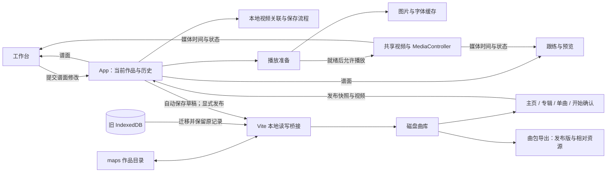

# Waifu Fit Player — HLD

当前架构概览，初稿：2026-10-17；最近维护：2026-10-23（灯光、结束时序、游玩帧率、音量开关、卡片材质与 BPM 检测）；旧会话核对：2026-10-21。用于定位代码和判断改动边界；只在模块职责、数据契约或关键流程改变时维护，不逐项登记功能与修复。

当前实现已核对至 `sol61 @ 00d86e7`。恢复阶段曾以 `0e5c061` 加 10 个未提交文件为基线，该工作区状态属于历史快照；后续实现已分功能归档提交。本文区分当前实现和待实现需求，不以旧助手“已完成”答复代替源码证据。恢复过程、决策原文索引、历史验证与不确定性见 [恢复报告](recovery/RECOVERY-REPORT-2026-10-21.md)、[当前实现核对](recovery/CURRENT-STATE-2026-10-21.md)、[决策恢复](recovery/DECISIONS-RECOVERED.md)。这些恢复材料记录调查时的快照；之后的 D35 专辑 Enter 单击交互已实现，当前行为以后文与最新代码为准。

## 系统范围

React + TypeScript + Vite 本地浏览器应用，无业务后端。主菜单分音游模式与创作模式：前者经专辑、单曲及谱面类型选择进入跟练，后者直接进入谱面工作台。FITNESS 健身谱以节奏锻炼为主，DANCE 舞蹈谱以视频舞步联动为主。一个作品由谱面 JSON 与关联的本地视频组成；工作台和跟练共用同一个 `<video>`，游玩声音直接来自视频。

“无业务后端”不等于纯静态运行：Vite dev／preview 中的 Node 插件提供 maps 本地扫描、受限写盘和 Range 媒体服务，不提供账号或云接口。作品以 maps 为准；纯静态部署不能保存作品，也不会退回浏览器存储。运行时无动作识别或输入评分；FULL COMBO 按谱面时间展示。当前没有每日打卡、游玩历史或跨曲累计热量系统。

## 模块与状态归属

| 位置                                                                                                                                                                        | 职责与持有的状态                                                                                                                                                                                         |
| --------------------------------------------------------------------------------------------------------------------------------------------------------------------------- | -------------------------------------------------------------------------------------------------------------------------------------------------------------------------------------------------------- |
| [App.tsx](../src/App.tsx)                                                                                                                                                   | 当前作品、撤销历史、保存状态、视频来源、页面切换；协调打开、保存、草稿恢复和视频授权。                                                                                                                   |
| [model.ts](../src/model.ts)、[editing.ts](../src/editing.ts)                                                                                                                | 谱面类型、解析／序列化、编辑变换和历史 reducer。业务规则尽量放在这些可独立测试的函数中。                                                                                                                 |
| [Editor.tsx](../src/views/Editor.tsx)、[recording.ts](../src/recording.ts)                                                                                                  | 时间轴交互、属性编辑与录谱；选择、缩放、拖动预览等为编辑器临时状态，不写入谱面。                                                                                                                         |
| [media.ts](../src/media.ts)、[timing.ts](../src/timing.ts)                                                                                                                  | 控制实际视频，发布时间／播放状态，处理循环；提供媒体时间与谱面时间换算、编谱网格和吸附。                                                                                                                 |
| [Player.tsx](../src/views/Player.tsx)、`components/`                                                                                                                        | 从谱面与当前媒体时间计算画面；音符、长条与特效组件负责呈现。`combo.ts`、`special.ts` 等提供计算规则。                                                                                                    |
| [local-media.ts](../src/local-media.ts)                                                                                                                                     | 视频预检、maps 关联解析和旧浏览器媒体迁移读取。对象 URL 的当前生命周期由 App 管理。                                                                                                                      |
| [usePlayerPreparation.ts](../src/usePlayerPreparation.ts)、[asset-cache.ts](../src/asset-cache.ts)                                                                          | 前者提供本曲资源清单并协调视频就绪；后者共享图片解码、字体加载任务和成功结果，失败项可重试。                                                                                                             |
| [library.ts](../src/library.ts)、[useLibrary.ts](../src/useLibrary.ts)、[chart-types.ts](../src/chart-types.ts)                                                             | 本地曲库、FITNESS / DANCE 草稿与发布快照、类型及评级元数据、专辑及曲绘；向菜单提供已发布作品。                                                                                                           |
| [Home.tsx](../src/views/Home.tsx)、[LibraryMenu.tsx](../src/views/LibraryMenu.tsx)、[useCardHighlight.ts](../src/useCardHighlight.ts)                                       | 菜单布局与导航、专辑滚动对焦、最近输入目标的唯一流光；曲目选择仍由 App 保留。                                                                                                                            |
| [useMenuMusic.ts](../src/useMenuMusic.ts)、[MenuMusic.tsx](../src/components/MenuMusic.tsx)、[useMenuSounds.ts](../src/useMenuSounds.ts)                                    | 主题 BGM、单曲试听及淡入淡出、共享频谱与菜单律动、独立 SE 播放；不接管游戏媒体时钟。                                                                                                                     |
| [AlbumCover.tsx](../src/components/AlbumCover.tsx)、[AlbumCoverEffects.tsx](../src/components/AlbumCoverEffects.tsx)、[album-cover-detail.ts](../src/album-cover-detail.ts) | 专辑图片内的运镜、分层盘面／飘带和局部灯光。精确匹配原图或上传原文件后启用对应效果；静止与选中共用同一构图，图层解码完成后才显示，未选中／隐藏页面时停动。全部曲目波形复用 MenuMusic 的 FFT 和更新循环。 |

播放时间通过媒体订阅直接进入需要它的视图，不写回谱面历史。编辑器卸载后临时工具状态会重置；谱面、历史和实际视频仍由 App 保留。

补充边界：`scripts/maps-library.ts` 负责扫描／HTTP 桥接，`scripts/maps-workspace.ts` 负责磁盘保存／恢复，`src/maps-workspace.ts` 负责浏览器调用及迁移；`song-pack.ts` 校验曲包契约，`map-library.ts` 提供浏览器索引／视频映射，`export-song-pack.ts / zip.ts` 负责发布版导出。`useAlbumInsertion.ts / album-deck-motion.ts` 负责插槽动画，`useBriefingMotion.ts / StartBriefing.tsx` 负责确认与充能；`GameEntrance`、`LiquidMenuTransition`、`MenuTransition` 和 `AlbumTuning` 分属不同导航流程，不能用一个全局转场替代。`usePlayerRenderPreparation.ts` 负责尽力绘制预热，和图片／字体解码准备是两个阶段。

## 数据契约与持久化边界

| 数据                   | 当前契约与保存位置                                                                                                                                                                                                                                       |
| ---------------------- | -------------------------------------------------------------------------------------------------------------------------------------------------------------------------------------------------------------------------------------------------------- |
| Chart                  | `schemaVersion: 1`；绝对毫秒 notes / specialEvents、tempoSegments；可选 songId、chartType、intensity、danceDifficulty、videoOffsetMs、playRange；videoHint 含文件名、时长和可选关联 ID。兼容集中在 model / chart-types 入口。                            |
| Note                   | tap 或含 endTimeMs / modifier 的 hold；SWAY 是 hold 的 modifier；FOLLOW 使用 STEP tap + follow，FOLLOW SWAY 使用 STEP hold + modifier=sway + follow；SPIN 原地转圈沿用 direction=free 的有时长 SWAY 数据。ARMS 支持 action/hand；STEP／侧收腹可有 foot。 |
| Song / Edition / Album | Song 按类型分别保存 drafts / released；Edition=chart、albumId、cover、updatedAt；Album=id、name、cover。各类型草稿／发布快照在 maps 同目录，隐藏状态写入 project.json；专辑在 maps/library.json。                                                        |
| 视频                   | project.json 保存稳定 ID、相对路径与文件元数据；共享 video 经受限 Range URL 播放。原磁盘视频不随浏览器删除操作删除。                                                                                                                                     |
| 普通 JSON 与曲包       | 普通谱面 JSON 不携带完整曲绘／专辑／视频；曲包 song.json v1 和相对路径补齐这些资源，只分享发布版，不包含草稿。两种 version 的含义独立。                                                                                                                  |
| 偏好与临时状态         | localStorage 保存上次草稿指针、音量、流速、游玩帧率与工作台 light/dark；选区、工具、剪贴板、A/B 编辑循环等是临时状态，不是持久化作品或运动历史。                                                                                                         |

工作台“谱面类型”下拉通过 App 的 `updatePublication` **复制当前 Chart 到目标类型**，目标已有草稿时提示替换；不会直接载入目标原草稿。继续另一类型现有草稿需从本地作品进入。顶部双标签与空白创建方案曾讨论并尝试，随后被用户撤回；不要把它作为当前已实现能力或已批准待办。工作台局部日夜样式已经存在，与第二套全游戏主题是两件事。

## 主要数据流

**磁盘作品与曲包**：GET /__wfp/maps 优先扫描各曲目的 project.json 和独立草稿／发布 Chart JSON；兼容旧 song.json 和松散 .wfp.json 曲包。POST /__wfp/workspace/* 提供视频采用／流式导入、作品保存及专辑保存，仅允许同源请求并限制在 maps。map-file 经 realpath 检查并支持 HTTP Range，不读取整段视频进入内存。完整协议与迁移边界见 [maps 存储说明](MAPS-STORAGE.md)。

**编辑与迁移**：useLibrary 以 maps 为权威，更新串行写盘，成功后更新界面。作品目录包含视频、project.json、wfp-类型-draft.json、wfp-类型-released.json 和曲绘；maps/library.json 保存专辑设置。旧浏览器作品首次加载时迁入 maps，服务端读回确认并保存原始 Song 备份，所有原 IndexedDB 记录保留，等待用户检查后的明确清理确认；失败项保留原数据并提示。磁盘已有作品优先，旧浏览器副本不覆盖它。导入曲包编辑后建立 project.json，不覆盖作者原始导入文件。撤下、隐藏状态同样写盘。

**导出分享曲包**：`export-song-pack.ts` 从一首歌的已发布快照收集两种谱面、关联视频、曲绘、专辑元数据及自定义封面，以相对路径写入 `song.json`；不导出未发布草稿，不带设备绝对路径或浏览器视频 ID。`zip.ts` 输出标准 UTF-8 STORE ZIP，原 MP4／图片直接作为 Blob 分片，CRC32 分块计算并让出主线程，不转码、不压缩大视频；单包上限 4 GB。入口在本地作品的“导出曲包”。`npm run test:e2e:packs` 使用独立目录与端口验证空白浏览器游玩和导出后在另一目录恢复。

**界面尺寸适配**：`menu-viewport.ts` 以 1920×1080 为较小窗口的逻辑舞台，菜单与 Gameplay 等比缩放 `#root` 并居中留边；宽高均达到设计尺寸时保持原有响应式布局。CSS 的 `--menu-vw`／`--menu-vh` 将画面内尺寸绑定到同一逻辑舞台，未启用时回退原生视口单位；物理窗口的紧凑布局断点在拟合时停用，避免二次缩小。`useMenuViewport` 仅在模式变化及窗口 resize 时同步，捕获阶段先更新，再让转场、插槽读几何。菜单 Portal、确认卡片和插入副本挂在同一根节点；`menuRect` 把屏幕矩形转换回逻辑坐标，潮水和机身轮廓读取 `menuViewport`。进入游戏的黑场仍覆盖真实窗口，原媒体元素与时间轴保持不变。工作室不启用整体缩放，`workbench-viewport.css` 使用原生 CSS 像素的全视口纵向弹性布局：移除工作室和页头 1680px 居中宽度限制，仅保留两侧 20px 边距，页面高度固定在可用窗口内。上方预览／播放工具与底部编辑区共同分配高度，1920×1080 及更大窗口保留完整五轨和 SPECIAL；较小窗口仅时间轴／长属性面板局部滚动，不再滚动整个页面。操作栏仍可换行，弹窗限制高度；时间轴原生像素／毫秒换算不变。

**编辑器视频尺寸**：`EditorPreviewResize.tsx` 为右上角现有视频框添加左下角拖拽柄，向左增宽、向下增高，默认高度随可用视口调整；右上重置按钮／拖拽柄双击／聚焦后 Home 恢复默认，方向键按 24px／16px 调整宽高。拖动只写工作台上方网格的 CSS 尺寸变量，每个动画帧最多更新一次，不缩放整个界面、不移动或重建共享 video，也不改变时间轴像素与时间的换算。左侧预览至少约 320～420px，视频至少约 320px；高度根据窗口、页头和五轨最小内容高度夹紧，上限 680px；根据工具栏、播放条、底部提示、STEP 检查栏和完整时间轴的实际高度计算预览上限，不再只预留固定 250px。ResizeObserver 仅在工作区／工具栏尺寸变化时重新分配，STEP 检查栏出现或展开时也同步调整；旧的大尺寸偏好同样受限，避免挤走底部编辑内容。比例／高度偏好只在完成操作后写入 `waifu-fit-player-editor-preview-size`，窗口变小时自动夹紧；Esc、失焦与指针取消恢复拖动前布局。退出工作台清理样式与监听，跟练视图沿用原布局。

**轨道顺序**：`model.ts` 的 `LANES` 统一定义 SQUAT → ARMS → STEP → CALF RAISE → SIDE CRUNCH，游戏、工作台、数字选轨与单曲大卡片 FOCUS MOVES 共用；本次试用将常用 ARMS／STEP 放在第 2／3 排，侧收腹放在底部，以阅读重心为主；确认页动作名称、图标及占比按动作 ID 对应，不依赖另一份平行数组。谱面仍保存动作 ID，不迁移或改写音符时间。

**长条绘制**：ARMS 的 HOLD 与 SWAY 均在长条中段复用既有 PalmPrint 白色轮廓手掌提示，游玩长条与工作台预览同步；沿用中点、短条空间阈值及判定线裁切，无新增滤镜或动画。`HoldRibbon.tsx` 与 `ribbonGeometry.ts` 按媒体时间绘制有界的 HOLD／SWAY 轮廓；柔光使用低透明度矢量描边层叠加，保留原路径、方向、轨道色和白色描边，不对移动／裁切的波浪路径应用实时 blur。Windows Chrome 的真实 Sunlight 冷启动对照将长条 blur 与首次 GPU 长帧关联，增加预绘未消除问题，该尝试已撤回。游玩 Player 通过独立的 `subscribeRenderTime`／`useRenderTime` 订阅绘制时间：SYSTEM 的 GAMEPLAY FPS 提供 60、120 和 display（跟随浏览器 RAF），默认 60；`waifu-fit-player-gameplay-frame-rate` 保存选择，非法或缺失值回退 60。沿用同一 RAF 循环，绘制读取真实视频时间、夹紧发布区间末尾，切档仅重置绘制调度，不 seek 或改变 playbackRate。普通 `subscribeTime`／`useTime` 仍约 60Hz，工作台预览、编辑器、进度条、统计及 BPM 不随高刷档位提高订阅频率；暂停／回拖／媒体状态事件同步两份快照。不能把 RAF 平稳等同于实际呈现的新画面，也不能保证 display 在所有环境达到显示器标称 Hz。

外晕切换到 28px 低 alpha 描边后，持续状态也必须沿用该透明度尺度：`ribbon-bloom` 基值 .015，半拍额外量约 .008333；这是旧模糊层 .45／.25 曲线的 1/30。旧 active 规则若仍覆盖为 .45～.7，会把宽轮廓变成明显的实体重影并反复明暗变化。仅调整该尺度，不改变头部渐隐、相邻音符遮挡、图层结构或媒体时钟；关于抵达前闪烁的现场反馈仍待验证。

**启动加载**：首次青色开场的分段条等待字体与本地曲库读取，并保留最短可读展示时间；填满后再退潮显露主页。曲库读取失败沿用原通知并允许进入主页，不等待 BGM 自动播放权限，也不提前加载整套游戏特效。

**双臂展开预设**：方向盘中央以一个连续的紫色 ↔ 表示左手向左、右手向右；保存为起点、类型、终点一致的两颗普通 ARMS reach，分别为 L-left 与 R-right，不新增谱面字段。`armDisplayNotes` 只在显示层合并，计数和卡路里仍读取原始两颗音符。编辑器将配对选中、拖动、拉长、改类型、复制与删除；`changeArmGesture` 转回普通方向时折回一颗 BOTH 音符，保留时长。仅完全匹配的动作配对，不合并不同起止或形态的音符。

**用脚／腿与方向**：STEP 可选 `Note.foot: left | right | both`，分别为青蓝／粉红／紫色；SIDE CRUNCH 仍只支持 left／right。颜色由 foot 决定，箭头由 direction 决定。绘制／属性面板提供 BOTH，STEP 的 H 循环 L→R→BOTH，侧收腹继续 L↔R；SPIN 可自由选三色，不强制双脚。旧谱面缺少 foot 时按原方向回退，编辑方向或类型前固定原有腿色；绘制、录谱、反向、复制、序列化和发布均保留独立 foot。离开这两种轨道时清除该字段，STEP 的 both 跨入侧收腹时也清除，回退为原方向腿色；混合多选设置 both 时跳过侧收腹。不改变旧谱面的时间、方向或 schemaVersion；游戏箭头、长条、尾端与命中特效复用已有双手紫色及图集。

2026-10-24 ARMS CLAP：双手前伸正上方提供独立拍手选项，与拳套同排，固定双手紫色。用户后续要求增加 HOLD，现支持 TAP／HOLD，SWAY 不开放。普通 ARMS 音符使用 `armAction=clap, direction=forward, hand=both`；HOLD 复用 `kind=hold, modifier=none, endTimeMs`，与前伸手掌通过动作字段区分，不新增轨道或更改旧谱。共用 Phosphor hands-clapping SVG（MIT，许可保留于 src/assets/icons/PHOSPHOR-LICENSE.txt），工作台预览／时间轴／游戏及长条头与连接处一致，无新音效或持续动画。绘制可拖成长条、TAP 可延长、属性可切换；录谱 P 点按为 TAP、长按为 HOLD，Ctrl 不将拍手改为 SWAY。转换其他手臂动作到 CLAP 保留现有长条时长；导入／本地保存允许 CLAP HOLD。支持撤销、复制和保存重开；热量沿用普通 ARMS 对应形态估算。模型变更后除构建前端，还需同步运行中的本地保存服务，避免 preview 静态页面与服务端旧模型混用。

2026-10-23 STEP 动作语义替换：原 FREE SWAY 改为 SPIN（原地转圈），使用静态粗实心环形箭头替换无限符号。统一工作台动作菜单、录谱提示／帮助、时间轴符号与游玩动作文字；复用 NoteGlyph／noteGlyphShape，长条头和持续提示同步。底层仍保留旧 direction=free、kind=hold、modifier=sway 及菜单值 free-sway，已有谱面直接按 SPIN 显示，不迁移或改写文件；时长、腿色、长条表现和其他 SWAY／FOLLOW 行为保持原有机制。

2026-10-24 SPIN 方向可选：新增可选 `Note.spinDirection: clockwise | counterclockwise`，缺省保持旧图标的顺时针方向，字段仅允许用于 STEP SPIN。绘制与录谱共用方向预设，已有音符在属性面板选择；反向操作也可切换旋转方向。时间轴、工作台预览、游玩长条头与持续提示由共用 SVG 镜像显示，无新增资源或逐帧计算。保存／导入／复制保留字段，切换为其他动作时清除；旧谱不迁移、不回写。

2026-10-23 STEP 左右 HOLD 明确为 LEG HOLD（抬腿保持）：`isLegHold` 识别左右方向的普通 STEP HOLD，NoteGlyph 和 HoldRibbon 共用单个向上箭头，与左右色、持有时长分别表达腿侧和保持时间；旧 distance=2 也仅影响原数据，LEG HOLD 的符号不再用双箭头表达跨度。时间轴、工作台预览、游玩长条头／持续提示同步，菜单、动作提示与帮助改为 LEG HOLD。已有方向、foot、跨度及时间数据不迁移、不改写；TAP、SWAY、FOLLOW 与 SPIN 的符号保持各自含义。

LEG HOLD 长条中点另复用 SQUAT 的空心双箭头提示，旋转 180° 朝上（LegUpCue）；同样大小及描边、原始中点定位、短条空间门槛和判定线裁切。时间轴与工作台预览同步添加，无新增滤镜、动画或谱面字段。

**FOLLOW 虚线连接**：FOLLOW／FOLLOW SWAY 提供默认勾选的「虚线连接前一个音符」；绘制／录谱工具控制新音符，已选音符属性控制当前音符。新增可选 Note.connectPrevious:boolean，缺省按 true，取消存 false，保持 schemaVersion 1，旧谱无需重编。仅按 STEP 轨道时间顺序连接前一颗音符，不加脚色、方向或时距筛选；第一颗或同起点无可见间隔时不画。follow-connections.ts 只在谱面变化时计算配对；FollowConnection.tsx 在原媒体时间渲染中绘制浅白细直虚线，中间保留与既有 STEP SWAY 相同正常尺寸的 ShoePrint，判定线／左边界裁切、脚印固定原两音符中点，仅绘制视口内线段，不加柔光、动画时钟或新计分语义。FOLLOW SWAY 连接到起点，其原波浪不变。保存、复制、反向、录谱及 FOLLOW 与 FOLLOW SWAY 互换保留开关，改成普通 STEP 时移除；解析校验仅 FOLLOW 接受布尔开关。工作台跟练预览与游玩同步；本轮类型检查及 30 文件 230 项单测通过，浏览器视觉仍待用户窗口确认。

**FOLLOW SWAY**：STEP 类型菜单在 FOLLOW 后插入 FOLLOW SWAY；保存为已有 `kind: hold, modifier: sway, follow: true`，保留 schemaVersion 1，不引入新 kind。仅支持左右方向，不设置跨度或跨轨；可选三种脚色。绘制拖动设置时长，单击默认延长到下一拍网格；类型转换保留 ID、起点、脚色和已有长条终点。录谱 Ctrl＋Alt＋长按左右方向键生成 FOLLOW SWAY，普通 Alt 录入 FOLLOW 仍为 TAP。显示复用 FOLLOW 的空心断线箭头与有界 SWAY 波浪轮廓，轮廓头部留出箭头空心区，不叠加实心头；工作台、持续提示、释放、计分和参考消耗沿用既有媒体时钟及 SWAY 时长规则。

**水平前伸手掌**：ARMS 增加 `armAction: forward, direction: forward, hand: left | right | both`，和八方向 reach／拳套 punch 分开校验，保持 schemaVersion 1。动作选择器在拳套下提供三枚无手套手掌，双手是一颗带两掌图形的紫色音符；不自动合并左右单掌。TAP／HOLD／SWAY、复制与保存复用既有 Note 流程，转换保留 ID、时间和长条时长。U／I／O 录入左掌／右掌／双掌，Ctrl 长按为 SWAY；F 互换单掌、双掌保持，H 继续只改变方向箭头的用手。forward 方向仅 ARMS 接受，不跨到其他轨道。共享 Glyph 和 HoldRibbon 对单掌、双掌及拳套本体统一镜像：原轮廓拇指在左边代表右手，左手只镜像路径，L／R 文字不镜像；配对拳套、长条头与释放头同步。双掌使用已有紫色和命中特效资源，不新增实时滤镜。

**打开作品**：解析 JSON → 按 `videoHint.assetId` 查找本地视频关联 → 必要时授权或重新定位 → 视频元数据预检与谱面校验 → 一起安装谱面和视频来源 → 等待图片解码、字体及实际视频可播放 → 允许播放。关联或预检失败不替换原作品；安装后的资源准备失败停在可重试界面。预检用的临时 video 不播放，不参与游戏计时。

**首次绘制准备**：曲库进入游戏的黑场会等待资源就绪，再由 `usePlayerRenderPreparation.ts` 驱动真实 Player 绘制 `player-warmup.ts` 中有上限的命中、保持、释放及 SPECIAL 代表状态，恢复开场帧后才显现房间。准备阶段同时取样通电、扫亮、房间对焦等真实 CSS 动画状态，结束后恢复等待状态，再绘制开场帧。进曲黑场复用专辑调谐的纹理与排版，资源／媒体任务占进度的 70%，有界绘制样本及恢复占 30%，全部完成后才揭幕；进度表示步骤完成比例，不是字节下载比例或固定计时条。准备取样不启动真实倒计时或其音效。启动光效改为静态阴影图层的透明度变化，轨道线仅做 transform／opacity；房间固定模糊随 opacity 淡出，透明后一次移除滤镜，避免持续改变全屏模糊半径。黑场保持阶段使用 0.995 透明度，避免浏览器将底下的绘制完全剔除；此时暂时隐藏右屏 Cover，让已暂停的视频首帧也实际合成。此处只临时取样轨道画面，不播放／跳转视频，不改变谱面数据、媒体时钟或倒计时时长；取消或卸载清理 RAF。普通菜单转场、暂停恢复和减少动态效果的直接进入路径不经过此黑场。

**编辑与保存**：操作生成新的 Chart → history reducer 提交／撤销／重做 → 工作台及试玩读取当前草稿。拖动仅更新预览，松开提交历史。编辑后防抖 650 ms 自动存草稿，Ctrl+S 立即存；JSON 下载用于备份，包含可选 `songId`、`chartType`（fitness / dance）、`intensity`（low / medium / high）、`danceDifficulty`（非负数），仍为 schemaVersion 1。两种评级互相独立，切换类型保留另一评级的值。localStorage 只存上次草稿指针 `{id, chartType}` 与偏好；旧版单份草稿首次进入创作模式时迁移，成功后移除旧记录。

**BPM 检测**：`BpmDetectButton.tsx` 按需启动 `bpm.worker.ts`，用打包到本地的 Mediabunny 按块读取、解码当前 MP4 的音轨；不播放音频、不解码视频。只分析当前节拍段内最多 90 秒，以三频段能量起音包络与自相关估计速度，逐块释放音频样本，读取缓存限 8 MiB。成功后通过原 `onChange` 更新当前段 BPM 并进入撤销历史；不修改锚点、音符或共享视频时钟。换视频、换段、改 BPM、关闭面板时终止 Worker，失败不覆盖原值。

**Fitness 曲式识别待实现要求**：用户确认生成器必须识别 intro、人声入场、Aメロ、Bメロ、副歌及其他常见歌曲结构，据此学习动作组、换段／重复／镜像与运动激烈程度。现有 v2 的起音／动态边界及八小节框架不满足该能力；统一算法、无用户强度选择不等于全程同负荷。应先核对结构时间轴、功能标签和独立人声事件，再从三首人工谱学习段落与编排关系，最后生成独立命名草稿。用户确认目标、待验证设计与当前缺失详见 [歌曲结构要求](fitness/STRUCTURE-REQUIREMENTS.md)。

**Fitness 一键草稿**：工作台指定 MP4 后由 `FitnessGenerateButton.tsx` 按需启动独立 `fitness/fitness.worker.ts`，完整流式读取最长 20 分钟音轨，复用有界压缩缓存、BpmEnvelope 与 BPM／起点检测，再由 `fitness/generate.ts` 拼接数据化积木库。只生成 Squat／Arms／Calf Raise／Side Crunch，无 STEP／SPECIAL，无强度选择；固定 medium 为现有评级元数据。全曲节奏明显不一致、起点不可靠或有效区间不足时停止，不安装部分结果。v2 先用边界前后各两小节的节奏／动态变化规划乐句，再匹配实际编排段落的重复特征；开头按短引子证据进入，不固定等待两小节。来源积木首个动作归零，保留恢复空间，完整短循环填齐段落，不跳过整小节；不进行视频姿态或旋律识别。核心三轨按覆盖选择，Side Crunch 为可选稀有点缀：单次最多两小节、间隔至少24小节、包含该动作的整段累计至多8%，开头16小节及恢复段不安排。自动强拍仍需人工核对，详细真实音轨对照及差异见 [v2 修订报告](fitness/REVISION-2026-10-23.md)。完成后通过 App 的既有写入队列存入同曲 Fitness 草稿，保留 Dance／发布槽；有动作的 Fitness 先展示生成结果并请求替换确认。进度、取消、失败不写入及完成报告／JSON 下载均在同一弹窗；安装草稿按切换作品流程重置编辑历史，不自动发布。参考三首共 600 个动作，经离线只读学习得到 35 个积木，来源与完整规则见 [Fitness 生成文档](fitness/README.md)。运行时按需加载 Worker 和仓库，不增加游玩常驻任务。

**Fitness 积木编辑**：`Editor.tsx` 的既有属性栏仅在 Fitness 草稿显示「积木」页签，懒加载 `FitnessPatternPanel.tsx`／`fitness/patterns.ts`。共享归一化积木与多轨落谱逻辑，支持动作分类、1／2／4／8 组、左右镜像、播放头插入并前进、双击插入和原生拖放／落点预览；不对称单组补成左右两组。整小节吸附，保留原轨配合；涉及轨道重叠、跨变速点、超出区间或非 4/4 时拒绝插入。一次插入进入原编辑历史，可撤销／重做，不修改其他轨道或重做工作台布局。

**第一拍候选检测**：节拍段 Offset 旁复用同一按钮／Worker，按当前BPM与拍号分析最多60秒音轨。first-beat.ts先搜索稳定拍点，再由bar-pattern.ts比较1／2／4／8小节的频谱重复及多片段支持的和声重音位置，回推共同小节开头；三组节奏形状一致时可恢复被后段响度掩盖的较轻开头。复用同次解码与按需MusicSpectrum，不增加游玩常驻任务；正式Fitness的起点分析也接入。无充分pattern时检查多长度绝对起点一致性和紧邻节奏支持，歧义时不写入；SE不是首拍依据。接近视频零点前80ms内的候选按非负时间约束取0并附带残差，仍需试听微调。首段从游玩区间开头搜索，后续段不跨邻段；结果仅更新当前anchorMs，可撤销，不移动音符或视频偏移。换目标、BPM、拍号或锚点取消旧任务。此为重复小节启发式，不保证任意音乐强拍正确，见[实际证据与限制](FIRST-BEAT-2026-10-23.md)。

2026-10-23 BPM 候选与变速保护：自相关保留最多六个彼此分离且有足够相关支持的候选，以拍点网格的相位清晰度作有界重排，减少将跨拍重复模式当成单拍的误判；不按歌曲名称或固定 132 BPM 特判。`analyzeTempo` 对已读取的同一份起音包络按 12 秒窗口（尾窗至少 8 秒）做一致性检查；短窗有接近的候选时参考整段结果，弱证据的半／倍速重拍歧义不单独报变速，强且持续的速度分歧则提示「可能变速或节奏歧义」，不覆盖原 BPM。只检查本次最多 90 秒样本，不是全曲变速扫描，不定位或自动插入变速点；短暂变速、缓慢小幅变速和半／倍速歧义仍可能漏检。用户可按现有方式在实际变速处建立节拍段，各段分别检测。复用音轨与缓存，不增加视频解码或后台常驻任务。

2026-10-23 检测读取兼容性：本地 HTTP 视频通过 `bpm-source.ts` 的 CustomSource 先 HEAD 获取大小，再完整读取有明确起止的字节段，以少量文件式预读和 8 MiB 缓存避免反复取消开放结尾的 Range 响应；不回退到整视频常驻内存，释放时中止请求。blob 导入仍走 UrlSource。相关计算前对起音包络作约 ±10ms 的三角平滑，容忍鼓点攻击点的微小偏移，原可靠度门槛不变。实际 Lovely Cavity／Sugar 的 AAC 文件分别检测为 150／约 114.05 BPM；当前 Windows Chrome 中合成的 Opus MP4 也可检测，格式是否可解码仍由运行环境决定，不能一概将失败归因于 Opus。

**游玩区间**：Chart 可选 `playRange: { startMs, endMs }` 使用原视频的绝对毫秒，保持 schemaVersion 1；缺省为完整视频，由 `parseChart` 校验整数、顺序和媒体边界。草稿与发布快照均保留全部事件及区间；`play-range.ts` 将区间加上 `videoOffsetMs` 后筛选 `[start, end)` 内的事件，供音游显示、连击、卡路里及选曲统计使用，不改写事件时间。HOLD／SWAY／SPECIAL 长条必须完整位于区间内，跨边界时发布阻止并可定位；完全在外的事件忽略。工作台“曲目”设置区间并在时间轴映射终点红线，仍可编辑完整媒体；发布弹窗显示实际范围。`MediaController.setPlaybackRange` 仅在音游启用，以同一 video.currentTime 限制跳转、起播和终点暂停，工作台循环独立。音游进度显示区间内的相对时长；单曲试听在原有 Audio 上循环当前已加载音源的区间，换曲淡出期间仍保留旧音源边界。

**曲库与发布**：`library.ts` 定义 Song、Edition、Album 及原子读改写；`useLibrary.ts` 持有菜单数据。每首 Song 保留 FITNESS / DANCE 两个当前工作草稿槽与两个发布槽，另有可命名的多草稿 `namedDrafts` 和当前来源记录 `activeDrafts`。自动暂存只更新当前工作副本；保存按钮／Ctrl+S直接覆盖当前草稿（已命名时按版本ID更新），不询问名称。保存按钮旁的菜单提供「另存为」，此时才命名，不同名称新增版本；切换版本会保留尚未命名的修改。命名草稿以独立 `wfp-<type>-draft-<UUID>.json` 放在同曲 maps 文件夹，名称／类型／路径等写入项目清单，参与事务恢复、正常备份和 revision 校验。旧单草稿兼容，发布版仍按当前工作副本显式发布。Edition 保存谱面、专辑归属、曲绘和更新时间。发布校验并深复制所选草稿，只替换该类型的发布槽；音游模式加载发布版，禁用草稿自动保存。撤下发布保留草稿；彻底删除清除整首记录及不再被其他谱面引用的视频关联，不操作磁盘原文件。

**谱面类型迁移**：`chart-types.ts` 集中兼容旧 `difficulty: normal / hard` 与 `difficultyRating`。JSON 解析转为 `chartType: fitness / dance`、`danceDifficulty`，无类型旧谱默认 dance；导出只写新字段。健身强度不从旧数值猜测，未标注显示 `—`。曲库 IndexedDB v2 升级事务逐条迁移 draft / released，槽名决定类型，保留全部谱面内容、曲绘、视频 ID、区间和时间戳；若新旧槽并存，已有新槽优先。恢复草稿时同时迁移旧 `{id, difficulty}` 指针，避免丢失上次编辑位置。

`Home.tsx` / `LibraryMenu.tsx` 呈现菜单与选择，`LibraryControls.tsx` 提供发布和管理弹窗。命名保存沿用弹窗，本地作品每曲每类型以草稿下拉框选择；打开管理列表时串行刷新磁盘与版本记录，外部更新后阻止旧工作副本回写，版本冲突不再误报视频需重新定位。操作与验证详见 [命名草稿记录](NAMED-DRAFTS-2026-10-23.md)。选曲状态由 App 保留；曲绘与专辑设置写入 maps，新作品不写入 IndexedDB。

**开始确认**：`StartBriefing.tsx` 使用所选发布快照，切换类型同时更新 App 的真实选曲／试听状态。`start-briefing.ts` 集中充能参数及动作构成统计：仅计算游玩区间内 Notes 数量，HOLD／SWAY 各计一个音符，高亮前两类及占比至少 15% 的第三类；图标复用游戏轨道 `LaneGlyph`。作者只读取已有可选 `artist`／`author` 元数据，缺失标为未标注，不扩展 Chart 格式。按住 Enter 或主鼠标键约 1150ms 充能，单一 RAF 只写 CSS 进度变量；松开 180ms 回退，失焦／取消／卸载清理，首次打开的 Enter 连发不能触发充能。视觉填充使用 ease-out，实际充满时间不变；Shift + Enter 跳过长按，复用同一完成反馈与开场流程，防止重复启动；专用充能 SE 随取消立即停止，充满播放 420ms 整条充能区通电反馈及专用完成 SE。光晕位于进度裁切外层，箭头从灰暗逐渐点亮，曲绘叠加静态纸纹，整张卡片缩放为 90%。进入游戏专用 `GameEntrance.tsx`／`game-entrance.css`，只动画黑色遮罩透明度：420ms 渐暗，完全遮住旧页后安装媒体，至少保持黑场 140ms，再用 620ms 显出昏暗房间。房间显现前保持倒计时 waiting，显现完成后才启动既有灯光、轨道通电和 Cover 倒计时；普通菜单导航使用内容淡入淡出与角落色块的轻推呼应。安装失败或需授权时淡回原页面，减少动态效果时直接切换。准备期间显示 Cover 等待，资源错误仍使用原重试界面。充能和暗场不操作媒体时间，视频与谱面仍在 GO 共用原媒体时钟。

专辑列表保留原生滚动吸附，首尾留白随列表高度调整，使第一张和最后一张也可居中。图片区域独立采用 7:2 宽高比，下方标题栏另占高度，整张卡片自动增高；图片使用 contain 完整显示，居中清晰，临近卡片保留景深模糊。默认五张插画来自 `src/assets/albums-illustrations/`。专辑上传保留原文件分辨率和比例，单曲曲绘仍走原有方图处理。`useAlbumArtwork.ts` 仅对与这些原图的旧 512 方形裁切完全匹配的保存封面恢复原图显示，不修改保存数据或替换无关自定义图。按卡片距可视区中心的距离连续对焦：中心为 100%，相邻约 96%。滚动事件每帧最多处理一次，先读取位置再写样式；只在中心所属卡片变化时更新选中状态。点击后列表轻移淡出，再显露新页面；键盘、鼠标点击和返回位置延续原有逻辑，减少动态效果时关闭缩放。

**菜单输入与流光**：三页共用 `MenuControls.tsx`，页脚按 `Select / Enter / Back` 排列并统一字号与基线，Select 使用倒 T 形方向键键帽图标。主菜单／单曲用左右选择，专辑用上下选择，Enter 确认；主菜单右端、专辑按右、单曲按上可到齿轮；专辑首卡按上进入周记录，单曲按下展开左侧统计、按右返回原曲并保持轮播位置。播放器展开时左右键只切换试听曲，收起后恢复菜单导航。主页卡片按下直接进入耳机菜单第一首曲目；菜单顶部（播放键、第一首曲目、播放模式）按上直接回到原卡片，跳过耳机按钮。菜单展开时，耳机按钮按上从下方进入列表最后一首曲目；菜单底部按下仍可选中耳机，Enter 固定，再按收起并取消固定。固定菜单在焦点返回主卡片时保持展开。专辑和单曲的 Back 按钮、Backspace、Esc 走同一返回流程及音效。`CoverTrace.tsx` 提供流光，`useCardHighlight.ts` 在 App 统一管理卡片、齿轮与耳机的唯一 `data-highlighted`；只有最近实际鼠标移动／点击或键盘操作的目标高亮。原生焦点与视觉高亮分开，停住的鼠标不能因滚动或动画抢回高亮；单曲页初次进入即高亮当前曲目，Enter 可直接确认。此状态用 ref 与 DOM 属性管理，不增加逐帧 React 更新。齿轮高亮沿用旋转，并通过现有 `--music-beat` 做轻微呼吸伸缩。悬停流光不改变居中选曲或试听来源。

**实体曲卡材质**：`album-cover.css` 将上方图片窗口表现为嵌入卡壳的透明面板：柔边宽反射、窄亮边、低强度横纹与窗沿高光／内阴影，图片动效保留在罩层下方；下方信息区改为独立内嵌标签面：奶白细颗粒标签距卡壳边缘约 7～10px，细描边与上沿内阴影形成凹槽，外围卡壳略深、底沿约 5px 并带少量成型槽；整卡内沿和黑色书脊统一硬质卡壳的薄厚感，文字位置不变。原布局、字体、尺寸及文字对比度保持。仅 CSS 渐变，无新增素材、实时滤镜或混合模式，装饰层均不拦截指针。卡架反光静止，插卡克隆上的反光通过一次 transform／opacity 动画轻移，与原插卡共用 `--album-insert-ms`（普通 960ms／快速 420ms）；原位移、easing、槽口裁切不变，取消返回暂停反光，移除克隆时一并清理，减少动态效果时关闭反光位移。插卡副本使用未选中的静止封面状态，保留 persistent 修正圆盘／前景层；克隆内所有 SVG defs 的 ID 与 clip-path／mask／filter 引用须一起重新命名，避免仍引用隐藏原卡的定义而露出旧底图。此处理只在创建副本时执行，不复制或替换图片素材。

2026-10-24 动漫封面模拟摄像机对着右侧夕阳产生的镜头 flare：原图太阳中心为光源锚点（窗景 1347,405，另一版 1740,406），采用 screen 光线叠加，使源处亮雾、柔和横向漏光、宽而低对比的弧形光晕与大小不一的淡镜片鬼影一起产生曝光感。鬼影沿太阳穿过画面中心的光轴微移（水平约±3原图像素、垂直±1像素，光雾缩放0.997～1.004），取消被用户否定的等大硬边六边形／固定角落装饰；不把 flare 做成独立几何贴片。3.6s 周期内保持常驻镜头光感，最淡为峰值的70%，约0.65s达到峰值，其间只小幅明暗起伏，不再归零消失。动漫不缩放或失焦，主体保持清晰；只为精确识别的两版夕阳原图启用。SVG 使用固定径向渐变，动画仅改变透明度与小幅变换，不用实时 blur、Canvas 或新 RAF；未选中／页面隐藏时暂停，减少动态效果隐藏，混合限制在图片内部。流行3s对焦周期不变。

原动漫的远近对焦完整移至流行专辑，随后按用户“频率加高一倍”将周期从6s改为3s：0～0.25s 清晰静止，0.25～1.5s 推近失焦，1.5～2.75s 退远回清，2.75～3s 再次清晰静止（跨轮约0.5s清晰停留）；失焦顶点不额外停顿，缓动为 cubic-bezier(.45,0,.55,1)。清晰段 transform 为 none，最大缩放 1.02，同图固定 blur(3px) 层以 opacity 0→0.9 再返回，不逐帧改变模糊半径。流行原有舞台灯／荧光棒保留在上方；耳饰闪光与缩放、对焦共用3s WAAPI时钟，保持250ms渐亮＋250ms渐暗的柔和过程，将整段闪光提前250ms（负delay），2500ms在回清／缩放收尾时起闪，2750ms画面完全清晰时刚好达到峰值，3000ms自然淡出完成；其余失焦阶段保持熄灭，禁止使用steps造成满亮突跳；三者同起点、同暂停恢复；文字／卡壳／罩层不模糊。取消选择时沿用 420ms 归位回清，页面隐藏暂停，减少动态效果及插卡副本隐藏失焦层；插卡与取消返回沿用清晰静止构图。

单曲选择卡片沿用同一组图片罩层样式（`record-jacket` 的宽反光／窄亮边、细横纹、窗沿高光与内阴影），选中 CoverTrace 位于罩层上方；卡片内沿增加薄厚感，下方 `record-caption` 增加哑光颗粒、约 7～10px 内嵌描边、5px 下沿及小型成型槽。材质均为静态 CSS 且不拦截指针，保留原卡片尺寸、文字、选曲和编辑按钮层级，不引入持续滤镜或动画；不改变 HOLD 确认页的纸张 Noise。

**菜单音乐**：`useMenuMusic.ts` 分别保留主题 BGM 与单曲试听两个 Audio 元素，同一时间只播放一个。主题曲由 Vite 枚举 `src/assets/menu-bgm/` 并随应用打包，曲目、循环方式与菜单音量保存在 localStorage。当前主题曲用 `Range: bytes=0-` 完整读取压缩文件，以 Blob URL 播放；只保留当前一首，切歌释放旧 URL，未完成的读取可取消。旧会话曾复现原 HTTP 媒体源暂停 25 秒后恢复会再次请求后续字节，但收到 204 空响应并报 `FFmpegDemuxer: data source error`；保留完整文件避免恢复时再走网络续读，也不需要后台静音播放。主菜单到未展开播放器的专辑列表不切源；展开专辑播放器或进入单曲页时读取当前发布版的视频关联，直接试听 MP4 音轨，过期读取会被丢弃。切换先淡出 500 ms、暂停，再淡入 700 ms；返回时直接继续已暂停的 BGM，不重新加载或跳转 MP3。离开试听释放其临时 URL；主题 BGM 和单曲试听都使用菜单 AudioContext，进入编辑／游玩等无菜单音源的页面或手动暂停 BGM 时才暂停它，恢复播放时唤醒。进入编辑或游玩停止全部菜单音频，倒计时等淡出完成后开始。游戏／视频音量由 MediaController 独立保存，与播放器滑条同步，单曲试听也使用此音量，不接入游戏媒体时钟或音频链路。

`MenuMusic.tsx` 提供耳机菜单与真实频谱：FFT 2048 点，将约 80 Hz～12 kHz 映射成 56 个对数频段，低频靠耳机、高频靠外侧；每段独立平滑起落，限制柱高，不使用整体振幅的传播历史。最多 30 次／秒分析，缓冲区复用；首页绘制频谱，专辑和单曲页只更新色块律动，不绘制 Canvas。主题音乐与单曲试听共用一个 AudioContext／Analyser，仍保持同一时刻只有一个音源播放；离开菜单、页面隐藏或暂停时停止更新，减少动态效果偏好下保持静态。

首页耳机悬停展开非模态三栏菜单，未固定时移出后折叠，点击耳机固定或收起，不创建遮罩；键盘焦点也可进入，Esc 收起。三栏等宽并与主卡片左右对齐，切角边框保留红蓝流光。进度区域仅在展开时订阅现有 BGM Audio 的媒体事件，拖动直接定位该 Audio，不增加轮询时钟，不影响游戏视频或试听时钟。

`MenuSettings.tsx` 在三个菜单页共用非模态角落设置，Audio／System 标签通过悬停、点击或键盘切换，每次打开默认选中并聚焦 Audio。标签下方小菱形仅在键盘焦点／交互高亮或悬停该标签时显示，移到音量项后收起。App 继续持有三路音量和音符流速，设置面板与耳机面板复用同一菜单音量；工作台不再提供旧设置齿轮或弹窗。展开状态通过 App 的 DOM 属性驱动现有粉色背景几何的伸缩、白色边线和网点，原音乐变换继续独立运行，不挪动主卡片。点击外部或 Esc 收起，隐藏时面板不可聚焦。

菜单随当前音乐起伏：首页与未展开播放器的专辑页跟随主题 BGM，专辑播放器展开及单曲页跟随当前歌曲试听，静音判断使用对应音源的音量。复用同一次频谱读取，以低频和中频能量相对近期平均值连续驱动 CSS 变量，平滑推起、较慢回落，避免只截取瞬时峰值带来的零碎抖动；持续响声不会一直撑满。首页 FIT 最多放大 3.5%／上移 5px，三页的背景斜切色块共用同一套节奏与幅度，沿对角方向最多偏移 44px／32px 并放大 2.4%，不再额外延迟。暂停、静音、页面隐藏、减少动态效果或离开菜单时停止并复位，不逐帧更新 React 状态。

菜单优化将 `--music-beat` 直接写入背景几何、标题、齿轮、引导箭头及选中专辑等使用节点；确认页的 `--menu-music-beat` 与充能进度仅写 `.start-charge`，完成时先批量读取姿态／尺寸再写样式。这样限制继承变量引发的样式重算范围，不改变 FFT、动画时长或媒体时间。该实现已提交，M3 真机效果尚待复测。

两张主卡片独立悬浮，不读取音乐强度：CSS 以 3.916 秒周期平滑往返，垂直范围 -8～6px，横向 ±2px，倾斜 ±0.25°，两张卡片错开半个周期。仅卡片视觉层浮动，点击区域固定；暂停 BGM 后继续悬浮，减少动态效果时关闭，离开主菜单随组件卸载。

右上角全局设置 AUDIO 的三类音量（MENU BGM、GAMEPLAY MUSIC、SFX）图标均为独立静音开关：点击或聚焦后 Enter／Space 置零，再次激活恢复该项上次非零音量，复用原共享音量更新与保存路径；额外保存恢复音量以支持离开菜单或刷新后的恢复。滑条置零同步静音状态，调高直接取消静音。静音以粉色斜线图标、轻底色和 MUTED 读数表达，按钮提供动态操作名称、aria-pressed、恢复百分比提示及焦点框；音量滑条聚焦时 Enter 同样切换静音／恢复，焦点留在滑条，忽略按键自动重复；左右继续调音量，上下切换设置项，音符流速的 Enter 保留原调整确认行为。

**普通菜单转场**：单曲返回专辑等普通导航使用 `MenuTransition.tsx`；专辑插入前进使用后述 `AlbumTuning`，主页↔专辑和进入 Gameplay 各用专门转场。采用参考 Material Motion 的 Fade Through／Shared Axis 的轻量适配：旧 `.menu-scene` 在 140ms 内淡出并沿导航方向移动 12px，透明后换页；新场景从相反侧 12px、opacity 0 开始，停 16ms 后用 220ms 淡入归位，总时长约 376ms。右上齿轮持续可见且位置固定；原粉青角落色块始终保持原形、原色与正常 BGM 律动，只用独立 translate 属性轻推 18px／12px 后归位，不复制、隐藏、冻结或覆盖画面。Web Animations API 动画结束态与原 CSS 完全一致，卸载不修改背景样式。输入锁沿用透明的 `.menu-curtain` 节点与 inert，等待当前阶段的全部动画完成后才推进状态；快速重复操作不会叠加转场。时长、距离和 easing 集中在 `menu-transition.ts`；减少动态效果偏好直接换页。参考：https://m2.material.io/develop/android/theming/motion 。

**主菜单↔专辑液体转场（试作）**：仅这两个导航方向由 `navigateMenu` 标记 `liquid`，走独立 `LiquidMenuTransition.tsx`。进入专辑时粉色从右上横向铺开再向下覆盖，返回时青色从左下向右、向上覆盖；另一角落向外让开，完全覆盖后才换页。回收保持全宽水平波浪，约 828ms 内完全退出屏幕，再让原几何从上下方用约 635ms 的 cubic ease-out 归位；持续读取实时 BGM 位置，齿轮附着粉色几何返回，结束／卸载恢复原 visibility 和前景控件样式。SVG 贝塞尔液面带局部短高光、四个淡白气泡，以及复用 `LaneGlyph` 的五种动作印花和稀疏 Pop Art 符号，不使用滤镜；主内容保持原位。接近全覆盖时出现双向不同的短提示与五格节拍条，到位时文字轻回弹，无假加载百分比。有限 WAAPI 时间线驱动短暂 RAF，不逐帧更新 React。色块归位必须读取实际绘制轮廓：粉色使用当前 SVG animatedPoints 与 getScreenCTM，再换算回菜单逻辑坐标；不能用未缩小的宿主矩形代替，否则潮水交接时会先回旧大小再缩回。蓝色同样读取 Fit Log 的绘制多边形并保留实时律动，播放器展开轮廓不受影响。`liquid-transition.ts` 集中管理覆盖 880ms、全遮挡停留 200ms、退场 1380ms、波高、印花／高光透明度和到位脉冲。`liquid-transition.css` 管理提示排版；离线生成的 `liquid.wav` 以轻柔气泡为主，经 `useMenuSounds` 独立短通道与点击声叠加，共用 SE 音量，组件卸载停止。首次启动复用该组件的后半段：蓝色满屏、品牌标题停留 620ms，再退潮露出主页，不重复涨潮、不自动播放音效。液体组件直接挂在菜单根节点，避免首次挂载 portal 容器变化重启演出。减少动态效果时直接显示主页／换页，其他导航与 Gameplay 黑场不走该组件。

**曲终 After Show**：自然曲终后先保留 300ms 的谱面收尾（AFTER_SHOW_FINISH.tailMs），视频与音频停在实际终点，仅 Player 的表现时间在这段内推进最后一轮 520ms 音符消散至完成（最多 60Hz），不改变媒体时钟、曲长或热量。完成后进入 afterShow 的拍照阶段：先快门／照片收缩落位，左侧仍为约 600ms 缓缓淡出的原谱面；照片落位后才挂载结果面板，并同步启动整个房间、顶部灯具和光晕的明暗时间线；结果态保持已消散的表现时间，避免左轨淡出时末拍特效倒退重现。收尾期间锁住暂停／播放和拖动，换源、重开或退出清理临时动画，正常播放不增加常驻 RAF。自然播放完视频，或播放到已发布游玩区间终点后，由 `MediaController.subscribeEnded` 通知 App；每次播放只通知一次，暂停／暂停状态下拖动不触发，工作台区间循环不触发。结束后保持 player 模式与同一个 video、同一源和舞台几何；五轨与旧统计仅淡出并设为 inert／aria-hidden，`AfterShow.tsx` 在左页覆盖奶油白摘要，复用字体、粉青黑配色、按钮与菜单音效；三个操作按钮按用户最新设计移除全部 CoverTrace 与流动边框，悬停／键盘／手柄共用唯一选中状态，选中不改变主题底色，以 10% 放大、上抬 6px、奶油隔边／黑色外框及硬投影明确焦点，右下箭头右移 4px，鼠标、键盘和手柄共用唯一选中；ENCORE 与 FINISHED 标题、FIT 字样、斜带统一使用原色粉 #f64e93，NEXT TRACK 与 BACK TO SELECT 统一使用右侧装饰蓝带的 #32c6d3，装饰斜带去掉透明度。三个按钮均使用深色文字提高对比度，并增加按钮间距与上下留白，容纳更强缩放。复用 MusicPulse 与原 BGM Analyser 的 30Hz 节奏读取，仅向按钮、三个指标 dd 与粉青装饰斜带写入 --music-beat；按钮带来最高 10% 的额外缩放（18% 版本按用户反馈回调），按钮缩放过渡 80ms，指标最高 8.5% 缩放、装饰带最高 12% 缩放与上移 5px（100ms 过渡），不更新整页变量或 React 帧状态，静音、暂停和减少动态效果时停止。标题小字改为 LIVE END ///，删除原区间时长／热量说明小字，保留 EST. BURN 标签。 DURATION、BPM、EST. BURN 标签与 KCAL 单位随面板出现，结果数字在面板挂载约 850ms 后同时出现并从零增长（原 450ms 偏早、2250ms 偏晚，1000ms 后再按反馈提前 150ms）；此时面板已就位，不再等待整段灯光结束；时长 1200ms、BPM 1100ms、热量 1800ms，采用前快后慢的 cubic ease-out。计数封装在独立指标组件，最多 30Hz 局部更新、结束即停止，卸载清理计时与动画帧；数字等宽并为热量预留最终宽度，避免单位跳动。减少动态效果时跳过等待和增长，直接显示结果。右侧末帧随后转为下述纪念照；顶部信息栏维持固定 6px 模糊与浅奶油透明色的毛玻璃层，纪念照保持清晰，底部黑条不覆盖，底部控件替换为等高黑色底条；空格、双击和暂停按钮不能恢复末尾播放。轨道淡出时长与闪光 80ms＋照片落位 520ms 共用计算；照片落位后面板再以 90ms 延迟＋340ms 平移／透明度入场，减少动态效果时直接切换，霓虹舞台不变。

**After Show Snap**：`AfterShowSnap.tsx` 仅在自然曲终的 afterShow 状态挂载，左侧静态布局、顶部信息栏与原彩带保留；摘要和灯光等待照片落位。谱面 300ms 收尾完成后的结束态立即（delayMs=0）从同一个暂停 video 一次性 drawImage 到内存 Canvas（最长边上限 1920px，保持比例，不编码、不落盘、不新增视频解码器）；游玩区间末尾若仍 seeking，等待 seeked／loadeddata，最多到挂载后 2000ms，无法获取有效帧则维持原末帧，跳过快门、闪光及空白纸框。成功时独立 SE 通道播放离线原创 0.24 秒数码相机快门 shutter.wav（明确的咔—嚓两段，后段在 55ms 起音、衰减常数 42/s，使释放声可辨；无反光镜／机身共鸣和机械回落，峰值 0.74）（generate-shutter-sfx.mjs），仅右侧视频区域以最高 38% 白色透明度闪光 80ms，再以 520ms 的 transform 动画从原画面位置收缩，逆时针 -3°，末尾仅 1.8% 小回弹后静止；纸框与阴影用 opacity 同步形成。 照片卡片实际收到 after-show-snap-reveal 的 animationend 后，才由单次 onReady 触发 App 的 afterShowRewardReady，同步挂载左侧结果、房间灯光／顶部灯／光晕，并启动原彩带／庆祝声及后续 BGM；帧率波动时不提前抢入。快门触发 onCapture 时才开始谱面渐隐，避免等末帧解码时提前淡空。额外 250ms 的完成事件兜底会检查真实 CSSAnimation；仍在运行时等待 finished Promise，不提前放行，截图失败则由原 2 秒降级释放流程。截图降级时也释放后续流程，离开时取消成形回调。照片定格后 160ms 开始一道斜向条状反光，约 1 秒横扫、每 7.5 秒重播；局部裁切的渐变层只做 transform／opacity，不重复截图、改变旋转或添加滤镜。边框复用 album-paper 与 cover-paper-grain.svg，仅纸面有 12% 颗粒，视频色彩不加滤镜。布局用右墙内 clientWidth／clientHeight 计算 contain 尺寸、纸框及旋转后边界，目标缩放最多 0.84，必要时继续缩小以留边，前景画面不裁切；ResizeObserver 仅在尺寸变化时重算，不逐帧测量。背后继续保留原暂停 video，静态 blur(3px) 并渐入约 30% 暗色遮罩，无常驻截图／视频分析／模糊动画循环。纸框右上角增加拍照瞬间的本地日期 YYYY.MM.DD 与时间 HH:mm:ss 两行，右对齐，与左上标题／编号复用相同字级、字体与行距；只在快门时记录一次，不启动时钟轮询。TRACK 编号按当前专辑的真实选曲排序计算，从 1 起补零；未发布的工作台试玩无可用编号时显示破折号。重开／下一首安装／返回使组件卸载，清理所有定时器、监听、观察器、快门音与 Canvas；源改变也以 key 清除旧照片。减少动态效果时保留快门但跳过闪光和变换，直接展示最终照片。核心时间、角度、缩放、截图尺寸见 after-show-snap.ts，模糊／暗化／颗粒强度见 after-show-snap.css。新增边界与截图失败降级单测，类型检查及 29 文件 226 项单测通过；未启动额外浏览器窗口，实际曲终截图与动效听感待用户窗口验收。

照片成形（正常约快门后 600ms）后，曲终奖励由 `AfterShowCelebration.tsx` 在同一逻辑视口两侧喷出各 28 条粉／青／奶油／少量金色彩带；仅 CSS transform 与 opacity，不用粒子引擎或逐帧 JS，2.3 秒移除，离开结束态卸载，减少动态效果时不喷花。新增原创离线生成的 0.95 秒清脆音阶 `celebrate.wav`（已按用户反馈移除低频鼓点／爆破层）（`scripts/generate-celebration-sfx.mjs`），复用 SE 音量并使用独立庆祝通道，不被悬停音打断。`beginAfterShowAudio` 在音效开始 700ms 后发出 BGM 提示，BGM 在结果页出现时就开始加载但暂不播放，提示到达后以 250ms 淡入接住庆祝音的尾部，避免音效结束后才读取音乐造成空档；不更换已准备的音源，离开前取消提示并停止庆祝音。`useMenuMusic` 新增 result 场景，复用原 BGM Audio／AudioContext、完整 Range 读取与渐变，播放用户提供的 `src/assets/result-bgm/Sparkling Game Loop.m4a`，每次从头循环、沿用 BGM 音量；不改变主菜单选曲／暂停偏好，也不将结束曲加入菜单随机列表。重开／下一首／返回按原音频切场淡停，原 gameplay video 始终保持末帧直到已有开始流程接管。

`after-show.ts` 摘要显示游玩区间时长、区间起点 BPM 与现有谱面动作热量估算（非身体测量、非实际累计运动记录），不生成成绩／等级／命中率。ENCORE 调用原 Restart 的 seek、资源准备和倒计时；NEXT TRACK 按当前专辑轮播的更新时间倒序取下一首并循环，排除当前曲目，优先当前 DANCE／FITNESS 类型，单首时禁用；调用原 playSong 黑场与开始流程。BACK TO SELECT／Esc／Backspace 保留专辑、当前曲目和类型。方向键、Enter／Space、鼠标及标准映射手柄方向／左摇杆、A 确认、B 返回可操作；异步切歌时锁住重复动作，手柄仅在结束页且已连接时启动轮询，离开后清理，不增加游玩逐帧任务。界面和数据逻辑通用，不读取歌曲主题。实现初版尚未做用户实际窗口的视觉或实体手柄验收。

**舞台灯光形状**：舞台底图更新为 studio-scene-v6.png，仅合入上方灯具附近的局部光照修正，其他区域保留 v5 原像素。灯口坐标仍为 (680,32)／1672×941，向斜下左方发散，两侧光缘与左右墙面受光一致；开场／曲终共用的 ready-light-wash 改用同坐标的静态 studio-spotlight-wash.svg 光锥和分墙裁切光斑，保留地面反光及原透明度时序，无新 RAF／实时滤镜。底图局部热点已按用户反馈降低亮度，转场光锥／墙面／灯口光晕强度约减三成，方向和范围不变；两层资源均通过 light=soft1 更新缓存键并进入已有素材预解码缓存。生成方式、最终提示词与局部合成边界见 [素材记录](art/studio-scene-v6.md)。

**结束灯光转场**：照片实际落位后进入 summary 阶段时，PracticeStartupLighting 的 finishing 分支复用开场的全舞台 ready-room-shade、顶部 ready-lamp-cap（原灯具坐标）与静态 ready-light-wash，不挂载模糊层。单次时间线保留约 270ms 压暗、约 450ms 后缓慢亮起，到 2250ms 恢复完成，左侧三组数字已在约 850ms 开始增长（房间遮罩最高 0.48、灯罩 0.96，88% 时暖光 0.9，最后所有临时层透明）；灯光时长为 AFTER_SHOW_FINISH.lightReturnMs（2250ms），数字起始等待为 metricsDelayMs（850ms），各自独立调整；数字增长时长仍为原设置；房间动画结束后组件移除临时 DOM，提前重开／返回直接卸载。finish／startup 使用不同 key，确保重开仍正常播放原准备灯光。现有独立呼吸延后至 2250ms、灯光恢复后接入；快门与照片先完成；房间和顶部灯光与左侧面板同批启动，按钮不等待整个灯光过程，过渡层不拦截操作。减少动态效果时跳过转场。计数／同步时长集中在 after-show.ts，灯光强度及阶段比例在 after-show.css，无新增滤镜或逐帧脚本。

**结束灯光呼吸**：用户明确要求与 BGM 脱离；仅 afterShow 期间挂载 studio-afterglow 的粉青灯光晕染，并对现有 stage-skirt 霓虹边缘做独立 5.4 秒 ease-in-out 呼吸。背景灯层透明度 0.04～0.18，霓虹 0.78～1；不向场景写节拍变量，不使用动态 blur／阴影或额外 RAF，离开结束页移除／取消，减少动态效果时保持静态。

**卡片与确认页动效**：`useMenuCardPress.ts` 保留主页模式卡、专辑卡和单曲卡的 150ms 按压反馈。单曲→确认由 `useBriefingMotion.ts` 使用 Web Animations API 实现约 780ms 的 Poster Reveal：选中卡片轻微缩放、相邻卡片向外淡出，复用原粉青几何层展开；110ms 起用斜切多边形遮罩在 460ms 内揭示原面板，使用先展开再平滑减速的缓动，避免前段瞬间撑开；340ms 起呈现信息，490ms 起让充能横幅从下方 72px 上移到位，780ms 完成。面板入场全程维持最终尺寸与静态缩放中心，不在结束时切换 transform-origin，避免固定 0.9 缩放下整体下跳；粉青几何层只向最终尺寸展开；两者均无超调回缩，横幅不越过终点。封面与原有 ink／grain／fibers 始终一起揭示，不复制、搬运或切换封面材质。原背景色与固定 5px 模糊放在独立遮罩层，只动画透明度，不逐帧改变模糊半径。结束后取消面板临时动画，恢复原静态 CSS 和 BGM 律动；充能期间不保留遮罩或额外缩放。Esc／Backspace／取消按钮以约 200ms 从当前进度收回，入场中也可取消；选曲滚轮与原生吸附在弹层期间暂停，卸载恢复原偏移与焦点，不更改歌曲选择。打开面板的 Enter 必须先松开；入场中忽略充能与类型切换，收回中不接受重复操作。减少动态效果时直接展示／关闭。`start-briefing.ts` 集中阶段时长与 easing，钩子顶部 `POSTER` 集中遮罩斜度、收回缩放与移动距离；原长按时长、Shift+Enter 快速开始、专用游戏黑场、倒计时和媒体时钟不变。

纸纹准备复用 `prepareAssets` 的共享解码缓存：选曲页提前解码原有四张纸纹 SVG，确认页在揭示前等待纸纹与当前封面解码。卡片反馈及背景变暗立即开始；正常缓存命中后海报动画约 780ms，首次素材读取额外耗时不算在动画时长中。等待期间仍可 Esc 取消；资源失败时沿用 CSS 降级而不锁住输入，缓存失败项可重试。静态纸纹实现、透明度及混合模式不变。

**音效（SE）音量**：全局设置独立控制，默认 50%，0 为静音；`App` 保存到 `waifu-fit-player-se-volume`，与菜单 BGM、游戏／视频音量互不影响。当前传给 `useMenuSounds.ts` 和专辑播放器机械声，将来增加游戏 note 音效时沿用此音量值。

**专辑试听片段**：`LibraryMenu` 为展开的专辑播放器计算当前发布曲目游玩区间正中间的最多 30 秒，未设置游玩区间时使用视频全长。起点为区间起点加上剩余时长的一半（毫秒向下取整），终点为起点加最多 30000ms。直接复用 `useMenuMusic` 的区间、相对进度与拖动，不分析音频、不保存新素材、不改变曲目数据。App 在播放器展开或专辑变化时随机选择当前专辑内一首已发布曲目，多个曲目时排除刚播放的曲目。片段结束时 `useMenuMusic` 经回调请求随机换曲，设置一次性切换标记并暂停旧音源，防止 RAF／timeupdate／ended 重复切歌；只有一首时继续循环原片段。手动上一首／下一首保持原操作，机械声不随换曲重启。单曲选择／确认仍使用原游玩区间的试听，正式游戏起点不变。

**专辑试听音色与机械声**：`album-preview-audio.ts` 复用菜单 AudioContext，在 preview 音源上并联原声与隔门音色：后者为单声道、130Hz 低架 +2dB、两级 780Hz 低通及 0.78 基础增益。隔门效果混合量为 75%，即原声增益 0.25、隔门支路增益 0.585；仅 `mode === albums && albumPlayerOpen` 使用隔门支路，切换时以 75ms 时间常数交叉渐变；单曲选择／确认恢复原声，游戏 video 不经过此链路。专辑插入单曲页时沿用同一音源和中间 30 秒区间，保持播放进度、不淡出重载；单曲页切歌仍取各曲中间 30 秒，片段结束循环当前曲目，仅专辑页自动随机换曲。有限试听区间在最后 700ms 按媒体时钟做 smoothstep 音量淡出，短于 1.4 秒的区间将淡出长度限制为区间一半；不新增开头淡入。包络与原有切歌渐变及视频音量相乘，循环／拖回区间中段立即恢复包络，暂停不按墙钟继续衰减。复用既有区间边界 RAF，不新增音频解码、音源或逐帧 React 状态。打开 HOLD 确认时才从原游玩区间开头（无区间时为视频开头）重新预览完整区间；显式确认状态保证短曲片段等于全曲时也会重播，关闭确认后切回中间片段。播放器运行时使用 `player-run.wav` 循环与 `player-start.wav` 启动短音，按 SE 音量播放；机械声仅跟随播放器展开状态，首次展开启动一次，切换专辑／曲目、空专辑及暂停试听均保持同一循环和运行中的 AudioContext，收起／离开专辑页才淡停；机械声直接接菜单输出，不进入音乐律动分析。两个小 WAV 首次需要时以完整 Range 请求读取、解码一次复用，异步结果由代次与卸载标记约束，避免快速关闭后延迟发声；卸载停止并断开所有声源。素材由 `scripts/generate-player-sfx.mjs` 离线生成，无实时合成或新增逐帧任务。

**菜单音效**：`useMenuSounds.ts` 统一播放 `src/assets/menu-sfx/` 的五个短 WAV（合计约 60 KB），使用 SE 音量；每次操作至多播放一个，连点中断上一段。耳机菜单、循环方式、BGM 选择与播放暂停、谱面类型等按钮复用点击音；菜单返回、取消、关闭叉号及 Esc 关闭共用 `back.wav`。只在实际操作回调中触发，滚动不会连续发声；音效由脚本离线生成并随 Git 保存。

**本地持久化**：新作品、视频关联、曲绘与发布状态全部保存在 maps，浏览器仅保留界面偏好和当前编辑内存。JSON 使用临时文件替换与同目录 .wfp-backup 上一版备份；.wfp-save.json 记录待完成的多文件事务，下次读取时恢复。保存检查磁盘 revision，拒绝陈旧覆盖。曲绘采用不可变内容文件，避免草稿改图污染发布版。

**本地视频改名恢复**：project.json 的媒体 ID 不依赖文件名。原文件名不存在时，在同曲目文件夹按大小＋毫秒修改时间唯一恢复 MP4，保存更新实际文件名；多个候选不猜测。旧浏览器引用迁移前也可通过 GET /__wfp/find-video 查询 maps 元数据，无需读取或哈希整个视频。旧未迁移曲包仍遵循原文件名规则。新增本地桥接能力需重启 Vite dev／preview 进程；不强制刷新正在编谱的页面。

**资源准备**：普通动作素材预先准备，SPECIAL 按本曲配置加载。缓存共享进行中的任务和成功结果，普通编辑及视图切换复用；更换视频或资源清单时重新协调准备。缓存限当前页面会话，不持久化解码结果，不把整段视频解码进内存。进度条表示准备任务完成比例，不是字节下载比例。

**普通命中特效**：游戏中的普通命中／释放使用 `public/art/impact/` 的五种轨道配色图集，每种含 32 帧命中和 32 帧释放，由 `scripts/bake-note-impacts.mjs` 用原 DOM/CSS 离线绘制。`NoteImpact` 只从现有媒体时间选择帧，不在游玩时实时计算多重 blur／阴影。工作台不加载这些图集，游玩仅解码当前游玩区间实际使用的配色（含配对手臂），同 URL 跨曲复用；五张图集各为 2048×1536，一份全量 RGBA 解码约 60MiB，显存／浏览器额外副本另计，素材尺寸与透明通道由测试约束。减少动态效果时显示简单静态圆环，工作台预览保留原 DOM 光效；SIDE CRUNCH／SPECIAL 继续使用各自图集。普通 TAP 在游戏内用 transform 移动并复用图形层，网格与音视频计时不变。修改原光效 CSS 后运行 `node scripts/bake-note-impacts.mjs` 重新生成图集；准备阶段的 RAF 取样是尽力预热，不是 GPU 完工屏障。

**专辑播放器**：`LibraryMenu` 区分展开播放器与插入专辑，展开后 Space 控制试听暂停。原 `.ambient-shape.pink` 以独立 translate／clip-path 下滑展开，保留音乐 transform；`album-deck-motion.ts` 将目标轮廓逆映射到原几何的局部坐标，不旋转几何本体。`AlbumHousing.tsx` 直接绘制填色 SVG 轮廓，620ms 的 points 插值复用原形状坐标和 easing；背景不经过 CSS clip-path，不使用大面积阴影或外扩实色块，装饰网点／细线单独裁切。此替换因用户实际窗口持续白块而实施，尚未完成新的浏览器运行验证，不能视为根因已证实或问题已解决。`AlbumDeck` 的图片区域只显示曲绘，试听控件复用 `useMenuMusic` 的 preview Audio、淡入淡出与音量。插槽按当前卡片测量对齐；`useAlbumInsertion` 复制当前可见卡片做裁切飞入，原卡隐藏，普通 Enter 或点击当前卡片／INSERT ALBUM 后自动推进 960ms，松键或松鼠标不取消；Esc／Backspace 或失焦时以 220ms 退回，完成前不切换页面。Shift + Enter 用 420ms 自动滑入，松键不取消，仍可用 Esc／失焦取消。完成后播放一次 `insert.wav` 卡扣声，由 App 持有的 `AlbumTuning` 全屏遮挡并换页，覆盖期间复位机身后揭幕。卸载清理飞入副本与动画；不增加播放器、频谱或逐帧 React 更新。 按用户静止对照要求，播放器展开时机身固定旋转 -33deg，不跟音乐平移／缩放，MusicPulse 跳过该节点的律动变量写入；收起后恢复。机身轮廓由 `AlbumHousing` 显式使用菜单模式的 `fitMenuViewport`，避免编辑器直接返回时子组件先读取到旧坐标模式；2026-10-22 偶发白块的调查、已修复尺寸错位及未确认部分见 [调查记录](ALBUM-PLAYER-WHITE-FLASH-2026-10-22.md)。

## 必须保持的约束

导航使用不同入口：主页↔专辑走液体覆盖；专辑插入前进到单曲走 `AlbumTuning` 全屏调谐；单曲返回专辑走普通 `MenuTransition`；单曲→确认走局部 Poster Reveal；确认→游戏走 `GameEntrance` 黑场。早期全局双几何潮汐、封面跨页飞行和标题分组方案已被撤回，不能据旧对话中间方案恢复。

**游玩暂停状态**：进入发布谱面后 waiting 等待资源与菜单淡出，随后 counting（600ms 灯光准备＋3×800ms 数字），GO 开始共享视频并退出 cover。Esc/Back 打开暂停菜单、冻结媒体并暗房间；恢复重新走 waiting/counting，到 GO 从暂停位置继续；RESTART 先 seek 游玩起点再走同一流程。恢复倒计时内取消回暂停菜单，首次开场取消回选曲。Space 只切媒体，不打开菜单、不倒计时；拖进度只 seek。EDIT IN STUDIO 保留当前媒体位置，按已有确认规则处理不同草稿，不直接改发布版。

**编辑 A/B 循环**：Editor/TimelineLoop 的区间与发布 playRange 分开；循环最终 seek 实际 video，偏移换算一致。重合区间关闭循环，切出编辑器后清除；不写 JSON 或草稿。N 定位全谱最后事件尾端（含 SPECIAL），B 回视频开头，均暂停且不改谱。

- **唯一媒体时钟**：以 `video.currentTime` 为准。暂停、跳转、变速和循环后的画面从目标时间计算，不靠另一套累计计时器补播动作。绘制通知有频率上限，不改变视频播放速度。
- **时间语义分离**：音符起止使用绝对毫秒。`chartTime = videoTime + videoOffsetMs`；BPM／节拍锚点用于网格与节奏计算，修改它们不隐式移动已写音符。循环最终操作实际视频。
- **作品一致性**：谱面和验证过的视频来源一起替换；更换视频重置编辑历史，避免撤销到与当前视频不匹配的元数据。
- **兼容性有入口**：当前文件为 `schemaVersion: 1`；校验和旧数据兼容处理集中在模型读写边界，不散落到渲染组件。改文件格式时明确迁移策略。
- **视觉与播放解耦**：特效只表达当前时间状态，不控制播放。新增视觉效果要考虑合成与解码负担；结构拆分本身不等于性能改善。

## 卡路里参考值

`calories.ts` 按谱面估算跟练消耗，不使用身高、体重或生理模型。每个音符到达判定点时计入一次动作权重；HOLD／SWAY 再按已经通过判定区的持续秒数计入，不在尾端重复计分。空白段和 SPECIAL 不额外增加。

| 动作               | 起始权重   | 持续权重／秒                      |
| ------------------ | ---------- | --------------------------------- |
| 下蹲／起身         | 3.6／1.8   | 下蹲 HOLD 4.2、SWAY 3.6，起身后 0 |
| 出拳／其他手臂方向 | 1.2／0.65  | HOLD 0.25，SWAY 0.65              |
| 侧收腹             | 3          | 1.2                               |
| 提踵／落脚         | 0.4／0.2   | 提踵保持 0.25，落脚后 0           |
| STEP／FOLLOW       | 0.18／0.09 | HOLD 0.55，SWAY（含 FREE）0.2     |

总权重乘固定系数 **0.0414 kcal**。此系数最初按 Sunlight 旧权重约 507.2051 点、用户手环全曲约 **21 kcal** 校准。持续下蹲早期由每秒 2 点提高到 HOLD 3.5、SWAY 3；2026-10-23 按用户反馈，再将下蹲／起身到达权重与下蹲持续权重整组上调 20% 至上表数值。包含下蹲的谱面按对应贡献增加，静止保持仍高于下蹲摇摆，其他动作权重不变。保持统一换算系数，不逐曲归一到 21；后续获得更多实测后再调整。这是动作量参考值，并非个人实测消耗。

音符变化时预先生成累计值与持续速率索引，播放时复用现有媒体时钟，以二分查找计算当前位置的累计值，不逐帧扫描音符、不另设计时循环。暂停冻结，跳转／重播按目标谱面时间重算，视频 offset 与音符使用相同换算。仅最终显示四舍五入到一位小数；每个动作贡献保留精度，**0.1 是显示精度，不是固定增量**。数值变化时仅做短暂的透明度／位移动画。

## Fit Log（首个摘要入口）

Fit Log 入口仅挂载于主页、专辑选择、单曲选择，悬停左下角白色统计图标展开今日估算热量、跟练时间和连续运动天数。工作室、游玩及结束画面不挂载入口、面板或装饰，不调整这些界面的布局。入口复用齿轮的尺寸、对角边距和环线反馈，接入菜单高亮与方向键导航；摘要随菜单画布缩放。菜单原有蓝色角块展开为背景，保留原律动通知，潮水转场读取实际绘制的蓝色多边形以同步回位。相关样式仅作用于菜单和 Fit Log。

专辑选择页另有 `WeeklyNotes` 日期索引签，与聚焦专辑卡片同宽，位于 All Tracks 卡片前并留出小段间距；随列表一起滚动和向播放器左移，不单独悬浮在页头。边缘目录码仅作印刷装饰。它复用同一本地记录源，按本地日期汇总周一至周日及 ISO 周号，同日多局合并为一个活跃日。悬停／键盘聚焦日期时，右侧读数临时显示当天分钟数，离开恢复本周活跃天数。

今天通过实体机械键点击／Enter／Space 打卡，再按撤销，后端拒绝补签其他日期。未打卡为凸起白色键帽，静置时每约 6.5 秒出现一次局部反光；悬停／键盘聚焦后停止反光并轻微预压。保存成功后粉色键帽锁定在较低位置，底座短亮，右侧读数窗显示 `CHECKED / TODAY` 约 1.2 秒后恢复真实周累计；即使今天已有运动、周天数不变也会反馈成功。刷新保留已打卡状态，不重复播放确认演出；撤销或失败不播放成功确认。手动日期保存在同一记录文件的可选 `checkIns` 数组，兼容此前仅有 `sessions` 的文件；手动打卡只影响周印记和连续天数，不添加虚假游玩局、时间或热量。撤销不会移除真实游玩记录，其日期仍按真实跟练显示。写入和游玩检查点串行处理、原子落盘并备份；客户端等待确认后再显示打卡成功，保存和按键反馈期间防止重复提交。日期触纸与按压／锁定／松开音效均离线生成为小型 WAV，使用独立轻音量通道并服从现有 SE 音量／静音设置，无运行时声音合成。

`useFitLogRecording` 只记录从曲库开始的实际播放区间，工作室试玩不计入；暂停、缓冲及跳转不计作运动，重新开始另记一次。使用媒体事件和播放期间每秒一次采样，每五秒、暂停、结束或离开时保存；不新增逐帧任务。热量复用谱面动作估算，不能视为身体实测。按本地日期累计，跨午夜拆分；今日尚未运动时连续天数可延续至昨日。

记录通过本地 `/__wfp/fit-log` 桥接写入项目 `data/fit-log/sessions.json`，原子替换并保留上次有效文件 `sessions.backup.json`，不使用浏览器数据库或 localStorage 存储记录。损坏文件保留并报告读取失败；记录目录不入 Git。历史游玩无法倒推，日周月详情及其余两个 UI 尚未实现。

## 后续扩展与整理

- **部分改善、仍待验证**：首次／偶发卡顿未宣布解决；普通特效烘焙与绘制预热已存在，但预热不是 GPU 完工屏障。最新充能优化只在本地，历史 Windows Chrome 降速模拟不能替代 M3 真机或长期多曲内存验收；性能证据与复现条件见恢复报告。
- **讨论中的方向**：日周月详情及其余 Fit Log UI 尚未实现；首个菜单摘要与本地累计已接入，单曲 After Show 按上文实现。16:10／略高比例铺满与留边颜色只讨论过，当前等比留边实现保持有效。

- App 仍协调作品加载、视频授权与页面切换；后续会话流程继续增长时再提取，保留现有媒体实例和校验流程。
- Editor 已集中较多职责，可按时间轴交互、属性面板逐步拆分；每次保持行为，沿用相关测试，不伴随全量重写。
- 新页面可提供自己的 `AssetManifest` 复用加载器。当前内置资源集合有限，尚无缓存容量／淘汰机制；资源规模实际增长后再考虑。
- 桌面打包尚未定案；当前作品存储在 maps，经本地 Vite 桥接读取／写入，不依赖浏览器 origin。

## 文档维护边界

- **README**：启动、使用和开发命令；**本文件**：当前架构。各自只记录所属内容，不复制接口字段表或逐功能实现细节。
- 普通修复、视觉调整和内部实现变动不要求更新 HLD；用户操作变了才更新对应 README 段落，架构边界变了才更新这里。
- `decisions.md`、`verification.md` 和旧交接文件仅作为历史资料，不再滚动追加或要求同步维护。测试结果放在当次提交／交付说明；可执行行为以代码和相关测试为准。
- `recovery/` 仅保留恢复结论、实现矩阵与决策索引；提取脚本、分段摘录和机器快照放在被 Git 忽略的 `artifacts/`。原始会话始终只读，历史命令不作为新授权。

2026-10-24 Fitness研究补充：四首人工谱重学及实际曲式模型／频谱上下文联合实验已完成一轮，尚未达到替代正式算法的条件。`retraining.ts`、`bricks-study.json`与训练产物独立于浏览器正式v2；未把模板增加或训练曲复现当作音乐理解成功。见[本轮证据及未完成能力](fitness/RETRAIN-2026-10-24.md)。

用户随后补充タメ蓄势、动静／高低强度平衡、呼应与左右对称及身体负担。研究流程增加逐小节占用／休止监督与序列规划，产出Scream独立待审命名草稿「AI重学 v3（待审）」供加载；不改变正式一键生成器，目标曲重建与整曲留出分别报告，原人工／AI／发布版保留。

2026-10-24 v4后续：加入独立九类预训练曲式模型、四首人工谱464片段的相对动态／功能相位任务学习与完整组编排。真正未参与动作学习的《極楽浄土》已另存「AI重学 v4（新曲待审）」294动作，Chrome副本加载／播放和maps哈希保护通过。按拍点衔接候选边界、保留两拍接续、观察回落后蓄势，并约束累计持续负荷；正式按钮仍为v2。留出动作重合偏低不能等同新曲质量差，陌生曲是否贴音乐须实际试听；人声入场与曲式标签准确性仍待验证，见[研究、样本和限制](fitness/RETRAIN-2026-10-24.md#v4真实新曲待审与验证口径)。
