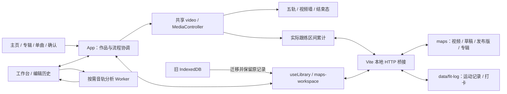

# Waifu Fit Player — HLD

初稿：2026-10-17；全面核对：2026-10-26（Asia/Tokyo）。提交基线：`sol61 @ c3100c2`，另包括当前工作区尚未提交的 LEG RAISE 实现及相关测试。本文按当前系统组织，不以开发日志代替架构；正式功能、研究原型与未完成要求分开记录。

本轮依据当前源码、启动配置、Git 历史、未提交差异及专项证据重新整理。旧会话恢复材料是历史依据，不是当前功能清单：见 [恢复报告](recovery/RECOVERY-REPORT-2026-10-21.md)、[调查时实现快照](recovery/CURRENT-STATE-2026-10-21.md)、[决策索引](recovery/DECISIONS-RECOVERED.md)。不把旧助手的交付声明当作实测结果。

## 系统范围

Waifu Fit Player 是本地音乐跟练播放器与谱面工作台，采用 React、TypeScript、Vite 和 DOM／SVG／CSS 舞台。视觉为 Pop Art／Editorial：奶油白、炭黑、粉红、青蓝，结合印刷颗粒、几何色块和实体唱片／卡带质感。2.5D 舞台由 CSS 透视构成，不使用独立 3D 引擎。

- **游玩**：主页 → 专辑 → 单曲及 FITNESS／DANCE 发布版本 → HOLD 确认 → 准备／倒计时 → 跟练 → After Show。FITNESS 随节奏健身，DANCE 跟随视频舞步，两者不是高低难度关系。
- **创作**：MP4 与谱面导入、五轨编排、按键录谱、预览、节拍分析、工作／命名草稿与发布；Fitness 另有本地一键生成及积木插入。
- **运动记录**：已实现本地真实游玩累计、菜单摘要、周记录纸签和今日手动打卡。日／周／月详情及其他规划界面尚未实现。

没有账号、云存档、摄像头动作识别或真实输入判定。FULL COMBO 是按谱面时间展示的完成计数，EST. BURN 是动作量估算，不是身体实测。谱面、视频和运动记录均以本地磁盘为准。

## 运行架构与模块边界

浏览器负责界面、播放和编辑；同机 Node 通过 Vite 插件提供曲库扫描、受限文件写入、视频 Range 和 Fit Log 服务。“无云业务后端”不等于纯静态网站。

| 模块                                                                                                                                                                      | 职责与状态归属                                                                                           |
| ------------------------------------------------------------------------------------------------------------------------------------------------------------------------- | -------------------------------------------------------------------------------------------------------- |
| [App.tsx](../src/App.tsx)                                                                                                                                                 | 当前 Chart、编辑历史、媒体来源、保存状态、页面、选曲／专辑／类型，以及加载、准备、暂停、重开和结束流程。 |
| [model.ts](../src/model.ts)、[editing.ts](../src/editing.ts)、[chart-types.ts](../src/chart-types.ts)                                                                     | 数据契约、解析／兼容／序列化、编辑变换与历史 reducer、玩法及评级规则。                                   |
| [Editor.tsx](../src/views/Editor.tsx)、[recording.ts](../src/recording.ts)                                                                                                | 时间轴、属性、绘制与录谱；工具、选区、缩放、拖动预览是临时状态。                                         |
| [media.ts](../src/media.ts)、[timing.ts](../src/timing.ts)、[play-range.ts](../src/play-range.ts)                                                                         | 共享视频、时间／状态通知、网格、偏移、编辑循环与发布游玩区间。                                           |
| [Player.tsx](../src/views/Player.tsx)、Glyph／HoldRibbon／NoteImpact／SpecialEffect                                                                                       | 依据当前谱面和媒体时间呈现轨道、音符及效果，不持有另一套播放时钟。                                       |
| [useLibrary.ts](../src/useLibrary.ts)、[maps-workspace.ts](../src/maps-workspace.ts)、[map-library.ts](../src/map-library.ts)                                             | 曲库快照、串行保存、磁盘版本／位置与媒体映射、旧数据迁移。                                               |
| [scripts/maps-library.ts](../scripts/maps-library.ts)、[scripts/maps-workspace.ts](../scripts/maps-workspace.ts)                                                          | 本地接口／扫描／媒体服务、视频采用、保存／恢复、版本冲突处理。                                           |
| [local-media.ts](../src/local-media.ts)                                                                                                                                   | 视频关联、预检与旧浏览器媒体读取；当前对象 URL 生命周期由 App 管理。                                     |
| [usePlayerPreparation.ts](../src/usePlayerPreparation.ts)、[asset-cache.ts](../src/asset-cache.ts)、[usePlayerRenderPreparation.ts](../src/usePlayerRenderPreparation.ts) | 媒体／资源就绪、共享解码缓存、有限的真实绘制预热。                                                       |
| Home／LibraryMenu／MenuSettings／useCardHighlight                                                                                                                         | 菜单布局、轮播、设置、最近输入目标的唯一高亮；选曲由 App 保留。                                          |
| useMenuMusic／MenuMusic／useMenuSounds／album-preview-audio                                                                                                               | 菜单 BGM、试听、频谱与律动、SE、专辑音色和机械声。                                                       |
| useAlbumInsertion／album-deck-motion／useBriefingMotion                                                                                                                   | 插卡、机身展开和 Poster Reveal，分别负责几何、输入锁与取消清理。                                         |
| AfterShow／AfterShowSnap／after-show                                                                                                                                      | 曲终摘要、末帧照片、庆祝音／BGM、灯光与结束导航。                                                        |
| [fit-log.ts](../src/fit-log.ts)、[useFitLog.ts](../src/useFitLog.ts)、[scripts/fit-log-store.ts](../scripts/fit-log-store.ts)                                             | 记录契约与汇总、媒体事件采样、客户端保存重试、本地原子存储。                                             |
| bpm.worker／first-beat／bar-pattern／fitness                                                                                                                              | 按需音轨分析、正式 Fitness v2 与独立研究模块，不常驻游玩帧循环。                                         |

工作台、试玩与跟练复用同一个实际 video。菜单试听另由预览 Audio 播放，进入编辑／游玩时停止；它不参与游戏计时。高频媒体时间不写回 Chart 或撤销历史。

## 数据契约与持久化边界

| 数据          | 当前契约                                                                                                                                                                            |
| ------------- | ----------------------------------------------------------------------------------------------------------------------------------------------------------------------------------- |
| Chart         | schemaVersion=1；title、videoHint、tempoSegments、notes、specialMove／specialEvents；可选 songId、chartType、intensity、danceDifficulty、videoOffsetMs、playRange。时间为整数毫秒。 |
| TempoSegment  | id、anchorMs、bpm、meter（4/4 或 3/4）；支持手动建立多个变速段，改网格不自动移动音符。                                                                                              |
| Note          | kind=tap，或 kind=hold 加 endTimeMs、modifier=none/sway；动作字段按轨道校验，详见音符模型。                                                                                         |
| Song／Edition | Song 分别保存 FITNESS／DANCE 的 drafts／released，以及 namedDrafts、activeDrafts、hidden；Edition 为 chart、albumId、cover、updatedAt。                                             |
| NamedDraft    | 在 Edition 上增加稳定 id、name、chartType，工作副本与命名快照分开保存。                                                                                                             |
| Album         | id、name、cover；自定义封面可包含完整图片数据，保存于 maps/library.json。                                                                                                           |
| FitLogData    | version=1、sessions、可选 checkIns；Session 含曲目／类型、开始／更新时间、completed 与分日 durationMs／estimatedKcal。                                                              |
| 浏览器偏好    | localStorage 只保存音量、流速、游玩帧率、工作台明暗／预览尺寸及最近作品指针等，不是作品或运动记录仓库。                                                                             |
| 临时状态      | 工具、选区、剪贴板、A/B 循环、转场、解码缓存、After Show 截图不写为作品内容。                                                                                                       |

时间换算为 `chartTime = videoTime + videoOffsetMs`。playRange 保存绝对视频起止位置；音符和 SPECIAL 保持绝对谱面时间，游玩用 playableChart 筛选，不删除草稿区间外内容。跨游玩边界的长条／持续 SPECIAL 在发布时拒绝，要求先调整。

旧 normal／hard 等通过 chart-types／library 入口迁移到 FITNESS／DANCE；缺失类型默认 DANCE，不从旧难度数字猜健身强度。intensity 与 danceDifficulty 独立。parseChart／serializeChart 是导入、保存与发布的共用边界；模型更新须同时更新本地服务，不能只更新前端校验。

Chart 可选 `credits: { music?, video?, mapper? }`，三个值为不超过 240 字符的单行署名，允许空字符串明确清空。每份 FITNESS／DANCE、命名草稿和发布快照各自保存；沿用现有 maps JSON／曲包路径，不增加浏览器存储或作者数据库。工作台「曲目 → 制作署名」编辑，失焦／Enter 提交到原历史与自动保存流程；复制谱面保留署名，不静默覆盖另一份版本。只有缺失 `credits.music` 时可显示旧 `artist`；不把含义不明的旧 `author` 或歌曲名猜作署名，尤其不作为 Mapper。

## 磁盘曲库、草稿与发布

### 目录和读写

每首歌的 MP4、project.json、工作／命名草稿、发布谱面和曲绘位于同一曲目目录。project.json 保存视频稳定 ID／相对路径／元数据、各类型文件、命名版本及活动版本。常规文件为 wfp-fitness-draft.json、wfp-dance-draft.json 及对应 released 文件；命名草稿有独立文件及清单引用。专辑设置在 maps/library.json。

扫描优先读取 project.json 托管作品，再兼容 song.json 分享曲包和松散 .wfp.json。旧目录编辑后建立托管文件，不覆盖作者原始导入谱面；重复歌曲 ID、资源缺失或歧义按错误／警告处理。目前分享 ZIP **需要解压**到 maps，没有 ZIP 内直读播放／编辑机制。

| 本地接口                             | 用途                                     |
| ------------------------------------ | ---------------------------------------- |
| GET /__wfp/maps                      | 曲库、专辑、视频、位置／版本及扫描警告。 |
| POST /__wfp/workspace/attach、upload | 采用 maps 内视频，或流式复制外部视频。   |
| POST /__wfp/workspace/song、album    | 保存作品、草稿／发布快照及专辑。         |
| GET/HEAD /__wfp/map-file/...         | 目录内受限资源读取，MP4 支持 Range。     |
| GET /__wfp/find-video                | 按大小／修改时间找可恢复关联。           |
| GET/POST /__wfp/fit-log              | 运动记录／检查点和今日打卡。             |

路径通过 realpath／目录边界检查；作品写入要求同源及专用请求头，串行执行。JSON 先写完临时文件再替换，上版保留在同曲 .wfp-backup；.wfp-save.json 记录中断后的多文件保存，下次读取时恢复。版本摘要防止陈旧窗口覆盖外部改动，冲突不能误报视频丢失。

maps 内视频按大小／毫秒修改时间唯一匹配后直接采用；外部视频导入时只流式复制一次，不转码。MP4 改名后可在曲目目录按已记录元数据唯一恢复，多个候选不猜测。原视频不会随隐藏、撤下或删浏览器数据自动删除。细节见 [maps 存储说明](MAPS-STORAGE.md)。

### 工作副本、命名草稿与发布

打开作品：解析 JSON → 解析媒体关联 → 元数据预检及校验 → 一起安装谱面／视频 → 等资源可用。关联或预检失败不替换当前作品；后续资源失败停在可重试状态。换视频重置编辑历史，防止撤销到不匹配媒体。

编辑经 history reducer 提交；拖动中只预览，松开才进历史。工作副本防抖约 650ms 自动存盘；普通保存／Ctrl+S 不询问名字，有活动命名版本时显式保存覆盖该版本，自动保存只更新工作副本。「另存为」才询问名字，建立／更新命名版本。本地作品按曲目和类型下拉加载现有草稿；切换保留未命名工作内容，重开前刷新磁盘版本。见 [命名草稿说明](NAMED-DRAFTS-2026-10-23.md)。

FITNESS／DANCE 分别有工作和发布槽。工作台切谱面类型是把当前 Chart 复制到目标类型，目标已有内容时确认替换；载入另一类型已有草稿从本地作品进入。被撤回的顶部双标签／空白创建方案不是现行设计。

发布复制独立快照，要求视频关联、有效非空游玩内容和专辑；后续编辑草稿不污染发布版。撤下只移除游戏入口，隐藏整曲写入 project.json。普通 JSON 是谱面备份，不自带完整视频、曲绘或专辑。

### 旧数据与分享

旧 IndexedDB 仅供迁移：在原 origin 读取，复制到 maps，服务端读回核对并保存 .wfp-backup/browser-*.json。磁盘已有作品优先；旧作品、专辑及视频记录继续保留，用户检查并明确授权后才清理。失败项不删，新浏览器也不能凭空读取另一浏览器未迁出的记录。历史真实迁移见 [迁移报告](MAPS-MIGRATION-2026-10-22.md)。

导出 .wfp.zip 只包含一首歌已发布的 FITNESS／DANCE、视频、曲绘和专辑，同视频只存一次，不带草稿。song.json 使用相对资源，不带设备绝对路径或浏览器关联 ID。export-song-pack／zip 按块计算 CRC32，以 STORE 写 ZIP Blob，不重压大视频、不转码，单包小于 4GB。

## 菜单、试听与导航转场

### 选择和设置

App 保留专辑、歌曲与发布类型。主页／单曲用左右，专辑用上下；页脚统一 Select / Enter / Back，字号及基线对齐。Esc、Backspace、返回按钮复用返回路径。useCardHighlight 管理最近真实输入的唯一高亮，停住鼠标不因动画／滚动抢回高亮，不增加逐帧 React 更新。

设置只出现在主页／专辑／单曲菜单：白色齿轮展开粉色几何，不重排主卡片。每次打开默认 AUDIO，标签小菱形仅选中／悬停显示。三路音量图标可静音／恢复，键盘在音量条按 Enter 同样切换。SYSTEM 提供流速 0.5～10（默认 3），GAMEPLAY FPS 60／120／跟随显示器（默认 60）。偏好本地保存。

主页耳机菜单支持悬停展开、点击固定、曲目／模式／进度／音量和键盘导航。卡片按下直接进入曲目区，顶部按上回原卡片。专辑首卡按上进入周纸签，单曲按下展开左侧摘要、按右回原曲。播放器展开时左右键只切试听曲，不跳 Fit Log；收起再恢复菜单导航。

### 试听和音频

主页／专辑延续主题 BGM；展开播放器随机试听专辑内发布歌曲，多首避免紧接重复、单首循环。片段取游玩区间正中间最多 30s，未设置则取视频中间，不足 30s 用全段；进度按片段显示。专辑片段结束随机换曲，单曲选择片段结束循环当前曲。

插卡接续同曲同位置进入单曲页，只平滑恢复正常音色；进入 HOLD 确认才从游玩起点预览完整区间，退出恢复中间片段。片段末尾约 700ms 按媒体时间淡出，不新增片段开头 fade-in。切歌和结束回调有一次性保护。

album-preview-audio 在菜单 AudioContext 混合原声／隔门低通，当前 muffledMix=0.75、cutoff=780Hz，另有低频／增益参数，不作用于游戏 video。首次展开播放启动声，展开期间马达持续，暂停／换歌不重启启动声或停马达，收起停止。菜单 BGM、游戏／视频、SE 三路独立；频谱和 MusicPulse 共用已有分析及更新循环。

### 转场分工

| 路径             | 当前机制                                                                                                                                |
| ---------------- | --------------------------------------------------------------------------------------------------------------------------------------- |
| 启动 → 主页      | 青色开场条等待字体、曲库及最短展示时间，不等 BGM 自动播放权限；失败通知后可进主页。                                                     |
| 主页 ↔ 专辑      | LiquidMenuTransition 液体覆盖，按实际角块轮廓接续，不能回旧尺寸后再缩。                                                                 |
| 播放器展开       | AlbumHousing 显式 SVG 轮廓、约 620ms 顶点插值，填充与边缘／网点分层；展开机身静止，不跟 BGM 平移／缩放。                                |
| 插卡 → 单曲      | Enter／鼠标单击自动约 960ms，Shift+Enter 约 420ms；松开不取消，Esc／Backspace／失焦可约 220ms 退回。完成卡扣声及 AlbumTuning 遮挡换页。 |
| 单曲返回专辑     | MenuTransition，保留原选择与位置。                                                                                                      |
| 单曲 → HOLD 确认 | Poster Reveal 打开 780ms、收回约 200ms；遮罩揭示现有面板和原 Noise，不搬无纹理封面后换图。                                              |
| 确认 → 游戏      | GameEntrance 黑场和准备进度，不用菜单潮水代替。                                                                                         |

插卡复制当前可见卡片，按共用逻辑坐标裁切；取消／完成／卸载清理副本和动画。确认面板最终大小无超调回缩，不切 transform-origin，横幅不越终点。打开确认的 Enter 必须松开后才能充能，阶段锁阻止重复输入；返回恢复轮播和焦点。

确认信息取所选发布快照；FOCUS MOVES 按 LANES ID 对应，突出动作数前两类及占比至少 15% 的第三类。充能 1150ms、松开回退 180ms、完成反馈 420ms，Shift+Enter 跳长按但走同一开始流程；参数在 start-briefing.ts。

单曲页底部 FITNESS／DANCE 选择按钮按较宽内容统一等宽；卡片内类型标签也统一宽度，保留完整文字。

单曲页底部沿用 SELECTED TRACK 信息栏，在歌名与类型按钮之间显示 MUSIC／VIDEO 两列；不改卡片封面或轮播尺寸。确认面板原 ARTIST 区改为 MAPPER。两处都读取当前所选类型的发布快照，无署名显示「未标注」，长署名最多两行并保留完整原文 title；草稿修改不绕过发布流程影响现有成品。已验证工作台填写／清空、磁盘草稿与发布隔离、JSON 导出、曲包校验／移目录读取，以及 1080p／16:10 排版与确认页切换类型。

## 卡片素材与视口布局

### 插画、材质和动画识别

专辑完整图像约按 7:2 显示，下方标题区独立；专辑和单曲卡共享罩面、印刷与下缘实体质感。useAlbumArtwork 优先读 maps 保存的 cover，缺省才取 src 内置图；只恢复已确认的旧裁切副本，不覆盖其他自定义图。

2026-10-27 移除东方专辑，内置分类为全部曲目、动漫、流行、虚拟歌姬。删除东方封面及月光／飘带实现与素材；读取旧保存分类时忽略已退役的 touhou ID，避免恢复成自定义专辑。移除前核对本地无谱面归属该分类，未删除视频或谱面文件。

album-cover-detail 对内置导入地址直接识别，对上传图片按 SHA-256 字节指纹启用专属动画。**动漫专辑例外**：「管理专辑与封面」提供“沿用光斑特效”，默认勾选，保存后写入 Album.coverEffect（anime-lens／none）并随 maps/library.json 和曲包携带。勾选时已知原图保留各自光源锚点，其余替换图片（含重新编码、PS 油画版和磁盘图片地址）保留 sunset-window 镜头光斑；取消时原图也关闭光斑。旧数据缺字段仍走原识别规则，不自动改用户专辑。光斑沿用右侧夕阳坐标与现有动画参数，不替换新图像素、不分析图片。其余专辑不显示该选项，仍须精确识别，避免把旧唱片／人物遮罩叠到新图上。替换 src 不会覆盖 maps 的独立封面，清浏览器缓存也不改磁盘图片。

| 插画               | 当前效果                                                                                               |
| ------------------ | ------------------------------------------------------------------------------------------------------ |
| 全部曲目／虚拟歌姬 | 完整唱片层旋转及前景遮罩，静止／选中／插入使用同一构图，停动不切另一张图；全部曲目波形复用菜单频谱。   |
| 动漫               | 两版夕阳图以太阳位置锚定常驻轻微变化的镜头 flare，不再缩放失焦。                                       |
| 流行               | 原舞台特效叠加约 3s 对焦周期，清晰期不缩放；耳环闪光在模糊收尾提前起，峰值接完全清晰，模糊期不持续闪。 |

分层资源在 assets/album-effects，改底图不等于盘面／遮罩／飘带同步更新。图层解码完才显示，未选中／隐藏页暂停，减少动态效果走静态路径；不增加常驻截图或大面积实时 blur。素材说明见 [图层记录](../src/assets/album-effects/README.md)。

### 窗口适配与工作台

menu-viewport 在较小窗口按 1920×1080 等比缩放 #root。**1.45 ≤ 窗口宽高比 < 16:9** 时扩展逻辑高度填满上下，五轨／视频墙高度按原宽度比例保持，多余高度交背景和留白；其他比例居中留边，足够大的窗口保持响应式。

这是比例判断，**不是 Mac 专属**，Windows 16:10／较高窗口也启用，16:9 保持原路径。Retina 物理像素不作逻辑尺寸。--menu-vw／--menu-vh、menuRect 与根节点 Portal 共用坐标，插槽、潮水、机身读取同一转换；只在 resize／模式变化同步，不逐帧测量。

工作台 workbench-viewport 取消旧 1680px 最大宽度，保留两侧约 20px，纵向填满可用高度；时间轴和长属性栏局部滚动，不靠整页滚动放下编辑器。EditorPreviewResize 可拖视频框左下角改变宽高，含重置和键盘操作；根据窗口、轨道最小宽度、工具栏和时间轴实际尺寸夹紧。只在操作完成保存尺寸，退出清理，不重建 video 或改变时间轴像素换算。

## 音符模型与编辑规则

LANES 顺序为 **SQUAT → ARMS → STEP → CALF RAISE → SIDE CRUNCH**，存储 ID 为 squat、punch、step、calf_raise、side_crunch；游戏、工作台、1～5 选轨及单曲动作映射共用定义。

TAP 是瞬时动作；HOLD 是保持；SWAY 是 hold 的 modifier。方向、手脚颜色和时长分开，编辑预览／游戏共用 Glyph 和 HoldRibbon。普通 TAP 绘制拖动可成 HOLD，已有 TAP 可用右侧手柄延长；LEG RAISE／FOLLOW 绘制模式仍仅放一颗 TAP。编辑变换集中于 editing，并校验跨轨合法性。

| 动作                           | 契约与呈现                                                                                                              |
| ------------------------------ | ----------------------------------------------------------------------------------------------------------------------- |
| SQUAT／CALF RAISE／SIDE CRUNCH | 原方向与 TAP／HOLD／SWAY；SQUAT SWAY 中点空心朝下提示。侧收腹颜色只支持左右。                                           |
| ARMS reach                     | 八方向，hand=any／left／right／both，颜色中性白／青蓝／粉红／紫色。                                                     |
| ARMS punch                     | 左右拳套，方向定手；兼容旧未标 armAction 的左右拳。拇指镜像与 L／R 字母分别处理。                                       |
| ARMS forward                   | armAction=forward、direction=forward，左／右／双掌；U／I／O 录入，支持 TAP／HOLD／SWAY。                                |
| ARMS clap                      | armAction=clap、direction=forward、hand=both；独立拍手符号，支持 TAP／HOLD／SWAY；P 点按／长按，Ctrl+长按 P 录 SWAY。                       |
| 双臂展开                       | 两颗同时同形态的普通左右 reach，显示层合并紫色 ↔；编辑按配对处理，计数／热量仍计原始两颗。                              |
| STEP 普通 TAP／SWAY            | 左右箭头和 1／2 格跨度，脚色独立；SWAY 中点鞋印。                                                                       |
| STEP LEG HOLD                  | 左右普通 hold／modifier=none；统一向上箭头，腿侧用颜色；中点 LegUpCue 空心向上提示。                                    |
| STEP LEG RAISE                 | tap + stepAction=raise，仅左右 STEP；与 LEG HOLD 同向上箭头，单次抬腿，不含跨度／FOLLOW。                               |
| STEP FOLLOW                    | tap + follow=true，空心断线箭头；Alt+左右录入，按住仍仅 TAP。                                                           |
| STEP FOLLOW SWAY               | hold + modifier=sway + follow=true，空心头和波浪；Ctrl+Alt+长按左右录入。                                               |
| STEP SPIN                      | 原地转圈，沿用 direction=free、hold、modifier=sway 及菜单值 free-sway；spinDirection 可顺／逆时针，缺省顺时针，↓ 录入。 |

STEP foot=left／right／both，H 循环三色；侧收腹 H 只左右。旧谱无 foot 按方向回退，编辑方向／类型前固定原腿色。普通箭头由方向决定，但 LEG HOLD／LEG RAISE／SPIN 使用专用动作符号，不能笼统把所有左右字段等同箭头朝向。

STEP 菜单依次 TAP / LEG RAISE / FOLLOW / FOLLOW SWAY / LEG HOLD / SWAY / SPIN。LEG RAISE 录谱 ↑ 按当前脚色创建 TAP，按住不成长条，切出 STEP 预设回 TAP。已有音符可延长为 LEG HOLD；转换移除不兼容 stepAction／follow／connectPrevious／distance／长条字段，保留 ID、起点、腿色。LEG RAISE、FOLLOW、SPIN、两格动作不能跨去无相应语义的轨道。

FOLLOW／FOLLOW SWAY 可选连前一颗 STEP：connectPrevious 缺省 true，取消保存 false。按时间顺序，不按脚色／时距猜动作，首颗和无间隔不画。配对只在谱面变更时计算，用现有媒体绘制显示细直虚线及正常大小鞋印，裁切可视区／判定线，不添时钟。改普通 STEP 或 LEG RAISE 清除连接开关。

录谱约 250ms 持续阈值只分类 TAP／HOLD，音符时间始终读实际 video；按下锁定方向／颜色／修饰键，途中切轨只影响下一颗。暂停、seek、换媒体、失焦取消未完成录入。Ctrl+长按为 SWAY（包括拍手 P），STEP Shift 为跨度，ARMS Shift／Alt 为斜向。2026-10-28 拍手 SWAY 同步开放绘制、属性转换、录谱及统一保存校验；切换手臂动作保留 SWAY、时长和拍手双手紫色，复用原有波浪长条及拍手头部，不新增特效。

同日实际保存失败补查：前端已构建更新，但用户5173上的Vite preview仍是修改前启动的进程，服务端保存校验保留旧CLAP限制。仅刷新页面／重建dist不会更新该进程的校验模块。已只重启保存服务、保留编辑页，实际页面保存《シニカルナイトプラン》82音符成功；对正在运行的保存接口做不落盘对照，非法modifier仍拒绝，SWAY通过音符校验，原谱面哈希保持不变。以后改动共用谱面校验或maps服务代码，交付必须同时更新运行中的preview进程，再验真实保存；新开的隔离测试服务通过不能代替这一步。

编辑 A/B 循环是临时视频循环，不是发布 playRange，不写 JSON，离开编辑器清除。N 定位最后事件尾端，B 回视频开头，均暂停。SPECIAL 使用本曲图标／名称及预告拍数，在游戏顶部显示，不新增常驻轨道，也不另加热量。

## 游玩生命周期与绘制

### 准备、倒计时与暂停

曲库进入游戏在 GameEntrance 黑场等视频首帧、图片／字体及有限绘制准备。asset-cache 共享进行中／成功任务，失败移除可重试，无通用容量淘汰。usePlayerRenderPreparation 取样真实命中、长条、释放、SPECIAL 及开场灯光等有界状态，再恢复开场帧，不播放／seek 视频或启动真实倒计时。进度约 70% 为媒体／资源、30% 为绘制步骤，不表示字节下载率。

预热提供绘制机会，**不是 GPU 完工屏障**。黑场约 0.995 不透明度防底层完全剔除；就绪后先 600ms 灯光准备，再每项 800ms 显示 3、2、1，GO 立即开始视频音频，封面约 300ms glitch 退出。取消／失败／卸载清理监听、RAF 和音效，失败不宣称就绪。

Esc／Back 暂停并暗房间；恢复重新走准备／倒计时，GO 从暂停点续播。RESTART seek 游玩起点再进同流程。恢复倒计时取消回暂停，首次开场取消回选曲。Space 只切媒体暂停／播放，拖进度只 seek，不自动开暂停菜单。EDIT IN STUDIO 保持媒体位置，按已有草稿确认处理，不直接改发布版。

### 时钟、刷新率与音符

video.currentTime 是唯一时钟；暂停、seek、变速、循环后的画面从目标位置计算，不用独立累计时间补播。MediaController 在单一 RAF 中调度普通时间约 60Hz，和游玩五轨 subscribeRenderTime／useRenderTime 的 60／120／display。媒体事件／命令会即时同步两个快照；display 跟随浏览器 RAF，不保证系统标称刷新率，不提升视频原始帧率。

流速只改变显示窗口 `previewMs = 3600 × 3 / noteSpeed`，不改音乐或谱面时间。音符保留正常大小与单中心线，位置用 transform，长条生成有界可视轮廓。ARMS HOLD／SWAY 中点手掌、STEP SWAY 鞋印及 LEG HOLD 上箭头按空间门槛和判定线裁切呈现。

长条不对移动波浪做实时 blur，以低透明度矢量描边保留轻柔外晕，不能写成“完全删除柔光”；持续 bloom 也需保持低 alpha，防旧 active 规则覆盖成重影闪烁。普通命中／释放使用烘焙精灵，侧收腹、SPECIAL 有独立效果。不要用常驻截图／逐帧日志、重复视频解码或无边界预热代替性能定位。

FULL COMBO：TAP 到点 +1；HOLD／SWAY 起点 +1、内部每半拍 +1、尾端 +1，尾端不重复半拍。跨 BPM 段按拍积分，暂停冻结，seek／重开重算。它不是成绩判定，结束页没有 Score／Rank／Accuracy。

## After Show：摘要与纪念照

自然曲终／游玩区间结束只触发一次，先留 **300ms** 收最后音符消散，视频保留有效末帧；视觉尾音不延长真实运动记录。随后顺序如下：

2026-10-26 原生 ended 入口增加轻量核对：当前 video 已有元数据、未 seeking／报错、ended=true，且 currentTime 已到有效终点（playRange.endMs 或实际 duration，最多容许 1ms 舍入），才发布完成通知。提前／残留事件不触发结束和 Fit Log completed，也不向前 seek 制造完成；正常播放事件仍复用原完成标记复位，不新增状态机或轮询。区间到点主动停止的原路径保留。

共用 Transport 进度条采用松手提交：指针拖动期间只更新本地滑块／时间预览，pointerup 才调用一次 media.seek；取消、失焦或丢失指针捕获时撤销预览。键盘调节仍即时提交，不改变暂停／继续状态。MediaController 跳过与当前时间相差不足 1ms 的重复跳转，避免在 0 秒端点反复重启读取；不新增跳转队列、解码器或轮询。

1. 捕获右侧有效帧，数码快门 SE 与仅视频区的 **80ms** 闪光同起；左侧还是原谱面淡出。
2. 照片 **520ms** 收缩落位，逆时针约 **-3°**，奶油窄边、轻纸纹／阴影；在墙面坐标居中，旋转边界计入缩放，最大比例 **0.84**。背景保留轻度暗化／模糊末帧。
3. 照片完成后才置摘要 ready，左侧 TRACK FINISHED 入场，房间和上方灯同步暗亮；回亮 **2250ms**。小标题为 LIVE END ///。
4. 摘要挂载后 **850ms** 才出现／增长数字，时长约 1200ms、BPM 1100ms、热量 1800ms，减速 ease，KCAL 标签先有。复用原两侧彩带／庆祝 SE，庆祝开始后约 **700ms** 接循环结果 BGM `Sparkling Game Loop.m4a`。

参数在 after-show／after-show-snap；当前数字开始不等于灯光 2250ms 已完全结束。摘要口径是**配置游玩区间长度、区间起点 BPM、整段谱面预计热量**，不是跳转／暂停后的真实累计时间。

截图为单次内存 Canvas，最长边上限 1920px，不编码／落盘、不添解码器；seek 未完成等有效帧，最多约 2s。失败保持原暂停视频、跳过空白照片，并让摘要继续。照片标题含真实专辑曲序（无法确定不伪造）、当前本地日期和时间两行；落位后间歇斜反光，照片本身静止。

按钮、结果数字和斜带跟结果 BGM 律动，hover／选择用放大、黑框、投影和位移，已取消此处流光。热量数字同标题粉色，次按钮主题青蓝。背景灯独立约 5.4s 呼吸，**不跟 BGM 节拍闪**。顶部信息弱化；视频与下方黑条不被整片毛玻璃覆盖，播放按钮／进度隐藏。

ENCORE 复用 Restart；NEXT TRACK 沿专辑顺序跳过本曲并尽量保留类型，单首禁用；BACK TO SELECT／Esc 保留选择。支持鼠标、方向键／Enter、标准手柄方向／A／B。退出／重开／换歌清理照片、计时、声音和完成标记，防上首残留及重复奖励。

## 卡路里参考值

calories 不用身高／体重或生理模型。音符到达计起始权重，HOLD／SWAY 加已持续秒数，尾端不重复计动作；空白和 SPECIAL 不增加。

| 动作             | 起始权重   | 持续权重／秒                      |
| ---------------- | ---------- | --------------------------------- |
| 下蹲／起身       | 3.6／1.8   | 下蹲 HOLD 4.2、SWAY 3.6；起身后 0 |
| 出拳／其他 ARMS  | 1.2／0.65  | HOLD 0.25、SWAY 0.65              |
| STEP／FOLLOW TAP | 0.18／0.09 | HOLD 0.55、SWAY／SPIN 0.2         |
| 提踵／落脚       | 0.4／0.2   | 提踵保持 0.25；落脚后 0           |
| 侧收腹           | 3          | 1.2                               |

总权重乘 **0.0414 kcal**，显示到 0.1，0.1 不是固定增量。LEG RAISE 沿用 STEP TAP，CLAP 沿普通 ARMS 对应形态，双臂配对仍按两颗算。系数最初由 Sunlight 旧权重约 507.2051 点／手环约 21 kcal 校准，后续下蹲权重已提高；不逐曲归一到 21，不称个人实测。

谱面变化时建立到达／持续速率累计索引，播放以二分查当前位置热量；暂停、seek、重播按时间重算。Fit Log 取真实经过区间的热量差，和结束摘要整段总量分开。

## Fit Log：累计、摘要与打卡

### 记录机制

useFitLogRecording 仅在 mode=player 且 playOrigin=library 启用，工作台试玩不计。实际播放开始会话，暂停、缓冲、seek 不算运动，重开 attempt 新建会话。媒体事件加播放期间每秒一次采样，约每五秒、暂停、结束／离开保存，不订阅高频五轨渲染。自然结束标 completed，未完成的有效跟练也保留。

FitLogAccumulator 检查媒体推进与真实时间，按设备本地午夜拆日，热量取谱面累计差值；重复实际跟练区间可贡献运动，seek 跳跃不可。周从周一开始、ISO 周号；今日未运动时连续天数可延续到昨日。真实运动日与手动打卡日并集用于活跃／连续天数，手动打卡不加分钟和热量。

正式数据在项目 data/fit-log/sessions.json，上一版 sessions.backup.json，目录不入 Git。客户端保留未保存检查点并重试，服务端按会话合并、串行临时文件替换／备份。坏文件保留报错，不静默清空或回退浏览器。突然退出仍可能遗失尚未成功落盘的检查点，不能承诺零丢失；未记录的历史游玩无法倒推。

### 当前两个组件

左侧摘要展开时，青蓝底板置于菜单卡片之上、统计文字之下；收起沿用原动画，结束后再恢复背景层级，防折回中卡片提前穿出。

左下 **MY RHYTHM／Fit Log 摘要**只在主页、专辑、单曲菜单挂载；白色统计图标与齿轮采用一致尺寸／对角边距。hover／键盘聚焦展开青蓝角块，显示今日预计热量、时间、连续天数，保留律动、网点与边缘质感，展开高度避开返回箭头。**工作台、游戏和结束画面不挂该入口／面板，也不为它重排。**

专辑页 **WeeklyNotes** 在 All Tracks 前，和聚焦专辑卡同宽；随列表滚动、播放器展开左移，不独立漂在页头。显示周号、七日印记、活跃天数，hover／键盘选择日期时右读数变为当天分钟，离开恢复。目录码只作印刷装饰。

仅今天可用机械按钮／Enter／Space 打卡，再按撤销，后端拒绝补签其他日期。未打卡白色凸键帽、轻量间歇反光，保存成功后粉色按下锁定、底座短亮和 CHECKED／TODAY 反馈；刷新保留状态，不重放演出。当日有真实运动仍可独立打卡，撤销不删运动日。保存／反馈中防重复提交，失败不播放成功确认。纸张／机械音效为离线 WAV，服从 SE 音量。

## 音轨分析与 Fitness 生成

### BPM／第一拍

BpmDetectButton 按需建 Worker，Mediabunny 分块解码 MP4 音轨，不播音频／解码视频；样本逐块释放、压缩读取缓存约 8MiB。可播放／可分析取决于浏览器解码能力，MP4 容器不保证其中所有音频编码都可分析，失败不覆盖原参数。

BPM 最多读当前目标段 90s，以多频带起音、自相关和网格相位重排候选，约 12s 窗检查一致性。有至少两个局部窗支持全段 BPM、其余仅为低置信度的半／倍速或简单三拍分组别名时，保留全段结果；强证据或非相关速度冲突仍保留为分歧。2026-10-27 《恋愛裁判》原音轨前 90s 复测：全段约 134.1，短窗约 67／89／177；旧一致性检查误报，修正后返回约 134.1。真实曲目的压缩起音特征纳入回归，既有 120→90、120→60 等明确变速测试保留。不是全曲变速定位器，不自动插段。

BPM 分歧及多起点候选通过结构化 Worker 消息列在对应字段下，原值保持不动，用户点击候选才调用原编辑提交，支持撤销；可收起，切目标／参数／视频同步清除，不把旧候选填进新段。第一拍无可靠候选或孤立开头仍不填写。《恋愛裁判》在手动 134 下的第一拍相位突出度约 0.033、低于原门槛 0.04，本轮未降低门槛强行填起点；不能把 BPM 修正写成该曲小节第一拍也已准确识别。原谱面未回写。

第一拍按已有 BPM／拍号分析最多 60s，first-beat／bar-pattern 比较稳定拍点、重复小节频谱和多窗口支持回推起点，不把开头单声 SE 直接当首拍。证据冲突不填写，接近 0 的微小负候选按非负限制处理并提示。只更新 anchorMs，不移动音符或 videoOffset；目标／参数改变取消旧任务。结果仍是候选，见 [证据与限制](FIRST-BEAT-2026-10-23.md)。

用户报告多首歌曲存在 4/4 小节相位差两拍，2026-10-27 按要求增加手动「提前两拍／延后两拍」，本轮不改检测算法。按钮位于当前段 Offset 下，按该段 BPM 将 anchorMs ±120000/BPM 并取整到毫秒，即半个 4/4 小节；仅提交当前段网格修改，保留音符、videoOffset 和其他段，沿用撤销／自动保存。越出视频范围或跨过相邻段时禁用对应方向，不自动钳位成不足两拍的移动。

### 正式一键生成：v2

工作台先填写节拍段 BPM／Offset，再由 MP4 → FitnessGenerateButton → fitness.worker → generateFitness，按已填网格完成音乐动态分析、积木拼接、校验和报告，按需加载，无外部 API。2026-10-27 起一键生成禁止检测或校正 BPM／Offset，不调用速度或起点检测，也不再计算起点检测专用频谱；音频拍点证据不足不会推翻用户设置。保留原节拍段 ID、BPM、Offset 和 videoOffset；若游玩区间从原网格中途开始，则沿原网格取下一个完整小节。当前仅支持单段 4/4，参数缺失／无效、多段／非 4/4 会明确提示；至少需 16s 分析素材，最长 20min 音轨，无有效音频或区间不足时不替换谱面。单独的 BPM／第一拍检测按钮保持独立。

正式 bricks.json／music-rules.json 来自 Sugar Mellowcle、Lovely Cavity、Happy Halloween 三首教练 Fitness 参考。按节奏变化、能量、重复短语规划乐句，再拼接完整单轨／多轨组与重复／镜像。只生成 SQUAT、ARMS、CALF RAISE、SIDE CRUNCH，**不自动加 STEP／SPECIAL**；不选强度，medium 为当前评级元数据，不表示恒定负荷。

v2 已针对部分晚小节／开头等待作修订，不固定先空两小节。Side Crunch 单次最多两小节，间隔至少 24 小节，总预算约 8%，开头 16 小节／恢复段不安排。报告含边界、积木、镜像／重复、动作量与警告；App 经原队列写同曲 Fitness 工作草稿，保留 DANCE／发布版，有动作先确认替换，不自动发布，取消／失败不安装。见 [生成器说明](fitness/README.md)、[v2 修订](fitness/REVISION-2026-10-23.md)。

2026-10-28 修正快歌套用密集蹲起积木：自动生成按实际毫秒筛选 SQUAT 相邻动作，间隔至少 500 ms，依据正式人工参考中最快的 120 BPM 一拍一次上下转换作为编排下限，并非个体运动能力或医学安全保证。筛选包括积木内部、循环重复边界及不同积木的拼接；不改 BPM／Offset、不拆坏多轨积木、不修改手动积木库。保留既有 >180 BPM 全局半速规则，但不再依赖它拦截快蹲。《アゲアゲアゲイン》175.05 BPM 旧谱最短 342 ms、31 个间隔低于 500 ms；只读原视频音轨后在内存用正式生成函数重生成，最短 685 ms、低于 500 ms 为 0。原 DANCE／Fitness 文件哈希不变，未自动覆盖；12 项生成／积木单测通过，覆盖 120／134.25／175.05／180／180.01／240 BPM 及跨组间隔。该验证不代表新谱已跟练验收。

Fitness 属性栏积木面板按需加载，支持分类、重复组数、镜像、播放头插入／双击／拖放，保留多轨配合；按完整组／小节，不对称补左右。跨变速／非 4/4／重叠／超区间拒绝，一次插入一次撤销，不重做编辑器布局。

2026-10-28 段落／动态缺陷修正：此前边界会在八小节附近向前后寻峰，并从偏移点继续推进，单小节填充／回落就可能形成七／九小节漂移；恢复按段落序号轮转，拼接没有休止选项，轨道配额又会压过能量代价。现移除弱证据的前后移一小节：默认八小节，仅持续前后各两小节的强变化允许改变常规分组，不将短暂停顿重置为新乐句；>180 BPM 半速动作的结构分析仍用原音乐小节。拍级相对能量／起音检测安静／短回落，休止独立于乐句边界；动作组不得穿过休止，空间不足时保留留白，不截断回位／镜像组。轻动态段约束为稀疏单手臂轨，取消按序号恢复，降低轨道配额与使用次数的权重，使音乐动态代价优先。报告将原「段落」改称「动作组」，单列安静休止及完整组收尾空间。

验证：新增用例先复现八小节被单小节重音带偏、长安静段仍塞动作及安静段轨道配额覆盖动态；修正后共16项生成／积木单测、真实 Worker 生成保存／拒绝覆盖／取消浏览器流程通过。只读《アゲアゲアゲイン》和三首正式参考音轨进行内存对照，原谱面哈希未变；目标曲旧边界含6／7小节，新规则为八小节框架加四小节尾段，识别约2秒深回落、约13秒完整组收尾空档。**这只证明规则行为改变，不证明 Aメロ／Bメロ／副歌边界正确。** Lovely重生成326动作（人工176），Sugar220动作（人工126），仍有密度与动作保持方式差异；不能据此宣布学会动静编排。正式按钮仍未接入下面的曲式模型／v4整曲规划，现有素材没有目标曲的人工曲式标注，不能用八小节整齐代替乐段验收。

### 独立研究：未替代正式算法

目标要求识别 intro、人声入场、Aメロ／Bメロ、副歌及其他结构，音乐驱动重复／镜像、タメ蓄势、动静／高低强度平衡、对称和身体负担。**正式 v2 尚无可靠功能曲式标签和人声事件识别**，八小节分组或能量边界不等于理解音乐结构。

研究重学前三首和《愛スクリ～ム》人工版本；retraining／phrase-learning／arrangement-study 及研究数据独立于正式 worker。已尝试七类和后续九类本地曲式模型、四首人工谱 464 片段的相对动态／功能相位／完整组编排；不是模型已进产品。研究权重和运行库在忽略目录，九类权重分发许可未确认，不能视为获准打包依赖。

专项报告记载 Scream「AI重学 v3（待审）」及真正未参与动作学习的《極楽浄土》「AI重学 v4（新曲待审）」294 动作已作为独立命名草稿安装，原人工／AI／发布谱保留；本轮未修改 maps。留出动作重合低不等于新曲质量差，泛化编排质量仍需实际试听／跟练。见 [重学与复现报告](fitness/RETRAIN-2026-10-24.md)、[结构要求](fitness/STRUCTURE-REQUIREMENTS.md)。

## 验证现状与已知限制

本轮全面更新仅改文档，没有重跑全套游戏测试、改功能或启动服务。下列证据按各轮真实范围引用，不把历史结果当作所有设备均已验收。

| 范围             | 证据与限制                                                                                                                                                                                                                                          |
| ---------------- | --------------------------------------------------------------------------------------------------------------------------------------------------------------------------------------------------------------------------------------------------- |
| LEG RAISE 工作区 | 2026-10-26 类型检查及 39 文件 298 单测通过；STEP 两文件共 10 项浏览器用例经修正旧断言、定向重跑通过。覆盖磁盘保存／刷新、录谱、转换、左右腿显示、旧 STEP 兼容；已看编辑／游戏截图，正式构建通过。                                                   |
| 较高比例适配     | 2026-10-25 Windows 多窗口／Retina 模拟、插槽、结束重开及液体转场通过，不能代替 M3 真机性能验收。                                                                                                                                                    |
| 持久化／多草稿   | 新浏览器读盘、迁移保留、改名、命名保存／加载、工作／发布独立、失败保护、曲包恢复等历史专项见存储／草稿文档，本轮未重做真实迁移。                                                                                                                    |
| 刷新率与卡顿     | Windows 流速 5 的 60／120／display 对照证实高频位置更新及额外 CPU 成本；仍有偶发长帧。**2026-10-26 用户确认当前 Windows Chrome 游玩仍偶有肉眼轻微掉帧，M3 也曾反馈密集音符卡顿；均未宣布解决。** 历史对照见 [性能报告](PERFORMANCE-2026-10-22.md)。 |
| 播放器白块       | 尺寸／坐标、背景大阴影和裁切组合已有修正，两尺寸背景像素／收放／音频专项通过；有限复测未捕获瞬时异常，缺现场 trace，不能保证不复发。见 [调查记录](ALBUM-PLAYER-WHITE-FLASH-2026-10-22.md)。                                                         |
| Fitness          | 正式 v2 可运行，曲式、人声入场、研究泛化仍待验收；训练曲重建／离线指标不算通用成品验收。                                                                                                                                                            |

测试为 Vitest／Playwright；tests/helpers/config 在 4180 用独立服务、隔离 maps／Fit Log、owner 校验清理，曲包另有配置。截图／trace／性能原始数据在忽略的 artifacts，不混功能源码。本轮文档只检查引用、格式与前后契约，不制造重复运行产物。

明确未完成或不承诺的能力：

- **提前曲终异常（2026-10-26）**：用户报告《寄明月》在中途帧直接进入拍照／结束，Restart 和重新进入仍异常、刷新后恢复。用户转述另一会话核查：视频约 101.9s、未设提前结束区间，Fit Log 有约 0.8s 即 completed 的记录；本轮未独立复核该日志。已在 media.ts 补上原生 ended 的位置／状态核对；新增三项回归在补丁前均失败、补丁后通过，连同媒体／结束／照片／Fit Log 共 50 项单测通过，覆盖连续重开和复用媒体元素。原始故障尚未独立复现，不能据此宣布触发根因已查明。同期另一会话浏览器测试可能增加同机负载，但无触发因果证据；与普通掉帧分开追踪，用户游玩期间不启动并行浏览器／性能测试。
- **暂停回拖读取失败（2026-10-26）**：用户提供《愛包ダンスホール》Chrome media-internals 日志（render 196／player 55，创建于 09:04:23 UTC）。第一次回拖约 492ms 内 26 次 seek（含 10 次重复 0 秒）；第二次约 69ms 内 8 次 seek，在 0.384s 后先报 FFmpegDemuxer EOF／kEnded，随后 seek 0 报 demuxer seek failed → PIPELINE_ERROR_READ。源码确认原 Transport 每个滑块变化都写 currentTime；已改松手一次提交并去重。原视频为 1440p60 AV1＋AAC；日志没有证明是编码不支持或视频解码失败，不要求用户转码。有限 HTTP Range／取消重请求检查均字节正确，不能排除全部读取条件。测试视频及该原文件各连续播放／暂停／回拖三轮通过，拖动中原生时间写入为 0、松手为 1，兼顾拖出边界、键盘和重复归零；浏览器底层为何在密集跳转下提前 EOF 尚未独立确定，修复去掉已确认的密集跳转触发因素，不承诺所有媒体读取错误均消失。回归可用 WFP_SEEK_TEST_VIDEO_URL 指定只读视频地址。
- Fit Log 日／周／月详情及其他规划 UI、未记录历史回填；现有摘要和周纸签已完成，不能再写“没有记录系统”。
- 动漫以外的油画／重编码封面保留专属动画及分层素材同步；动漫已支持保留光斑，但不自动识别新图太阳位置。
- ZIP 不解压直读、Electron 或其他 app 封装，尚未接发行流程。
- Windows Chrome 与 M3 偶发掉帧的稳定复现、根因及有效修复；视口适配／帧率设置不等于解决卡顿。
- 任意 4K 或文件大小的通用流畅上限；当前没有自动降分辨率／转码，负载依实际编码、解码及合成而异。
- 任意曲目的准确 BPM／首拍、自动全曲变速分段、可靠曲式驱动的通用 Fitness 生成。

## 必须保持的约束与文档维护

- **数据安全**：测试用隔离副本，maps／Fit Log 默认真实用户数据；不自动清理、重置、删迁移源或覆盖人工谱。
- **媒体一致性**：共用实际 video 时钟，视觉不控制另一套进度；换媒体重置不匹配历史，取消／暂停／seek 清理监听及未完成操作。
- **输入与布局**：专辑单击插卡、确认松开后再长按及 Shift+Enter 快速路径都保留；菜单设置／Fit Log 不侵入工作台、游玩、结束布局。
- **性能定位**：先复现取证，不加无界预热、强制图层、常驻截图或用删原视觉掩盖根因。测试服务用完关闭，不占用户 5173。
- **启动**：npm start 的 prestart 自动构建再启正式本地预览，Windows start-demo.cmd 调用它；npm run dev 为热更新开发，npm run preview 本身不构建。src 改动需新构建；纯静态 dist 没有本地桥接，不能退回浏览器假称写盘。
- **文档**：README 为操作／启动，本 HLD 为当前架构／契约／流程／边界；专项文档保留实验和历史证据，旧 handoff／decisions／verification 不作当前权威，不因旧而删。冲突按当前源码／证据与本 HLD 处理。

App／Editor 拆分、缓存淘汰和桌面打包属于后续按实际需求评估的工程方向，不是已授权的大规模重构。
