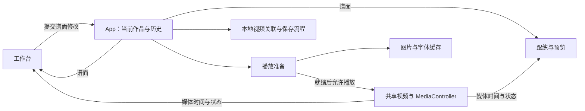

# Waifu Fit Player — HLD

当前架构概览，初稿：2026-10-17。用于定位代码和判断改动边界；只在模块职责、数据契约或关键流程改变时维护，不逐项登记功能与修复。

## 系统范围

React + TypeScript + Vite 本地浏览器应用，无业务后端。当前包含首页、谱面工作台和跟练画面。一个作品由谱面 JSON 与关联的本地视频组成；工作台和跟练共用谱面及同一个实际播放的 `<video>`，声音直接来自视频。

## 模块与状态归属

| 位置                                                                                               | 职责与持有的状态                                                                                        |
| -------------------------------------------------------------------------------------------------- | ------------------------------------------------------------------------------------------------------- |
| [App.tsx](../src/App.tsx)                                                                          | 当前作品、撤销历史、保存状态、视频来源、页面切换；协调打开、保存、草稿恢复和视频授权。                  |
| [model.ts](../src/model.ts)、[editing.ts](../src/editing.ts)                                       | 谱面类型、解析／序列化、编辑变换和历史 reducer。业务规则尽量放在这些可独立测试的函数中。                |
| [Editor.tsx](../src/views/Editor.tsx)、[recording.ts](../src/recording.ts)                         | 时间轴交互、属性编辑与录谱；选择、缩放、拖动预览等为编辑器临时状态，不写入谱面。                        |
| [media.ts](../src/media.ts)、[timing.ts](../src/timing.ts)                                         | 控制实际视频，发布时间／播放状态，处理循环；提供媒体时间与谱面时间换算、编谱网格和吸附。                |
| [Player.tsx](../src/views/Player.tsx)、`components/`                                               | 从谱面与当前媒体时间计算画面；音符、长条与特效组件负责呈现。`combo.ts`、`special.ts` 等提供计算规则。   |
| [local-media.ts](../src/local-media.ts)                                                            | 视频预检、关联解析、文件句柄／文件的 IndexedDB 存储和访问权限恢复。对象 URL 的当前生命周期由 App 管理。 |
| [usePlayerPreparation.ts](../src/usePlayerPreparation.ts)、[asset-cache.ts](../src/asset-cache.ts) | 前者提供本曲资源清单并协调视频就绪；后者共享图片解码、字体加载任务和成功结果，失败项可重试。            |

播放时间通过媒体订阅直接进入需要它的视图，不写回谱面历史。编辑器卸载后临时工具状态会重置；谱面、历史和实际视频仍由 App 保留。

## 主要数据流

**打开作品**：解析 JSON → 按 `videoHint.assetId` 查找本地视频关联 → 必要时授权或重新定位 → 视频元数据预检与谱面校验 → 一起安装谱面和视频来源 → 等待图片解码、字体及实际视频可播放 → 允许播放。关联或预检失败不替换原作品；安装后的资源准备失败停在可重试界面。预检用的临时 video 不播放，不参与游戏计时。

**编辑与保存**：操作生成新的 Chart → history reducer 提交／撤销／重做 → 工作台和跟练读取同一份 Chart。拖动过程中仅更新预览，松开时提交一次历史。正式保存为 JSON；localStorage 仅保存最近作品的恢复草稿，不替代文件保存。

**本地持久化**：JSON 保存谱面与视频关联 ID，不包含视频二进制。IndexedDB 优先保存视频文件句柄，不支持时保存 File；关联依赖当前浏览器资料及站点 origin，跨机器或清理存储后可能需要重新定位。页面会话中的对象 URL 仅用于播放。

**资源准备**：普通动作素材预先准备，SPECIAL 按本曲配置加载。缓存共享进行中的任务和成功结果，普通编辑及视图切换复用；更换视频或资源清单时重新协调准备。缓存限当前页面会话，不持久化解码结果，不把整段视频解码进内存。进度条表示准备任务完成比例，不是字节下载比例。

## 必须保持的约束

- **唯一媒体时钟**：以 `video.currentTime` 为准。暂停、跳转、变速和循环后的画面从目标时间计算，不靠另一套累计计时器补播动作。绘制通知有频率上限，不改变视频播放速度。
- **时间语义分离**：音符起止使用绝对毫秒。`chartTime = videoTime + videoOffsetMs`；BPM／节拍锚点用于网格与节奏计算，修改它们不隐式移动已写音符。循环最终操作实际视频。
- **作品一致性**：谱面和验证过的视频来源一起替换；更换视频重置编辑历史，避免撤销到与当前视频不匹配的元数据。
- **兼容性有入口**：当前文件为 `schemaVersion: 1`；校验和旧数据兼容处理集中在模型读写边界，不散落到渲染组件。改文件格式时明确迁移策略。
- **视觉与播放解耦**：特效只表达当前时间状态，不控制播放。新增视觉效果要考虑合成与解码负担；结构拆分本身不等于性能改善。

## 后续扩展与整理

- 加选曲／难度页面前，优先从 App 提取作品加载、保存与会话管理，保留现有媒体实例和校验流程。
- Editor 已集中较多职责，可按时间轴交互、属性面板逐步拆分；每次保持行为，沿用相关测试，不伴随全量重写。
- 新页面可提供自己的 `AssetManifest` 复用加载器。当前内置资源集合有限，尚无缓存容量／淘汰机制；资源规模实际增长后再考虑。
- 多难度的一首歌与多份谱面如何组织、桌面打包采用什么方式，均未定案。当前不预建曲库系统、不改存储格式、不引入新框架。

### 整曲 MP4 导出（2026-10-18）

- `components/VideoExport.tsx` 管理临时录制会话，`video-export.ts` 用标签页捕获与 MediaRecorder 生成 MP4。复用现有全屏游戏画面、视频实例和 video offset，曲终保存；结束或取消后释放捕获资源、恢复编辑位置。普通游玩不启动录制资源。
- 720／1080／2K 档保留全屏比例，目标 60fps。采用实时整曲录屏，不做区域裁剪、区间导出、转码或离线逐帧渲染。录制期间退出循环、使用正常速度，成片包含当前游戏构图和原声；画质与帧稳定性受实时捕获、编码性能影响。

## 文档维护边界

- **README**：启动、使用和开发命令；**本文件**：当前架构。各自只记录所属内容，不复制接口字段表或逐功能实现细节。
- 普通修复、视觉调整和内部实现变动不要求更新 HLD；用户操作变了才更新对应 README 段落，架构边界变了才更新这里。
- `decisions.md`、`verification.md` 和旧交接文件仅作为历史资料，不再滚动追加或要求同步维护。测试结果放在当次提交／交付说明；可执行行为以代码和相关测试为准。
